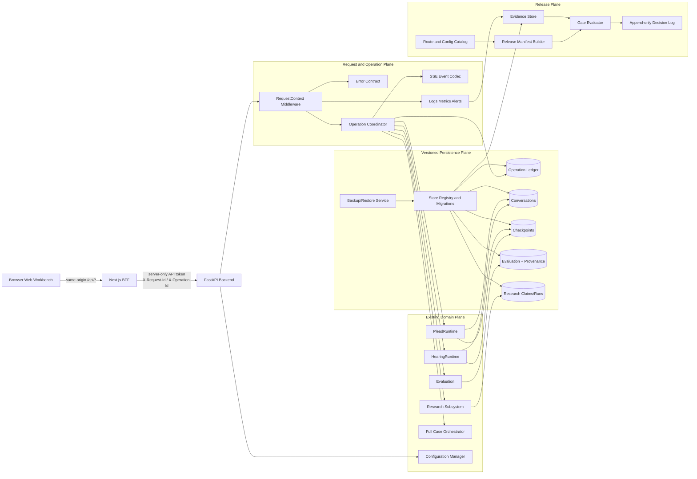
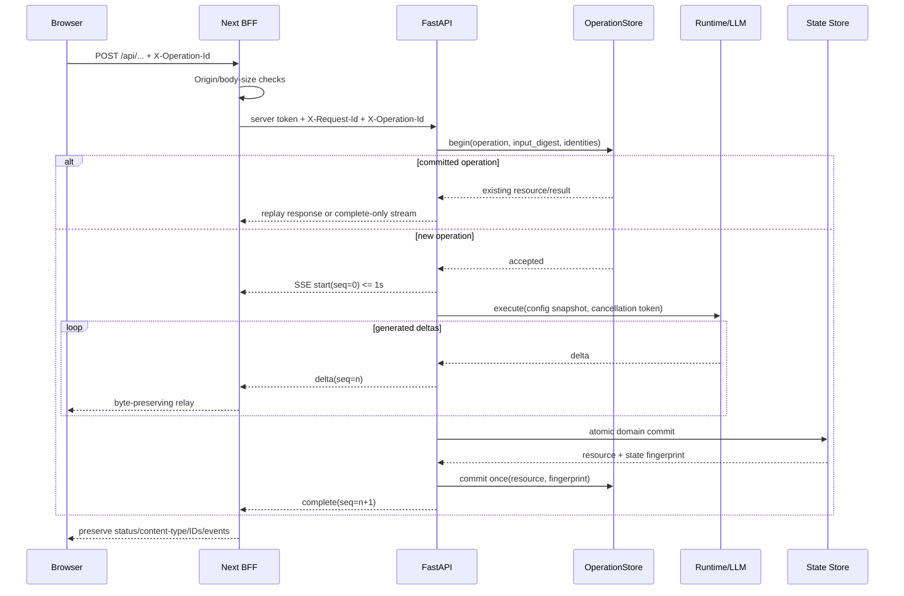
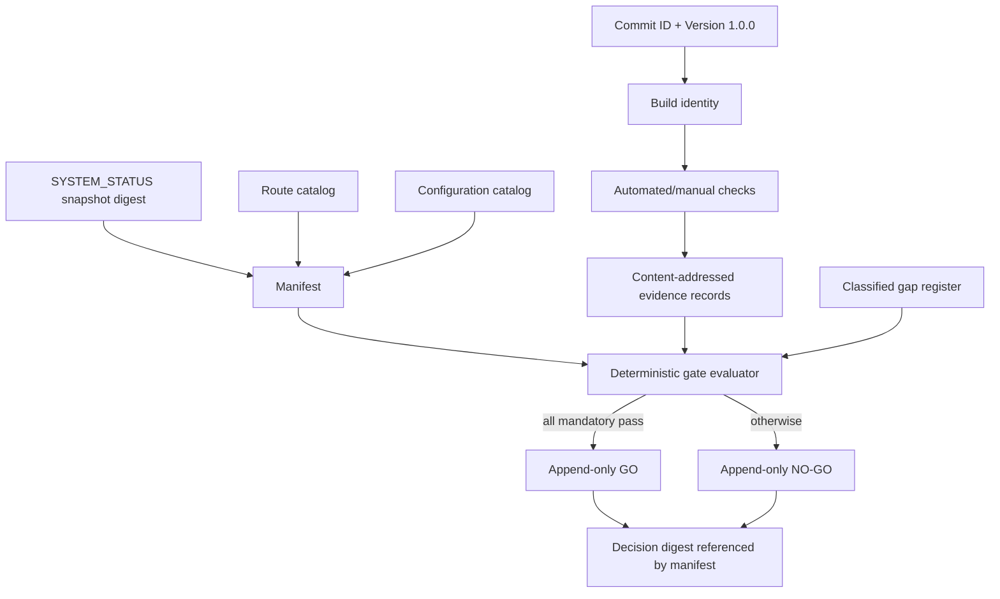

# Design Document

## Overview

本设计把 LexGentium `1.0.0` 的“发布就绪”实现为一组可审计的运行时约束、兼容迁移和发布门禁，而不是扩展民事引擎或生产法律内容。唯一产品代码与验证范围是 `mock_court_system/`。`mock_court_system/docs/SYSTEM_STATUS.md` 是能力、数据数量和限制的权威来源；`docs/CODEMAP.md` 提供现役分层边界。

明确排除：`/hearing-3d` 的场景、模型、HUD、动画、观演体验，以及 `components/hearing-3d` 的视觉质量。旧 `/court3d`、`/court3d/[sessionId]`、`/court3d/replay` 仅保留重定向契约验证，现有实现分别重定向至 `/hearing-3d` 或携带 URL 编码后的 `sessionId` 查询参数，不进行任何视觉改造。

设计目标有三层：

1. **运行时正确性层**：统一 Request ID、错误、SSE、Operation ID、幂等、取消、配置快照、状态指纹、运行时 checkpoint 和评测来源。
2. **生产运维层**：生产配置校验、服务端 Secret、认证、liveness/readiness、结构化日志、指标、告警、SQLite 模式/备份/恢复、容量拒绝和最小权限部署。
3. **发布决策层**：由版本与完整提交哈希绑定的路由清单、缺口分类、测试证据、性能证据、恢复/回滚证据和 append-only go/no-go 决策。

### 现有实现研究与关键发现

本设计基于对以下现役实现的检查，而非假定：

- FastAPI 装配与中间件：`api_server.py` 当前总是新建短 Request ID，不接纳传入 ID；异常响应尚未采用稳定错误代码，日志仍可能包含异常文本。
- BFF：`lib/backend-fetch.ts` 已提供共享代理与服务端 token 读取，但连接失败、超时和内部错误均返回 500，响应媒体类型与 Request ID 未完整透传，错误中包含后端 URL 和原始异常。三个 SSE Route Handler 各自实现代理并把成功状态固定为 200。
- 浏览器认证：`lib/session/unlock.ts` 当前把 `API_TOKEN` 存入 `sessionStorage` 并加入浏览器请求；这与生产 server-only token 目标冲突。
- SSE：`api/services/sse.py` 只是字符串拼装器；会话流使用 `delta/final/heartbeat`，全案流使用另一组事件名，均无统一 sequence、terminal 去重和 Operation ID。客户端断开只能取消外层协程，线程中的 LLM 工作无法可靠停止。
- 配置：`settings.py` 已有 LLM fast/strong 配置；`api/state.py::_persist_llm_env` 原地覆盖 `.env`，先重绑运行时后落盘，无法保证原子性；`_mask_key` 掩码长度随密钥变化。
- LLM：`core/llm_client.py` 已实现 fast tier、默认 512、目的维度指标和缓存，但缓存键缺 configuration identity、prompt version、purpose；调用记录缺关联身份和 degraded；同步请求的多次重试可能超过所要求的超时停止界限。
- 运行时：`HearingRuntime`、`PleadRuntime` 已按 session 建锁、fork agent 并使用 `SqliteCheckpointStore`；Plead 已有滚动窗口。checkpoint 当前仅为 `thread_id/payload/updated_at`，缺 schema version、turn、Operation ID、指纹和原子条件提交。现有并发测试只覆盖 2 个 CI 会话。
- 自动全案：`FullCaseOrchestrator.run_stage_ci` 仍以 `min(max_turns * 3, 60)` 计算上限，尚未统一到 `CI_MAX_AUTO_TURNS` 默认 30，也没有到限后“零额外 CI LLM 调用”的持久证据。
- SQLite：会话、评测、game、mediation、checkpoint、LLM cache、research claims 分散建表，无统一 schema registry/read-write-delete readiness probe/在线备份协议。会话保存是单表事务，但会话、checkpoint、操作去重不能原子绑定。
- 研究：`ResearchPackLoader` 与 Pydantic `ResearchPack` 可复用；角色材料过滤、缓存 namespace、`unknown` 数据表示及 10/12 次 party utterance 停止逻辑已经存在。当前 `ReviewRecord` 只有 reviewer/time/state/note，缺 reviewed pack version、outcome 和 reviewed-content digest，不能证明 formal status。两个 SAMPLE 不能因某些字段为 `law_reviewed` 而转成正式研究包。
- 评测：`EvaluationTaskStore` 已绑定 `report_id/session_id/run_id`，研究评测可导出；但 Web session 评测当前会创建 `data/session_predictions/` 中间文件，provenance 字段与命名空间还不完整。
- 健康与运维：`GET /health` 同时探测法条检索且返回绝对路径，没有独立 liveness/readiness；没有结构化 request log、固定运行指标、告警规则、发布清单和证据链。
- 文档：已有 `docs/INSTALL.md` 与 `docs/DEPLOY.md`，但安装仍示例 `npm install`，部署示例使用 root、nohup，且缺生产 readiness、备份恢复和回滚演练。
- 前端依赖基线：`package.json` 的产品版本是 `1.0.0`，当前锁定框架实现为 Next `16.0.10`、React `19.2.0`；设计不假定尚未安装的框架版本，Release_Test_Environment 与 manifest 必须记录实际 lock digest 和版本。若后续升级框架，必须作为独立兼容迁移并重跑 BFF、build 与 E2E 门禁。
- API schema 漂移：`api/routers/evaluate.py` 当前读取并返回 `session_id/run_id`，但 `api/schemas.py` 的 `EvaluationRequest/EvaluationResponse` 尚未声明这些字段；provenance 落地前必须先统一 schema、路由和 BFF 类型，避免把现有运行时属性错误当成已成立合同。
- 测试：现有 pytest 覆盖 runtime、research、reasoning、evaluation attribution；Vitest 仅覆盖排除范围内的 `components/hearing-3d`，当前 Python/Node lock 中没有 Hypothesis/fast-check。`tests/test_inference_speed.py` 已声明默认 30 步并导入 `ci_auto_turn_limit`，但现役 `core/case_orchestrator.py` 未定义该函数且 `run_stage_ci` 仍按最高 60 步执行，说明测试意图与实现存在待关闭的 blocker。当前没有浏览器 E2E、统一 BFF 契约、安全、备份恢复或发布门禁测试。

### 外部技术研究结论

- FastAPI 中间件适合在每个请求前后统一建立请求上下文并写响应头；启动前检查应放入 lifespan。参考 [FastAPI Middleware](https://fastapi.tiangolo.com/tutorial/middleware/) 与 [Lifespan Events](https://fastapi.tiangolo.com/advanced/events/)。
- SSE 应保持 `text/event-stream` 并按事件块发送；本设计在标准 `event/data/id` 字段之上定义业务 envelope，而不是让 BFF 解析或改写流。参考 [MDN: Using server-sent events](https://developer.mozilla.org/en-US/docs/Web/API/Server-sent_events/Using_server-sent_events)。
- Next Route Handler 使用标准 Request/Response，可直接转发 ReadableStream，因此共享 BFF stream proxy 可以保持状态、媒体类型、头和字节顺序。参考 [Next.js Route Handlers](https://nextjs.org/docs/app/getting-started/route-handlers-and-middleware) 与 [Backend for Frontend guide](https://nextjs.org/docs/app/guides/backend-for-frontend)。
- SQLite 在线备份应使用连接级 backup API而非复制正在写入的数据库文件；恢复后再执行 schema/readiness 检查。参考 [Python sqlite3 documentation](https://docs.python.org/3/library/sqlite3.html)。
- 告警条件应由固定间隔规则求值，并可对规则做单元测试。参考 [Prometheus alerting rules](https://prometheus.io/docs/prometheus/latest/configuration/alerting_rules/) 与 [unit testing rules](https://prometheus.io/docs/prometheus/latest/configuration/unit_testing_rules/)。

以上外部资料内容均已为遵守许可限制而改写（Content was rephrased for compliance with licensing restrictions）。

## Architecture

### 总体架构



### 设计原则

1. **BFF 是唯一浏览器业务出口**：浏览器只访问同源 `/api/*`；API Token 只由 Next 服务端环境读取。`NEXT_PUBLIC_BACKEND_URL` 仅可用于明确的公开文档链接，生产默认不提供直连特权 API。
2. **一次逻辑操作，一个 Operation ID，一个结果**：所有稳定的状态变更先登记 operation，再执行业务；已提交 operation 重试返回既有资源，不再调用 LLM。
3. **请求身份与业务身份分离**：Request ID 标识一次 HTTP 尝试；Operation ID 标识可重试逻辑操作；Session/Task/Run/Report 标识资源。每层均原样传递适用身份。
4. **先记录 provenance，再做高成本工作**：evaluation、LLM call、full-case、research run 在开始计算前持久化不可变输入摘要和配置快照。
5. **未知保持未知**：所有事实合并使用“证据支持优先、unknown 不被无来源文本覆盖”的合并策略；材料不足写入 `admit_insufficient` 并关闭对应 claim 的后续生成。
6. **证据与源代码分离**：运行数据、备份和 Release Evidence 使用 Production_Profile 指定的外部可写目录；不可写入不可变应用源目录。
7. **增量迁移与可回滚**：数据库只做 additive/expand-contract 迁移；协议先双读后单写；每阶段都可回退到前一已批准构建与兼容 schema。

### 实际模块映射

| 关注点 | 复用现有实现 | 新增/演进位置 | 关键设计动作 |
|---|---|---|---|
| Request ID/错误 | `api_server.py` | `api/middleware/request_context.py`, `api/errors.py`, `api/contracts/common.py` | 接纳合法传入 ID；统一异常 handler；422 稳定 field path/reason |
| BFF 契约 | `lib/backend-fetch.ts`, 各 `app/api/**/route.ts` | `lib/backend-proxy.ts`, `lib/backend-stream.ts` | 502/504、媒体类型/状态/ID 原样转发、Origin/大小限制、server-only token |
| SSE | `api/services/sse.py`, `lib/court3d/parseSse.ts`, `lib/api/sse.ts` | 演进为 Python/TS 对称 codec；`api/services/operation_coordinator.py` | envelope、sequence、terminal CAS、取消令牌、兼容旧事件读取 |
| 幂等 | 各 store 和 service | `core/store/operation_store.py` | Operation Ledger；唯一键、请求摘要冲突检测、资源回放 |
| 配置/Secret | `settings.py`, `api/routers/config.py`, `api/state.py` | `core/configuration.py`, `api/services/configuration.py` | Production_Profile 校验、恒定掩码、临时文件+fsync+replace、配置快照 |
| LLM 治理 | `core/llm_client.py` | 演进 `LLMCallContext/LLMCallRecord`；`core/prompt_registry.py` | purpose/tier/identity/token/timeout；空响应；unknown assertion validator；完整判决 |
| Runtime | `core/graphs/hearing_runtime.py`, `plead_runtime.py`, `checkpoint.py` | 演进 checkpoint schema；`api/services/runtime_unit_of_work.py` | turn CAS、operation 绑定、恢复、10 session 隔离、30 step 限制 |
| SQLite | `core/store/*`, claims/checkpoint/cache DB | `core/store/registry.py`, `core/store/migrations.py`, `core/store/backup.py` | schema registry、探针、在线备份、干净环境恢复、指纹校验 |
| 导入导出 | 会话 store、ResearchPack Pydantic model | `core/archive/conversation.py`, `core/research/codec.py` | 严格 schema、逐字段错误、稳定 pretty print、round trip |
| 数据分轨 | `core/research/*`, `api/services/materials.py`, `data/dataset_1000` | `core/research/governance.py`, `core/data_boundaries.py` | fixture/formal 分类、双向拒绝、独立 namespace，不新建空材料目录 |
| 评测来源 | `evaluation/*`, `EvaluationTaskStore`, research eval | `core/store/evaluation_provenance_store.py`, `api/services/evaluation_input.py` | 内存/临时受管输入流，不再读写 `data/session_predictions/`；不可变 provenance |
| 健康/可观测 | `/health`, Python logging, LLM metrics | `/health/live`, `/health/ready`, `api/observability/*`, `monitoring/*` | 组件 readiness、JSON log、低基数指标、5m 告警与恢复 |
| 发布治理 | `SYSTEM_STATUS.md`, package version, git | `release/routes.yaml`, `release/configuration.yaml`, `core/release/*`, `scripts/release_gate.py` | 生成 manifest、证据摘要、缺口分类、go/no-go append-only record |
| 性能 | `scripts/bench_hearing.py`, `bench_plead.py`, inference tests | `scripts/benchmark_release.py`, `core/release/statistics.py` | 单调时钟、nearest-rank p95、环境 identity、容量 429、资源释放 |
| 测试 | `tests/`, TypeScript/Vitest | `tests/release/*`, `tests/contract/*`, `tests/property/*`, `e2e/*` | pytest + Hypothesis、Vitest、Playwright、3 连跑关键门禁 |
| 部署 | `docs/INSTALL.md`, `docs/DEPLOY.md` | 更新文档并新增 `deploy/` 模板 | 锁文件安装、非 root、TLS/proxy、双进程、备份/恢复/回滚 |

### 请求与流式操作时序



客户端断开时，ASGI disconnect 触发 operation cancellation token。若尚未 domain commit，worker 在 5 秒内停止且 operation 标记 `cancelled_before_commit`；若已提交，则只停止发送，保留结果并禁止第二次提交。对于无法中断的第三方同步 SDK 调用，调用在独立受控 executor 中运行，超时后结果被隔离并禁止写入；下一阶段优先使用支持连接取消的 HTTP client。

### 发布证据流



## Components and Interfaces

### 1. RequestContextMiddleware 与 ErrorContract

`RequestContextMiddleware` 位于认证之后、路由之前，并由 lifespan 初始化依赖。合法 Request ID 格式为 16–64 位 `[A-Za-z0-9._-]`；传入合法值原样保留，否则生成 UUIDv4 hex。上下文使用 `contextvars`，避免并发请求串值。

```python
@dataclass(frozen=True)
class RequestContext:
    request_id: str
    operation_id: str | None
    session_id: str | None
    task_id: str | None
    run_id: str | None
    report_id: str | None
    started_monotonic_ns: int

class PublicError(BaseModel):
    code: str
    message: str
    request_id: str
    retriable: bool = False
    field_errors: list[FieldError] = []

class FieldError(BaseModel):
    path: str       # JSON Pointer-like stable path, e.g. /body/max_tokens
    reason: str     # required | type | range | format | conflict
```

所有错误响应形状固定为 `{ "error": PublicError }`。服务端日志记录内部 exception class 与受控错误编号，但 Public Error 不含 stack、绝对路径、后端 URL、原始 prompt/dialog/legal material 或 Secret。成功 payload 保持现有字段，减少兼容破坏；Request ID 同时出现在 `X-Request-Id` 和需要持久关联的响应字段中。

### 2. BFF Proxy

`lib/backend-fetch.ts` 演进为两个共享入口：

```ts
proxyJson(request: Request, target: BackendTarget): Promise<Response>
proxySse(request: Request, target: BackendTarget): Promise<Response>
```

`BackendTarget` 由 server-only route catalog 构造，不接受浏览器提供任意 URL。共同规则：

- BFF 生成或验证 `X-Request-Id`，透传 `X-Operation-Id`；后端返回 ID 时必须相同，否则记录 contract violation 并向客户端返回 502 `backend_contract_violation`。
- 连接建立超时返回 502 `backend_unavailable`；等待响应头超时返回 504 `backend_timeout`。两者都使用 BFF Request ID。
- 非流式响应保留 status、content-type、resource IDs 和正文值；SSE 响应不解析、不重排、不重新序列化事件字节。
- state-changing BFF Route Handler 在转发前校验 Origin allowlist、`Content-Length` 和流式读取后的实际字节数；超限 413。
- `API_TOKEN/BACKEND_API_TOKEN` 只从 Next server environment 读取。移除 `lib/session/unlock.ts` 中 token 的存取和 `clientAuthHeaders` 的 Authorization 行为；软解锁仅保存非敏感 UI 标志。
- 兼容期保留现有 `/api/*` URL 与响应成功字段；每个 Route Handler 只声明 method/path/response mode，不再复制代理逻辑。

### 3. OperationCoordinator 与 OperationStore

所有稳定 state-changing route 接受 `X-Operation-Id`，迁移期也兼容 body `operation_id`，若两者并存必须相等。ID 由客户端为用户动作生成；后台子步骤使用父 Operation ID 加稳定 step key 派生，不创建无关联操作。

```python
begin_operation(operation_id, kind, input_digest, correlation) -> BeginResult
mark_running(operation_id, config_identity)
commit_operation(operation_id, resource_type, resource_id, result_digest, state_fingerprint)
fail_operation(operation_id, error_code, retriable)
cancel_operation(operation_id, before_commit)
get_operation(operation_id) -> OperationRecord
```

同一 Operation ID + 同一 input digest 返回 existing；同一 ID + 不同 digest 返回 409 `operation_conflict`。`commit_operation` 使用数据库 compare-and-set，只允许 `accepted/running -> committed` 一次。LLM 调用前检查 operation 状态；committed operation 的 retry 直接回放 resource/result。operation ledger 不保存 raw prompt 或全文。

### 4. SSE_Event_Codec 与 StreamLifecycle

统一业务事件类型：`start | heartbeat | delta | progress | complete | error | cancelled`。每个事件具有：

```json
{
  "schema_version": "1",
  "operation_id": "op_...",
  "request_id": "...",
  "sequence": 0,
  "type": "start",
  "role": null,
  "text": null,
  "degraded": false,
  "sub_stage": null,
  "resource": null,
  "error": null
}
```

codec 将 `sequence` 同时写入 SSE `id:`，`type` 写入 `event:`，完整 envelope 写入 `data:`。sequence 从 0 开始严格递增；heartbeat 也占 sequence。decoder 对未知类型、缺字段、Operation/Request ID 漂移、非递增 sequence 返回 typed protocol error，绝不生成业务事件。

`StreamLifecycle` 维护 per-operation sequence 与 terminal CAS。只有一个 `complete/error/cancelled` 可被接受；后续 terminal 被忽略并递增 `lexgentium_sse_duplicate_terminal_total{type}`。接入会话流、全案流和 game 流时先由适配器把现有内部事件映射为统一 envelope，领域层无需一次重写。

兼容策略：第一阶段 TypeScript decoder 双读现有 `final/simulation_complete` 和新 terminal；后端只写新格式后保留一个发布周期双读；证据门禁确认无旧事件消费者后删除旧读路径。`lib/court3d/parseSse.ts` 仅作为通用管子被演进，`components/hearing-3d` 不参与视觉修改。

### 5. ConfigurationManager 与 SecretBoundary

`settings.py` 保留 Pydantic Settings 入口，但增加显式 `APP_PROFILE=development|production|test` 和范围约束。Production_Profile 在 FastAPI lifespan 和 Next 启动检查中 fail closed：LLM 必填变量、外部监听 token、运行数据目录、证据目录、Origin allowlist、timeout/token/concurrency 范围必须有效后 readiness 才可能成功。

`ConfigurationManager` 采用 immutable `ConfigurationSnapshot`。更新流程是：验证候选配置 → 连接测试 → 写同目录临时文件 → flush/fsync → 设置服务账户权限 → `os.replace` → fsync parent → 生成 config identity → 在锁内原子交换 active snapshot。接受操作时捕获 snapshot，运行中不读取全局可变 client；旧操作继续使用旧 snapshot，新操作使用新 identity。

API 返回 Secret 一律为固定 `********`。Secret redactor 在日志、错误、metric attributes、trace attributes、health、browser response 和 evidence serialization 六个出口复用。配置连接测试将 fallback、空白、认证失败和 timeout 映射为 `failed` 或 `degraded`，绝不映射 `connected`。

### 6. ProductionSecurity

- `API_HOST` 为非 loopback 且 `APP_PROFILE=production` 时，没有非空 API Token 则 lifespan 抛出配置错误，uvicorn 在绑定/接受业务流量前以非零状态退出。
- Protected Route catalog 默认覆盖除 `/health/live` 外的 Backend_API；`/health/ready`、metrics 和 docs 是否暴露由配置明确声明。生产 docs 开启时走同一认证依赖。
- BFF 不再接受或转发浏览器 Authorization；token 不进入 cookie、storage、URL、markup 或 browser log。
- FastAPI 与 BFF 均设置 request body limit；BFF 负责浏览器入口的早拒绝，FastAPI 防止绕过。
- React 默认文本渲染；禁止对外部/生成文本使用 `dangerouslySetInnerHTML`。门禁做静态扫描和代表性 XSS E2E。
- 依赖漏洞扫描证据以 lock file 为输入；critical 必须为 0，其他接受项含 owner/mitigation/expiry。

### 7. LLMCallGateway

在 `LLMClient` 外保留现有 agent API，内部引入 `LLMCallContext`：

```python
@dataclass(frozen=True)
class LLMCallContext:
    purpose: Literal["clerk", "extract", "score", "judgment", "chat", ...]
    operation_id: str
    request_id: str
    configuration_id: str
    prompt_version: str
    deterministic_input_digest: str
    model_id: str
    deadline_monotonic_ns: int
```

- clerk/extract/score 强制 fast tier，缺省 `LLM_FAST_MAX_TOKENS=512`；judgment 强制 strong tier并使用 `LLM_MAX_TOKENS`。
- judgment 的 provider result 原文完整持久化，不再做应用层字符/句子/token 二次截断；展示摘要必须是派生字段，不能覆盖原文。
- 空白返回不提交成功 utterance，映射为 failed/degraded。
- cache key 扩展为 purpose + model + config identity + prompt version + deterministic input digest；任一不匹配即 miss。
- timeout 使用绝对 deadline；最多在 deadline 内重试，达到 provider timeout 后 5 秒内返回受控结果。迟到线程/响应失去 commit capability。
- 调用记录只保存摘要身份、latency、provider token count、degraded 和关联 ID，不保存 raw prompt。
- `UnknownFactGuard` 比对候选输出与事实台账/研究 `missing_code/source_status`。无获准来源的“已确定”断言被记录 rejected，状态仍为 `unknown`；无法支持结论时产生 `admit_insufficient`。

### 8. HearingRuntime / PleadRuntime Unit of Work

保留现有按 session lock 与 fork-stateless agent。checkpoint 扩展为 versioned record，并把 conversation append、checkpoint、operation commit 纳入一个 `RuntimeUnitOfWork`。由于当前会话与 checkpoint 可能位于不同 SQLite 文件，第一阶段将 checkpoint 表迁入可配置的同一 runtime state DB；迁移期间双读旧 checkpoint、只写新表。跨库场景不声称原子提交。

恢复规则：按 `session_id/scenario` 读取最高 `turn_number` 且 `commit_state=committed` 的 checkpoint；校验 payload digest 和 state fingerprint；损坏或不支持 schema 时 readiness/migration gate 阻止业务运行。相同用户文本不会参与 identity 生成。

Plead prompt 继续使用 `PLEAD_WINDOW_K` 最近 turn + bounded summary。全案自动 CI 使用 `CI_MAX_AUTO_TURNS`（缺省 30）；每个 auto step 有派生 operation key，达到 limit 后先持久化 terminal limit，再返回，禁止调用下一次 CI LLM。研究 session 在 runtime 入口先调用现有 `research_llm_blocked`，确保 10/12 party utterance 或 `admit_insufficient` 后零额外调用。

### 9. StoreRegistry、Schema Migration、Backup/Restore

`StoreRegistry` 声明每个 required store 的 logical name、path env、schema version、migration list 和 probe。readiness 对每个 store 在专用 probe 表执行 transaction 内 insert/select/delete，确认不改业务记录。所有表增加 `schema_migrations`；未知更高版本返回 `migration_required`。

备份服务：

```python
create_backup(destination, requested_by) -> BackupManifest
restore_backup(backup_manifest, clean_data_root) -> RestoreResult
verify_backup(manifest) -> DigestResult
```

使用 SQLite connection backup 为每个 store 建一致快照，记录 schema versions、开始/结束、SHA-256、最大 included commit time。backup set manifest 最后原子写入。恢复只允许空的 Release_Test_Environment data root；先验证全部 digest，再恢复，再运行 migrations/readiness，抽样比对 Session/Task/Report fingerprint。RPO 由备份调度和最大 included commit age 证明不超过 24h，RTO 用单调时钟证明不超过 4h。

### 10. Conversation Archive Codec

`ConversationArchiveCodec` 是纯逻辑层，不直接写 DB：parse → validate all → normalized model。错误收集所有可判定 schema violations，每项含 path/reason。只有完整验证成功后 importer 才开启事务。Pretty Printer 使用稳定 key order、UTF-8 和 schema version；export-import-export 比较 normalized semantic digest，不比较无语义空白。

Session ID 策略由 archive 明确：`preserve` 仅在无冲突时保留；`remap` 产生映射并同步更新 links/operation references。导入操作本身受 Operation ID 幂等保护。

### 11. Civil / Research DataBoundary 与 Research Governance

`DataBoundaryClassifier` 根据显式 schema discriminator 判断 `civil_case/v1` 或 `research_pack/v1`，不以文件路径猜测。两个 import boundary 在 parse 前后都验证 discriminator；错轨返回 422 `wrong_data_track`，两个轨的 fingerprint 都不变。

`ResearchGovernance` 计算而非人工缓存正式数量：

```python
is_technical_fixture(pack) = pack.identity in {
  "enf-cn-notice-001", "cisg-art79-sample-001"
}
is_formal(pack) =
  not fixture
  and review contains independent_reviewer_id
  and review_timestamp
  and reviewed_pack_version == pack.pack_version
  and outcome == "approved"
  and reviewed_content_digest == canonical_pack_digest
```

现有 schema v1 pack 可继续读取，但因缺完整 formal review 字段一律 non-formal。两个 SAMPLE 无论字段 review_state 如何都为 `Technical_Fixture`，formal count 永不包含它们。`SYSTEM_STATUS.md` 声明的 15 份未独立复核标注与案例 25 待确认状态通过发布 inventory metadata 呈现，不将仓库根法律材料复制到运行目录，不创建空选案/原文/规则卡目录。正式数量在满足完整字段前固定为 0。

civil session 未提供 research identity 时，hydration 不创建空 research block；research session 独立保存 dataset/cluster/version/review status/run_id。civil evaluation namespace 固定 `civil.lexeval|civil.j1|civil.cadd`，研究量表固定 `research.<rubric_version>`。

### 12. Evaluation Provenance

移除 Web 评测对 `data/session_predictions/` 的依赖。`EvaluationInputBuilder` 从 latest committed ordered dialog 构造 immutable in-memory model；对仍要求文件接口的 legacy evaluator，在 Release runtime data root 下创建 task-scoped 临时文件并在任务结束清除，路径不在源码树且不作为持久输入。

接受任务时，在评分前事务性插入 `EvaluationProvenance` 和 task，输入摘要包含 normalized dialog、显式输入 identity、evaluator/rubric/config/model/prompt versions。报告完成后 `report_id`、provenance_id、result_digest 不可更新；状态消息可更新但结果内容 append-only。Operation retry 返回既有 task/report。

### 13. Health、Logging、Metrics 与 Alerts

- `GET /health/live`：只返回 process availability、version、time、Request ID；不访问 LLM、SQLite 业务记录或 law retrieval。
- `GET /health/ready`：分别报告 `configuration`, `conversation_store`, `runtime_store`, `evaluation_store`, `research_store`, `law_retrieval`, `hearing_runtime`, `plead_runtime`。任一 required failure 返回 503 和稳定 reason；不返回路径、文件名、Secret 或 stack。
- 兼容期 `/health` 返回 liveness 摘要和迁移提示；BFF 系统页改用两个新端点后再决定是否移除旧形状。

每次 Backend_API 请求恰好一条 JSON completion log：`request_id, route_template, method, status, duration_ms` 加可用 correlation IDs。流内 delta 不写 request completion log。默认日志禁止 raw content。

固定指标前缀 `lexgentium_`：request/error counters、request duration histogram、active SSE gauge、LLM failure/degraded/persistence/duplicate terminal/CI LLM counters。标签仅 route template、method、status class、purpose、model tier、error code 等低基数字段，不用 Session/Request ID 作 label；关联 ID 只在日志/trace。

告警规则：5 分钟 stable route 请求数 >=20 且 error ratio >5%，在 60 秒 evaluation interval 内 firing；readiness 失败连续 2 分钟后 60 秒内 firing；条件清除一个完整窗口后记录 recovered_at 并 resolved。规则和测试输入存于 `monitoring/`。

### 14. Release Manifest、Evidence、Gap 与 Gate

`release/routes.yaml` 是稳定/实验 route catalog 的声明源，字段为 method/path/auth/response_mode/journey/stability/owner；门禁与 FastAPI/Next 实际 route inventory 比对，遗漏或多报均失败。实验页面必须从 catalog 派生 `实验功能` 标签。

`ReleaseManifestBuilder` 固定读取 package metadata、health metadata、user-facing version constant、route/config catalogs、Authoritative_Status digest、数据 inventory、known limitations 和 evidence index，生成 canonical JSON。版本表面有任一不一致即失败。

Gap register 强制 one-of primary classification。Engineering blocker 未 closed 时 gate no-go；内容/数据缺口不增加 blocker count，但必须披露。Evidence record 使用 artifact digest、环境 identity、命令、时间、duration、exit code、sample count、Version/Commit ID。Decision record append-only，引用 manifest/evidence/gap digests。

### 15. Performance 与 Capacity

所有计时使用 `time.perf_counter_ns()`/Web Performance API。nearest-rank p95 计算为排序后下标 `ceil(0.95*n)-1`。外部 LLM sample 分开记录 provider 与 local duration。Approved Baseline identity 必须匹配 CPU/memory/OS/Python/Node/lock digests/model/fixture/network；不匹配只可 invalid，不可 pass。

Backend 并发由 bounded semaphore 控制高成本 operation；饱和时在开始 LLM/写状态前返回 429 `capacity_exceeded` 与正整数 `Retry-After`。FullCase terminal 后取消 worker、清 queue、释放 runtime references，并以 gauge/weak reference 检查 10 秒内释放。

### 16. Deployment 与 Release Tooling

`docs/INSTALL.md` 改为 Python lock + `npm ci`，每条命令声明 cwd/前置条件/预期退出码。`docs/DEPLOY.md` 改为非 root systemd 单元，FastAPI/Next 可同一或不同 service account；只给 runtime data/log/evidence 目录写权限。外部可达部署必须 TLS termination、trusted proxy、forwarded-header policy、API Token。

启动顺序：挂载/权限检查 → backup/migration precheck → Backend lifespan/readiness → Next server → BFF smoke。关闭顺序先停止接收新工作、等待 bounded grace、取消未提交 operation、flush evidence。升级前备份；失败则停止候选、恢复前一 immutable artifact 与兼容数据快照、验证 readiness。`main.py` 和 `core/offline/api_reconstructor` 只在文档中作为离线批跑。

### 迁移顺序与兼容策略

1. **Phase A — 观察而不改语义**：引入 route/config catalog、version constant、RequestContext、统一日志字段和 evidence schema；保留旧 payload。
2. **Phase B — 安全边界**：Next server-only token、Origin/body limits、production startup validation、恒定 Secret mask。先让 BFF 兼容无浏览器 token，再移除 UI token 输入/storage。
3. **Phase C — Operation/Store expand**：新增 operation/provenance/schema/checkpoint v2 表和 migration registry；双读旧 checkpoint、单写 v2；完成备份恢复演练。
4. **Phase D — API/SSE 协议**：前端 decoder 先双读；后端切统一 error/SSE envelope；BFF 切 opaque proxy；operation ID 从可选告警升级为 stable mutation 必填。
5. **Phase E — Domain invariants**：runtime unit of work、30-step、research stop、UnknownFactGuard、formal pack governance、evaluation in-memory input。
6. **Phase F — 运维门禁**：readiness、metrics、alerts、capacity、performance baseline、E2E/contract/security/restart/concurrency tests。
7. **Phase G — 发布演练**：三连跑关键 gate、clean install、non-root deploy、backup/restore、rollback、生成 manifest 和 go/no-go。

回滚原则：代码可回滚一阶段；DB expand 字段/表在两个批准版本内保留，不执行 destructive down migration；新 writer 产生的数据旧版本无法安全读取时，回滚流程恢复升级前备份。任何 evidence 与 decision 不回写或删除，只追加 superseding record。

## Data Models

### Request 与错误

```text
RequestContext
- request_id: string
- operation_id?: string
- session_id?: string
- task_id?: string
- game_id?: string
- report_id?: string
- run_id?: string
- started_monotonic_ns: int

PublicError
- code: stable string
- message: actionable safe string
- request_id: string
- retriable: bool
- field_errors: FieldError[]
```

### Operation Ledger

```text
OperationRecord
- operation_id: PK
- kind: stable enum
- input_digest: sha256
- status: accepted|running|committed|failed|cancelled
- request_id_first: string
- resource_type?: string
- resource_id?: string
- result_digest?: sha256
- state_fingerprint_before: sha256
- state_fingerprint_after?: sha256
- config_identity?: sha256
- llm_call_count: int
- commit_count: int
- terminal_type?: complete|error|cancelled
- error_code?: string
- retriable: bool
- accepted_at/updated_at/committed_at?: UTC timestamp
```

不变量：`operation_id` 唯一；committed 后业务身份/result digest 不可变；`commit_count <= 1`；同 ID 不同 input digest 为冲突。

### SSE Event

```text
SseEventV1
- schema_version: "1"
- operation_id: string
- request_id: string
- sequence: non-negative int
- type: start|heartbeat|delta|progress|complete|error|cancelled
- role?: string
- text?: string
- degraded: bool
- sub_stage?: string
- resource?: {type,id}
- error?: PublicError
- emitted_at: UTC timestamp
```

不变量：同 operation sequence 严格递增；terminal 恰好一个；terminal 后无业务事件。

### Configuration Snapshot

```text
ConfigurationSnapshot
- configuration_id: sha256(canonical non-secret config + secret version token)
- profile: development|production|test
- provider/base_url/model/fast_model
- max_tokens/fast_max_tokens/timeout/temperature
- api_bind/token_present/origin_allowlist/body_limits/concurrency_limits
- runtime_data_root/evidence_root
- committed_at
```

Secret value 不进入 snapshot serialization；仅保存 `token_present` 或 secret version token 的不可逆摘要。

### CheckpointV2

```text
RuntimeCheckpointV2
- checkpoint_id: UUID
- runtime: hearing|plead
- session_id: string
- scenario: CI|CD|DD
- operation_id: string
- turn_number: int
- schema_version: int
- payload_json: canonical JSON
- payload_digest: sha256
- state_fingerprint: sha256
- commit_state: prepared|committed
- created_at
UNIQUE(runtime, session_id, scenario, turn_number)
UNIQUE(operation_id)
```

### Store Schema 与 Backup

```text
StoreDescriptor
- logical_name
- schema_version
- required_in_production
- path_config_key
- migrations[]
- probe_version

BackupManifest
- backup_id
- version_id
- commit_id
- store_entries[{logical_name,schema_version,digest,max_commit_time,size}]
- started_at/completed_at
- environment_identity
- manifest_digest
```

### Research Governance

```text
FormalReviewRecordV2
- independent_reviewer_id
- review_timestamp
- reviewed_pack_version
- outcome: approved|rejected|changes_required
- reviewed_content_digest
- note

ResearchInventoryEntry
- dataset_id/cluster_id/pack_version
- classification: technical_fixture|unverified|formal
- review_status
- formal_eligible: bool
- exclusion_reasons[]
```

两个固定 SAMPLE identity 的 classification 永远为 `technical_fixture`。15 份未独立复核标注和案例 25 状态属于 inventory disclosure，不自动注册成 ResearchPack。

### Evaluation Provenance

```text
EvaluationProvenance
- provenance_id: UUID
- input_digest
- session_id?: string
- prediction_identity
- evaluator_version
- rubric_namespace/rubric_version
- configuration_identity
- model_identity
- operation_id
- degraded
- affected_metrics[]
- created_at

EvaluationReport
- report_id: UUID
- provenance_id: unique FK
- namespace
- result_digest
- immutable_results
- status
- created_at/completed_at
```

### Release Governance

```text
GapRecord
- gap_id
- classification: engineering_blocker|legal_content_gap|data_limitation|accepted_risk|out_of_scope
- trigger/expected/actual
- owner/status/evidence_link
- approval fields when risk remains open

EvidenceRecord
- evidence_id/check_id
- version_id/commit_id
- command/environment_identity
- started_at/duration_ms/exit_code/result
- sample_count/artifact_digest/correlation_context

ReleaseDecision
- decision_id
- type: go|no_go
- decided_at/approver
- version_id/commit_id
- manifest_digest/evidence_links
- failed_criteria/closure_actions
- previous_decision_digest
- record_digest
```

State fingerprint 使用 canonical JSON（稳定 key order、标准 UTF-8、排除非语义时间戳）计算 SHA-256。不同领域定义自己的 normalization allowlist，禁止对任意对象粗暴移除字段以制造相等。


## Correctness Properties

*A property is a characteristic or behavior that should hold true across all valid executions of a system-essentially, a formal statement about what the system should do. Properties serve as the bridge between human-readable specifications and machine-verifiable correctness guarantees.*

以下属性经过反思后已合并逻辑重复项。例如所有资源类型的重试统一为 Operation ID 幂等属性，研究计数与正式资格合并为一条治理属性，多个“失败前状态不变”要求由统一事务适配器参数化。UI 视觉、外部进程、真实负载和部署行为不强行写成 PBT。

### Property 1: 排除范围不影响发布结论

For any 发布检查集合及任意 Observation_Presentation 视觉检查结果，加入、删除或改变这些视觉检查不得改变 Candidate_Release 的 gate 结论。

**Validates: Requirements 1.3, 18.3**

### Property 2: Gap 恰有一个主分类且按分类影响 gate

For any gap 集合，每个合法 gap 恰有一个主分类；任意非 closed Engineering_Release_Blocker 必然导致 no-go，而 Legal_Content_Gap 与 Data_Capability_Limitation 只进入披露且不改变 blocker count。

**Validates: Requirements 1.6, 1.8, 1.9, 20.2**

### Property 3: 路由清单完整分区

For any 合法 route catalog，每个 Stable_Route 都包含 method、path、auth、response mode 和 journey，每个路由恰好位于 stable 或 experimental 分区之一。

**Validates: Requirements 2.1, 2.2**

### Property 4: 版本表面一致

For any package、UI、health 与 manifest 版本值组合，版本一致性检查通过当且仅当所有值都严格等于 `1.0.0`。

**Validates: Requirements 2.5**

### Property 5: 民事 split 缺失集合准确

For any `{train, validation, test}` 的现存子集，case-selection 返回的缺失列表应当恰好等于全集与现存集合的差集。

**Validates: Requirements 2.6**

### Property 6: 正式研究资格与库存计数

For any Research_Pack 库存，formal count 仅统计非 Technical_Fixture 且独立复核身份、时间、pack version、approved outcome 和内容 digest 全部有效的 pack；两个固定 SAMPLE、15 份未独立复核标注以及 case 25 待确认材料永不计入 formal count。

**Validates: Requirements 2.7, 2.8, 12.4, 12.5, 12.6, 12.7, 12.8, 12.9, 14.5, 14.6**

### Property 7: Operation ID 幂等提交

For any 支持 Operation ID 的状态变更类型、合法输入和任意正整数重试次数，同一 Operation ID 与同一输入摘要最多创建一个逻辑资源、最多提交一次，committed 后不增加 LLM 调用、utterance、step、pack 或 report 数量，并返回相同资源身份。

**Validates: Requirements 3.4, 4.10, 5.9, 6.6, 9.11, 10.9, 11.3, 14.9, 15.10, 18.11**

### Property 8: 流事件关联身份一致

For any 已接受的 SSE operation，其所有 start、heartbeat、delta、progress 与 terminal 事件都保持同一 Operation ID、Request ID 和适用的 Session ID。

**Validates: Requirements 3.6, 5.3**

### Property 9: Delta 按序且 final 只持久化一次

For any 合法的 delta 分块与网络读取边界，消费者按 sequence 呈现文本，拼接结果等于编码前全文，且最终 utterance 只持久化一次。

**Validates: Requirements 3.7**

### Property 10: 调解身份与会话身份隔离

For any 现存 Session ID 集合，创建独立调解所得 identity 以 `med_` 开头、不等于集合中的任何 Session ID，且不会替换任何会话链接。

**Validates: Requirements 3.9**

### Property 11: Evaluation Report 唯一归属

For any 完成的 evaluation operation，恰有一个 report_id 关联恰一个 initiating Session ID 或显式输入 identity，并关联恰一个 provenance record。

**Validates: Requirements 3.10, 15.4**

### Property 12: 无研究包不会改变民事状态

For any civil session state，在所选分类没有 Research_Pack 时，请求研究选择只返回 empty/no-pack 结果，操作前后 civil State_Fingerprint 相等。

**Validates: Requirements 3.11**

### Property 13: BFF 保持后端契约

For any 非流式响应或合法 SSE 响应，BFF 保持后端 status、media type、Request ID、资源身份和 payload 值；对流式响应还保持字节顺序和全部事件字段；对错误响应保持 status/code/PublicError/Request ID。

**Validates: Requirements 4.2, 4.3, 4.4, 5.3**

### Property 14: Request ID 归一化且端到端一致

For any incoming Request ID，若其格式合法则 Backend_API 响应与结构化日志原样使用该值；若缺失或非法则只生成一个合法 ID，并在响应与日志中使用同一值。

**Validates: Requirements 4.7, 4.8**

### Property 15: Validation Error 集合完整

For any 含一个或多个 schema 违规的请求，422 响应中的 field path/reason 集合恰好覆盖所有可判定违规，且不包含 Secret 值。

**Validates: Requirements 4.9**

### Property 16: 契约身份不匹配必定拒绝发布

For any contract evidence，只要存在一个 status-code 或 Request ID mismatch，Release_Gate 就不得返回 go。

**Validates: Requirements 4.12**

### Property 17: SSE sequence 严格递增

For any 一个 Operation ID 下待编码的事件序列，SSE_Event_Codec 分配的 sequence 从非负起点严格递增且不重复。

**Validates: Requirements 5.2**

### Property 18: SSE terminal exactly-once

For any operation 的事件与 terminal 竞争顺序，成功只接受一个 complete，失败只接受一个 error，取消只接受一个 cancelled；首个 terminal 后的 terminal 全部忽略，duplicate-terminal metric 的增量恰等于忽略数。

**Validates: Requirements 5.4, 5.5, 5.8**

### Property 19: 提交边界决定断开结果

For any client disconnect 时点，若 domain commit 未发生则 State_Fingerprint 保持不变；若 commit 已发生则结果保留且 commit count 仍为一。

**Validates: Requirements 5.6, 5.7**

### Property 20: SSE codec 往返

For any 合法 SseEventV1，encode 后 decode 得到语义等价事件，Operation ID、Request ID、sequence、type、role、text、degraded 和 sub_stage 均保持不变。

**Validates: Requirements 5.10**

### Property 21: 非法 SSE 不产生业务事件

For any unsupported type、缺失必填身份或非递增 sequence 的 SSE 输入，decoder 返回 typed protocol error 且输出零个 decoded business event。

**Validates: Requirements 5.11**

### Property 22: Degraded 状态全链传播

For any degraded LLM/domain output，其 API response、持久化结果与 downstream Evaluation_Provenance 都标记 `degraded=true`，受影响 metrics 集合不为空。

**Validates: Requirements 6.3, 15.7**

### Property 23: 持久化失败不改变已提交状态

For any 受事务保护的配置、checkpoint、导入或 data-boundary 操作以及任意 pre-commit 持久化失败点，操作后的 last committed State_Fingerprint、资源数和 active identity 与操作前相同。

**Validates: Requirements 6.4, 7.7, 10.10, 11.5, 12.10, 12.11**

### Property 24: 未知事实与材料不足保持

For any source material 缺失事实集合，台账将这些事实记为 `unknown/absent`，依赖它们的 claim 不得 established；无法支持时产生并持久化 `admit_insufficient`，之后不生成替代结论或 support/citation 文本。

**Validates: Requirements 6.7, 6.8, 9.8, 13.1, 13.2, 13.3, 13.4, 13.11**

### Property 25: Secret 恒定掩码与敏感字段删除

For any 长度和内容的 Secret 以及任意包含 stack、绝对路径、raw prompt、dialog 或 legal material 的内部错误，所有公开出口中的 Secret 值都严格替换为 `********`，其他禁止字段均不出现。

**Validates: Requirements 6.9, 7.4, 7.5, 8.7, 16.6**

### Property 26: Production 配置验证与变量 catalog 完备

For any Production_Profile 配置，缺失 LLM 必填变量、超范围数值或错误类型都被拒绝并返回变量名与稳定约束信息；合法配置被接受；fallback/empty/auth failure/timeout 永不分类为 connected；For any 支持的配置变量，catalog 恰好声明 required/optional、secret/non-secret 与 browser-visible/server-only 三组分类。

**Validates: Requirements 7.2, 7.3, 7.10, 7.11**

### Property 27: 操作捕获接受时配置快照

For any 配置提交时间与并发操作接受时间序列，每个操作使用且只使用其被接受时的 ConfigurationSnapshot；提交前已接受的操作不切换，提交后接受的操作使用新 identity。

**Validates: Requirements 7.8, 7.9**

### Property 28: 外部绑定强制认证

For any Production_Profile 的 host/token 组合，非 loopback host 配置有效当且仅当 API Token 非空；loopback 不因 token 缺失被此规则拒绝。

**Validates: Requirements 8.1**

### Property 29: 生成文本只按文本呈现

For any 包含 HTML、script、事件属性或 Unicode markup 的外部/生成字符串，Web renderer 的可见 textContent 保持输入字符且不产生可执行元素或 handler。

**Validates: Requirements 8.8**

### Property 30: Origin allowlist fail-closed

For any state-changing BFF 请求和任意 Origin，只有 allowlist 中的 Origin 可进入 Backend_API 转发；其他 Origin 返回 403 且 backend invocation count 为零。

**Validates: Requirements 8.10**

### Property 31: LLM purpose 决定模型层与预算

For any LLM 请求，purpose 为 clerk/extract/score 时选择 fast tier 并使用配置的 fast max tokens，purpose 为 judgment 时选择 strong tier 并使用 LLM_MAX_TOKENS。

**Validates: Requirements 9.1, 9.2, 9.3, 9.4**

### Property 32: 判决完整持久化且空白不伪成功

For any 位于模型限制内的非空 judgment provider response，持久化文本逐字符等于 provider response；For any 纯空白 response，不得提交未标记的成功 utterance。

**Validates: Requirements 9.5, 9.6**

### Property 33: LLM 调用记录完整

For any terminated LLM operation，无论成功、失败、缓存或降级，记录都含 purpose、model/config/prompt identity、latency、Operation ID、Request ID、degraded 及可用 token counts。

**Validates: Requirements 9.7**

### Property 34: Cache identity 全等才命中

For any cache query 与 entry，命中当且仅当 purpose、model identity、configuration identity、prompt version 和 deterministic input digest 全部相等；任一字段变化均 miss。

**Validates: Requirements 9.9, 9.10**

### Property 35: Runtime turn 原子 checkpoint

For any committed Hearing/Plead turn，checkpoint identity、Session ID、Operation ID、turn number 和 State_Fingerprint 同时存在并相互一致，不会观察到部分字段提交。

**Validates: Requirements 10.3**

### Property 36: Plead 上下文窗口有界

For any 长度的 CD/DD dialog history，Plead prompt 中最近原始 turn 数不超过配置 K，且其顺序等于输入 history 的最后 K 项。

**Validates: Requirements 10.6**

### Property 37: 停止条件后零额外 LLM 调用

For any workflow 类型及其 step/party-utterance limit，达到 Full Case 30（或配置）step、NYC 12 次、CISG 10 次或 `admit_insufficient` 后，terminal 结果被提交且对应 CI/support LLM call count 不再增加。

**Validates: Requirements 10.7, 10.8, 13.4, 13.5, 13.6, 13.9**

### Property 38: 相同文本不合并会话身份

For any 两个不同 Session ID 和任意相同用户文本，其 Operation ID、checkpoint identity 与 correlation identity 保持不同。

**Validates: Requirements 10.11**

### Property 39: Conversation Archive 语义往返

For any 合法 ConversationArchive，pretty-print 后可被 codec 接受，export-import-export 的 normalized semantic digest 相等，并保持声明的 session policy、stage、dialog order、links、Unknown_Fact、reasoning metadata 和 operation identities。

**Validates: Requirements 11.4, 11.6, 11.7**

### Property 40: 民事与研究数据分轨

For any civil 与 research 记录，它们的 schema discriminator、location class、identifier fields、selector 和 evaluation namespace 不交叉；无 research identity 的 civil session 不出现 research context，research session 独立保存五项研究身份。

**Validates: Requirements 12.1, 12.2, 12.3, 15.8**

### Property 41: 错轨导入对称拒绝

For any schema-valid Research_Pack 提交到 Civil boundary，或 schema-valid Civil_Dataset 提交到 Research boundary，请求被拒绝且两轨 State_Fingerprint 都保持不变。

**Validates: Requirements 12.10, 12.11**

### Property 42: 研究发言只计当事人角色且去重

For any 混合角色 utterance 序列，argument count 恰等于唯一 committed Operation ID 的 claimant/respondent utterance 数；插入 clerk、tribunal、system、tool、observer 或重复 operation 不改变计数。

**Validates: Requirements 13.5, 13.6, 13.7, 13.8, 13.10**

### Property 43: Research Pack parse-print-parse 往返

For any schema-valid Research_Pack，parse-print-parse 保持 schema/pack identity、dataset、cluster、version、role visibility、anchors、claims、Unknown_Fact 和 review status。

**Validates: Requirements 14.1, 14.3, 14.4**

### Property 44: Research run 比较只允许兼容身份

For any 两个 research runs，只有 dataset、cluster、pack version 与 rubric version 全部相等时才允许直接 score comparison；任一不同返回 compatibility error。

**Validates: Requirements 14.8**

### Property 45: Evaluation 输入只来自最新已提交有序对话

For any 包含 committed/uncommitted turn 的 session history，Web evaluation input 只包含 latest committed snapshot 中按 turn 排序的 dialog，其 digest 对等价排序输入稳定。

**Validates: Requirements 15.1**

### Property 46: Evaluation provenance 完整且报告一对一不可变

For any accepted evaluation，provenance 在结果之前存在并含全部身份字段；完成后恰一个 immutable report 通过 unique provenance_id 关联该 provenance。

**Validates: Requirements 15.2, 15.3, 15.4**

### Property 47: 缺失评测输入不创建报告

For any 缺少一个或多个 required evaluation fields 的请求，响应为 422，field errors 完整，report count 与操作前相同。

**Validates: Requirements 15.6**

### Property 48: Readiness 失败集合准确

For any required readiness component 状态组合，只要至少一个失败，响应为非 2xx，公开 failed component/reason 集合恰等于真实失败集合。

**Validates: Requirements 16.3**

### Property 49: 日志关联字段按可用性投影

For any RequestContext，completion log 包含所有可用的非 Secret correlation identities，缺失身份不生成伪值，且总是包含 request/route/method/status/duration。

**Validates: Requirements 16.4, 16.5**

### Property 50: 告警状态机符合窗口规则

For any request/error/readiness 时间序列，只有满足声明的持续时间与阈值才进入 firing；条件清除一个完整 evaluation window 后进入 resolved 并记录不早于清除点的 recovery time。

**Validates: Requirements 16.9, 16.10, 16.11**

### Property 51: Metric catalog 完整

For any 声明的 Operational_Metric，manifest catalog 都包含 name、type、unit、label set、alert expression、evaluation interval 与 operator-response link。

**Validates: Requirements 16.12**

### Property 52: nearest-rank p95 正确

For any 非空有限 Performance_Sample duration 列表，p95 等于升序列表中索引 `ceil(0.95*n)-1` 的值，输入排列不影响结果。

**Validates: Requirements 17.4**

### Property 53: 性能证据有效性 fail-closed

For any performance result，只有样本数达到要求、环境 identity 与 Approved_Baseline 相同、统计与参数摘要字段完整时才可判为 pass；外部 LLM 样本必须同时具有独立 provider/local latency。

**Validates: Requirements 17.1, 17.7, 17.10, 17.11**

### Property 54: 三连跑不允许失败或间歇通过

For any 相同 Commit ID 的三轮 critical non-LLM gate 结果矩阵，只有每个 required check 三轮均通过才满足稳定性门禁。

**Validates: Requirements 18.12**

### Property 55: Required check 与 evidence fail-closed

For any mandatory check/evidence 集，只要存在 failed、timeout、sample 不足、Correlation_Context 缺失、record 缺失/陈旧/digest-invalid/commit mismatch，Release_Gate 必须 no-go。

**Validates: Requirements 18.13, 18.14, 20.1, 20.3, 20.8, 20.9**

### Property 56: 部署文档主题完整

For any Non_Observation journey 和 required operations topic，Deployment_Documentation catalog 都恰有至少一个声明 cwd、前置条件、参数、预期退出码和预期结果的 Documented_Command。

**Validates: Requirements 19.7, 19.8**

### Property 57: Gate 决策确定且唯一

For any 完整 gate input，全通过时只产生一个字段完整的 go；存在任意失败时只产生一个 no-go，且 failed criteria、evidence、owner 与 closure action 恰覆盖失败集合。

**Validates: Requirements 20.4, 20.10, 20.11**

### Property 58: 决策日志可检测篡改

For any append-only ReleaseDecision 序列，每条记录的 previous_decision_digest 指向前一条 canonical digest；修改、删除或重排任意历史记录都会使 hash-chain validation 失败。

**Validates: Requirements 20.12**

### Property 59: 发布披露与 blocker 状态独立

For any inventory 与 gap 集合，manifest 分别披露 formal count、fixture identities、15 未复核、case 25、civil incompleteness 和 observation exclusion；改变这些披露项本身不改变 Engineering_Release_Blocker count。

**Validates: Requirements 20.13**

## Error Handling

### 错误分类

| HTTP/流结果 | 稳定 code | 适用场景 | 状态与重试 |
|---|---|---|---|
| 400 | `invalid_request` | JSON/业务语义错误 | 不提交；修正输入后新 operation |
| 401 | `unauthorized` | Protected Route token 缺失/错误 | 不转入业务；不回显认证材料 |
| 403 | `origin_forbidden` | BFF state-changing Origin 不允许 | 不转发 Backend_API |
| 404 | `resource_not_found` | session/task/report/pack 不存在 | 不改变状态 |
| 409 | `operation_conflict` | 同 Operation ID 不同 input digest | 不重试原 ID；客户端生成新 ID |
| 409 | `migration_required` | store schema 高于支持版本 | readiness 失败，禁止业务流量 |
| 413 | `request_too_large` | body 超限 | LLM/持久化调用数为零 |
| 422 | `validation_failed` | schema/range/错轨/缺输入 | 返回全部 field errors，状态不变 |
| 429 | `capacity_exceeded` | 高成本并发已满 | 带正整数 `Retry-After`，可复用 Operation ID |
| 500 | `internal_error` | 未处理 Backend_API 异常 | PublicError 安全；是否重试由 operation 状态决定 |
| 502 | `backend_unavailable` | BFF 连接建立失败 | BFF Request ID；可重试 |
| 502 | `backend_contract_violation` | BFF 发现 status/ID 协议不一致 | 不向客户端伪装成功；gate blocker |
| 503 | `not_ready` | required readiness component 失败 | 禁止业务入口，liveness 仍可成功 |
| 504 | `backend_timeout` | BFF 响应头 timeout | BFF Request ID；可重试同 Operation ID |
| SSE error | domain stable code | 接受流后业务失败 | 恰一 error terminal |
| SSE cancelled | `operation_cancelled` | pre-commit disconnect/cancel | 恰一 cancelled terminal（若连接仍可写） |

### 失败原子性

1. **验证/认证/容量前置失败**：不得创建 operation 或业务记录，也不得调用 LLM。
2. **operation 已接受、domain commit 前失败**：OperationRecord 可写 failed/cancelled，但 domain State_Fingerprint 必须保持 before 值；retriable=true 时 Web 显示唯一 retry action 并复用 ID。
3. **domain commit 成功、response 失败**：OperationRecord 必须可由资源唯一键修复为 committed；retry 返回已提交结果，不再次执行 domain/LLM。
4. **配置失败**：只有 `os.replace` 与 active snapshot swap 都成功才发布新 identity。若进程在两者之间崩溃，启动 reconciliation 根据 canonical file digest 决定 active identity，不部分合并。
5. **checkpoint 失败**：conversation final utterance 与 checkpoint 使用同一 runtime DB transaction；若暂处双库迁移阶段，则先不启用“原子已保证” gate，直到数据共置完成。
6. **backup/restore 失败**：不覆盖当前生产 data root；restore 只在 clean target，验证成功后通过受控切换启用。

### 降级语义

Degraded_Mode 不是成功的同义词。所有降级结果必须：

- `degraded=true`；
- 记录稳定 reason code 与使用的 fallback identity；
- 不把 Unknown_Fact 提升为 established；
- 进入 Evaluation_Provenance 并标出 affected metrics；
- 连接测试中的 fallback/empty 不得显示 connected；
- 允许用户查看/重试，但 release evidence 必须区分正常成功与降级完成。

### 可恢复性

Web Workbench 在失败前保留非 Secret 输入；Secret 不在浏览器长期存储，用户需在明确配置动作中重新提供。Session/Task/Report GET 以持久 store 为权威，内存字典只作 cache。后端重启后先完成 schema/readiness，再开放 BFF 业务入口。

## Testing Strategy

### 测试分层

本 feature 同时包含大量纯业务不变量和真实 I/O/进程行为，因此采用双重策略：

- **Property tests**：协议 codec、Operation Store 状态机、配置验证、cache identity、事实合并、研究计数/资格、archive/pack round trip、统计、alert/gate 纯逻辑。
- **Unit/example tests**：固定错误分支、默认 512、旧 redirect、页面文案、特定 security boundary。
- **Integration tests**：FastAPI/BFF、SQLite transaction/migration/backup、disconnect、并发、restart、metrics、文件权限。
- **Browser E2E**：非观庭主旅程成功/失败、输入恢复、stream order、resume、research empty state、report/readiness。
- **Performance/recovery/deployment drills**：固定 Release_Test_Environment 中采样，不能用 unit mock 替代最终 gate。

### PBT 库与配置

Python 使用 **Hypothesis**；TypeScript codec/proxy 纯逻辑使用 **fast-check** 配合 Vitest。实现时必须把精确版本写入 `requirements.lock` 与 `package-lock.json`，不得使用未锁定安装命令。每条设计 property 对应一个 property test，禁止把同一 property 拆成多个重复随机测试；每个测试最少 100 examples/runs。

每个测试含标签注释：

```text
Feature: release-readiness-optimization, Property {number}: {property title}
```

Hypothesis profile 固定 seed artifact、deadline 策略和 `max_examples>=100`；失败时 evidence 保存最小 counterexample。fast-check 使用 `numRuns>=100` 并保存 seed/path 以复现。涉及 SQLite 的 property 使用临时目录和内存/临时 DB，不访问仓库 `data/`。

### 目标测试布局

```text
mock_court_system/
  tests/
    property/
      test_release_gate_properties.py
      test_operation_properties.py
      test_sse_codec_properties.py
      test_configuration_properties.py
      test_runtime_budget_properties.py
      test_archive_properties.py
      test_research_governance_properties.py
      test_evaluation_provenance_properties.py
      test_observability_properties.py
    contract/
      test_backend_api_contract.py
      test_bff_contract.py
      test_sse_contract.py
    integration/
      test_runtime_restart.py
      test_sqlite_migration_backup_restore.py
      test_security_profile.py
      test_release_evidence.py
    release/
      test_manifest_inventory.py
      test_gate_three_runs.py
  lib/**/*.property.test.ts
  e2e/**/*.spec.ts
  monitoring/tests/*
```

现有 `tests/test_hearing_*`, `test_plead_*`, `test_ci_concurrency.py`, `test_llm_budget.py`, `test_research_*`, `test_eval_attribution.py`, `test_session_*` 保留并扩展，不复制其覆盖。`components/hearing-3d/*.test.ts` 不进入本 feature 的 pass/fail 计算。

### 关键测试矩阵

| 领域 | Unit/PBT | Integration/E2E | 发布证据 |
|---|---|---|---|
| Manifest/gaps/gate | catalog schema、properties 1–6/54–59 | 真实 route inventory/version/status diff | canonical manifest、gap report、decision chain |
| API/BFF | PublicError、ID validator、properties 13–16 | status/auth/not-found/500/502/504/422，SSE opaque relay | 每个 response class 结果 |
| SSE/Operation | properties 7–9/17–21 | 首事件<=1s、disconnect<=5s、retry、terminal race | event list、sequence、commit/call count、fingerprints |
| Config/Security | properties 25–30 | startup bind、atomic write、HAR/storage scan、body limit | 三长度 secret、权限、Origin、docs auth |
| LLM | properties 24/31–34 | provider stub timeout、request capture、late response quarantine | fast/judgment params、full length、cache/unknown result |
| Runtime | properties 35–38/42 | >=10 session barrier、restart、checkpoint failure、30-step | routing/isolation/resume/call count |
| Persistence | archive/operation properties | schema probe、invalid import、backup/restore | digest、duration、sample fingerprints、RPO age |
| Data tracks/research | properties 6/24/40–44 | real inventory、两向 boundary、absence of empty dirs | formal=0、fixtures、15、case25、counter traces |
| Evaluation | properties 11/22/45–47 | provenance-before-score、immutable report、no session_predictions access | digest recompute、namespace/retry count |
| Observability | properties 48–51 | one-log/request、gauge timing、rule evaluation | forbidden scan、metric transitions、alert recovery |
| Performance | properties 52–53 | 5m API、30 cold nav、30 hearing/plead、capacity/release | raw samples、p50/p95/max/error/environment |
| Deploy/recovery | doc schema | clean install、non-root、backup/restore/rollback | transcripts、identity、permissions、RTO |

### Browser E2E 范围

Playwright 只覆盖非观庭产品：

1. `/register` 配置成功与失败、固定 mask、非 Secret 字段保留；
2. `/login` connected/degraded/failed + Request ID；
3. `/conversation` Operation ID 唯一创建、stream order、一次 final；
4. Backend_API restart 后 `/conversation/{Session_ID}` 恢复；
5. Full_Case Task 状态直到 terminal；
6. 独立 mediation ID；
7. evaluation report/provenance retrieval；
8. research formal count 0、SAMPLE fixture 与 no_formal_pack/empty state；
9. system liveness/readiness 区分；
10. 旧 `/court3d` 三路由 redirect contract（不截图、不评视觉）。

每个 Non_Observation journey 至少一条成功 trace 与一条 injected-failure trace。

### 并发、重启与故障注入

- 使用 barrier 同时启动至少 10 个 Session ID，消息文本部分相同，比较 dialog/stage/facts/links/checkpoints/identities。
- 分别在 operation accepted、LLM started、checkpoint prepared、domain committed、terminal emitted 注入中断，验证状态机。
- 使用真实临时 SQLite 文件重建 Backend_API app 实例模拟 restart；不依赖 module-level dict。
- 文件系统故障注入覆盖 temp write、fsync、chmod/ACL、replace、parent fsync。
- provider stub 覆盖 auth failure、empty、fallback marker、timeout、迟到响应、partial stream。

### 性能方法

- non-LLM stable routes：10 concurrent clients、连续 5 分钟、>=300 valid samples；p95<=500ms、error<1%。
- 每个非观庭 entry page：30 次 cold navigation，固定 network profile，primary action p95<=3s。
- Hearing/Plead：各>=30 approved fixture samples；local p95 不超过同 identity baseline 20%。
- 样本以 monotonic start/end、result、correlation、environment identity 落证据；warmup 或工具失败等 exclusion 必须有 reason，不能静默删除。

### 发布门禁顺序

1. scope/source-control/version/inventory 静态检查；
2. Python full suite；
3. TypeScript typecheck、release Vitest、production Next build；
4. API/BFF contract + property suites；
5. security + data-boundary；
6. concurrency + restart + backup/restore；
7. browser E2E；
8. non-LLM critical gates 同 Commit ID 连跑三次；
9. performance/baseline；
10. clean non-root deploy、smoke、rollback；
11. manifest/evidence digest validation；
12. deterministic go/no-go。

任一步 failed、timeout、样本不足或缺 Correlation_Context 都不得被后续步骤覆盖为通过。

### 文档化命令设计

实现阶段在 `docs/INSTALL.md`、`docs/DEPLOY.md` 和 release manifest 中固定以下非 watch 命令的最终形式与退出码，具体新增 script 名称由实现任务落地后以 package/CLI 为准：

```text
python -m pytest tests                     -> 0
npm run lint                               -> 0
npm run test:release -- --run              -> 0
npm run build                              -> 0
python scripts/release_gate.py verify ...  -> 0 only for GO-eligible evidence
```

浏览器 E2E 使用单次运行模式，不启动 watch。开发/生产服务器由部署编排或操作者按文档在独立终端运行，不把长运行 server command 当作门禁命令直接阻塞执行器。

### 需求覆盖索引

| Requirements | 主要组件 | Properties / 主要验证 |
|---|---|---|
| 1–2 | scope catalog, manifest, inventory | P1–P6；route/status diff；UI labels |
| 3–4 | Web Workbench, BFF, request/error contracts | P7–P16；E2E 与 contract suite |
| 5–6 | OperationCoordinator, SSE codec, error/degraded | P8–P25；disconnect/fault injection |
| 7–8 | ConfigurationManager, SecretBoundary, security middleware | P25–P30；startup/HAR/filesystem tests |
| 9 | LLMCallGateway, UnknownFactGuard | P24, P31–P34；provider stub |
| 10 | Hearing/Plead RuntimeUnitOfWork | P35–P38；10-session/restart |
| 11 | StoreRegistry, archive, backup/restore | P7, P23, P39；SQLite drills |
| 12–14 | DataBoundary, ResearchGovernance/Codec | P6, P24, P40–P44；inventory/trace |
| 15 | EvaluationInputBuilder/ProvenanceStore | P11, P22, P45–P47 |
| 16 | health, logs, metrics, alerts | P25, P48–P51 |
| 17 | benchmark runner/statistics/capacity | P52–P53；负载测试 |
| 18 | release test orchestrator | P1, P7, P54–P55；全套 gate |
| 19 | install/deploy/rollback docs | P56；clean non-root drills |
| 20 | manifest/evidence/gate/decision | P2, P6, P55, P57–P59 |

### 设计阶段验证边界

本阶段只创建设计文档，不修改 `mock_court_system/` 产品代码、数据、`.config.kiro` 或法律材料目录，也不启动开发服务器。实现阶段必须按迁移顺序逐批落地并在每批后运行对应 targeted tests；最终 gate 才运行完整 suite、构建、E2E、性能、恢复与回滚演练。