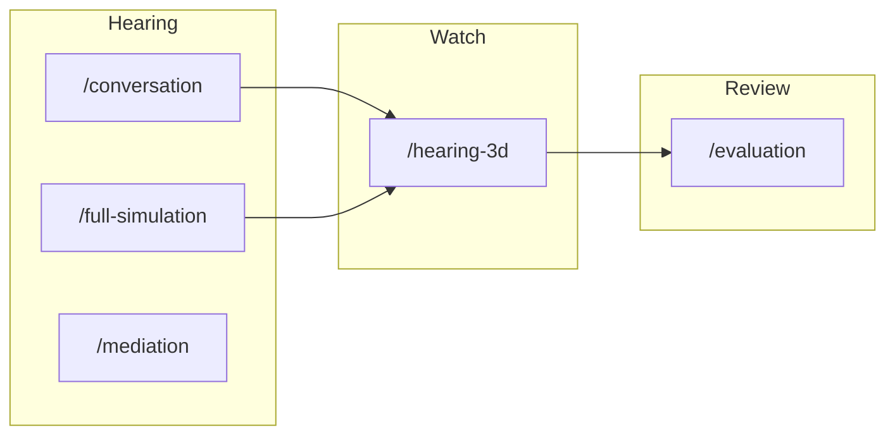
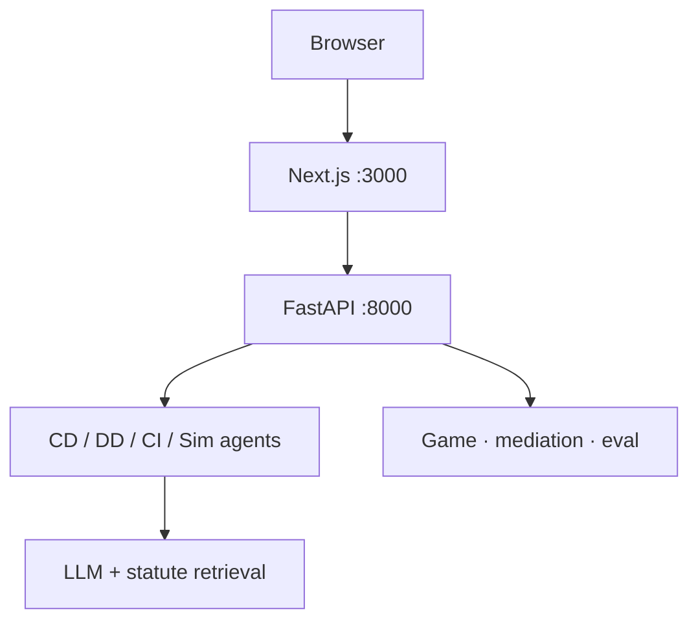

# LexGentium 0.8

[中文](README.md) · [English](README.en.md)

**A workbench for international commercial arbitration hearing simulation.** Not a generic mock-trial demo.

One hearing = one `session_id`. Three steps share that session:

| Step | What you do | Open |
|------|-------------|------|
| 1 Hearing | Application / defence / oral hearing | [`/conversation`](http://localhost:3000/conversation) |
| 2 Watch | Procedural 3D (Phase A, not formal VRM) | [`/hearing-3d`](http://localhost:3000/hearing-3d) · [`/hearing-3d?sessionId=`](http://localhost:3000/hearing-3d) |
| 3 Review | Contrast, strategy, procedural compliance | [`/evaluation`](http://localhost:3000/evaluation) |

**Runnable code lives only in [`mock_court_system/`](mock_court_system/).** Start there. Version `0.8.0`.

---

## Run it in 5 minutes

You need **Python 3.9+**, **Node.js 20+**, and an OpenAI-compatible LLM key.

Two terminals, both inside `mock_court_system`:

```bash
cd mock_court_system
pip install -r requirements.txt    # pinned: requirements.lock
npm install
cp .env.example .env               # set LLM_API_KEY / LLM_BASE_URL / LLM_MODEL
```

```bash
python api_server.py               # backend  http://localhost:8000
```

```bash
npm run dev                        # frontend http://localhost:3000
```

Then:

1. Open [`/register`](http://localhost:3000/register) to write a model, or [`/login`](http://localhost:3000/login) to test an existing config (soft unlock, no user table).
2. Start a hearing at [`/conversation`](http://localhost:3000/conversation). Keep the `session_id`.
3. Watch at [`/hearing-3d?sessionId=`](http://localhost:3000/hearing-3d) (Phase A placeholders). Old `/court3d` redirects here.
4. Review at [`/evaluation?session=…`](http://localhost:3000/evaluation).

Step-by-step troubleshooting: [`docs/INSTALL.md`](mock_court_system/docs/INSTALL.md).

**On Windows, use a venv first:** `python -m venv venv` → `.\venv\Scripts\Activate.ps1`, then `pip install`.

---

## Words you will keep seeing

| In the code | Plain meaning |
|-------------|---------------|
| **CD** | Claim / application drafting |
| **DD** | Defence drafting |
| **CI** | Hearing (court interaction) |
| **`session_id`** | ID for this hearing. Hearing, watch, and review all carry it |
| **`med_*`** | Standalone mediation session. Not the in-hearing settlement path |
| **Soft unlock** | `/register` and `/login` store LLM config in the browser. **No accounts table** |

Standalone mediation is [`/mediation`](http://localhost:3000/mediation). It uses a separate `med_*` id and **does not** change in-hearing CI settlement.

---

## Product loop



The browser talks only to Next `/api/*`. Next is the BFF in front of FastAPI. Agents, games, mediation, and evaluation run on the backend. Watch is `/hearing-3d`: conversation or sample JSONL become HearingEvents. Old `/court3d` redirects here.



---

## Workbench map

Marketing: `/` `/about` `/docs`. Four workbench groups (`Ctrl+K` uses the same set):

| Group | Routes | Role |
|-------|--------|------|
| Hearing | `/conversation` `/full-simulation` `/mediation` | Single hearing, full CD→DD→CI case, standalone mediation |
| Research | `/research` `/research/packs/[dataset]/[cluster]` | Annotation workbench (RESEARCH path) |
| Watch | `/hearing-3d` | Phase A placeholders; optional `sessionId`. `/court3d` redirects |
| Review | `/evaluation` `/evaluation/reports/[id]` | Contrast / strategy / compliance / research rubric |
| System | `/login` `/register` `/system` `/settings` `/database` | LLM check, health, statutes |

Palettes: `ink` (default) / `parchment` / `seal`. See [`DESIGN.md`](mock_court_system/DESIGN.md).

---

## What runs, what to leave alone

```text
.
├── mock_court_system/     # Only launch entry
├── 法学材料/              # Guides, workbook, source tables. Not a runtime
├── 3D建模方案/            # Design docs (manuals in 说明/). Do not copy into public/
├── 归档/                  # Filings, business plan, papers. Not a runtime
├── README.md
└── README.en.md
```

Inside the app, these are the usual stops:

```text
mock_court_system/
├── app/                   # Pages + /api proxies
├── agents/                # CD / DD / CI / Sim
├── api/                   # FastAPI routes and services
├── core/                  # Hearing / plead runtimes, game, mediation; lab/ offline/ store/
├── evaluation/            # LIVE contrast chain; lab/ paper runs; fossil/ old numbers
├── data/                  # Runtime SQLite (do not commit)
├── database/              # Statute store + FAISS
├── public/hearing-3d/     # Watch contracts + sample
├── public/court3d/        # Legacy capsule casts; pages redirect to /hearing-3d
├── api_server.py          # Web backend
└── main.py                # Offline batch runner, not the web path
```

APIs, BibTeX, deeper architecture: [`mock_court_system/README.md`](mock_court_system/README.md) ([English](mock_court_system/README.en.md)).

---

## Where data lands

Paths are relative to `mock_court_system/`.

| Use | Path |
|-----|------|
| Sessions | `data/conversations.sqlite3` |
| Evaluation tasks | `data/app_state.sqlite3` |
| Games / mediation | `data/game_sessions.sqlite3`, `data/mediation_sessions.sqlite3` |
| Statutes + vectors | `database/legal_articles.db` and the `.index` beside it |
| Case picker | `data/dataset_1000/` (in-repo: metadata + 100 summaries only) |

**Do not commit** `.env` or SQLite. Rebuild the full 1000-case set from ClaimGen-CN with `scripts/build_dataset.py`.

A hearing can also link `task_id` (full case), `game_id` (strategy play), and `report_id` (contrast report) via `api/services/links.py`. The browser stores the current hearing in `sessionStorage` as `lexgentium.lastSessionId`.

---

## Papers → modules

| Paper | What it does here |
|-------|-------------------|
| LexEval (NeurIPS 2024) | Six-layer legal-cognition metrics |
| J1-EVAL (2025) | Procedural compliance |
| AgentMediation (AAAI 2026) | TKI strategies + five-stage mediation |
| CADD (2025) | Behavior–liability–statute chains |

---

## Docs

| File | Open this when… |
|------|-----------------|
| [`docs/INSTALL.md`](mock_court_system/docs/INSTALL.md) | Install fails / backend won't connect |
| [`docs/DEPLOY.md`](mock_court_system/docs/DEPLOY.md) | You need to deploy |
| [`docs/ARCHITECTURE.md`](mock_court_system/docs/ARCHITECTURE.md) | You are changing pages or proxies |
| [`docs/EVALUATION_GUIDE.md`](mock_court_system/docs/EVALUATION_GUIDE.md) | You are running review or offline eval |
| [`AGENTS.md`](AGENTS.md) | Read first in a new session: live boundaries |
| [`docs/SYSTEM_STATUS.md`](mock_court_system/docs/SYSTEM_STATUS.md) | Current status as of 2026-09-15; the old 76-item table is archived |
| [`docs/CODEMAP.md`](mock_court_system/docs/CODEMAP.md) | Layer tags: LIVE / LAB / OFFLINE / FOSSIL / FROZEN |
| [`docs/COURT3D_ASSET_SPEC.md`](mock_court_system/docs/COURT3D_ASSET_SPEC.md) | You are swapping 3D characters |
| [`归档/README.md`](归档/README.md) | You need filings, papers, or the external inference memo |

`3D建模方案/` is design-only. Defence/demo files over GitHub’s 100MB limit are not in the repo.
