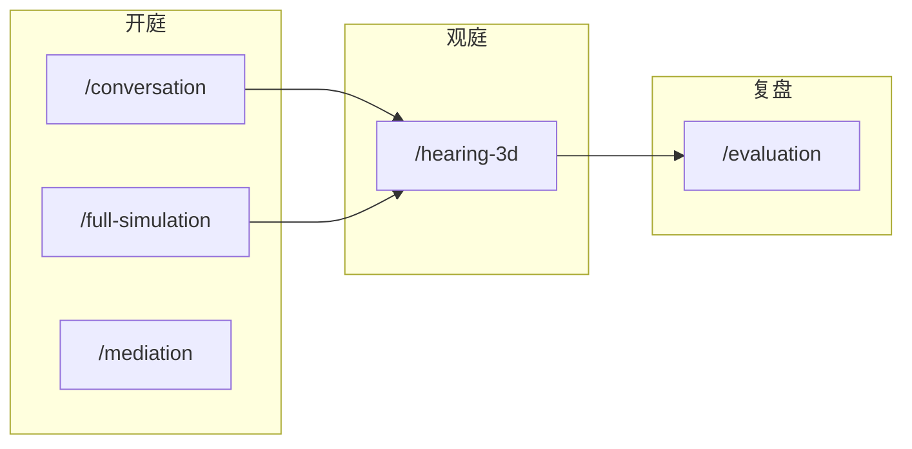
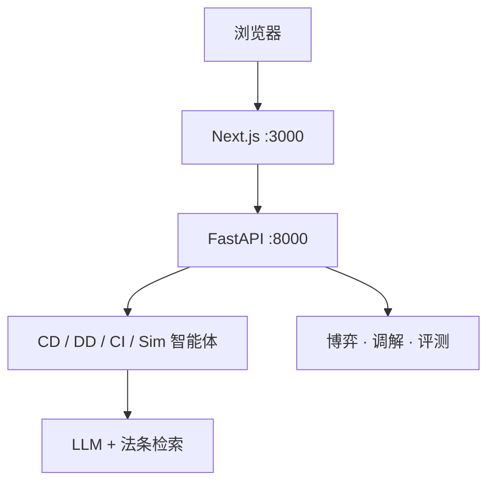

# LexGentium 0.8

[中文](README.md) · [English](README.en.md)

**国际商事仲裁听证仿真工作台。** 不是泛用模拟法庭演示页。

一场听证 = 一个 `session_id`。三步共用这一场：

| 步 | 做什么 | 打开 |
|----|--------|------|
| 1 开庭 | 申请 / 答辩 / 听证 | [`/conversation`](http://localhost:3000/conversation) |
| 2 观庭 | 程序化 3D（Phase A，非正式 VRM） | [`/hearing-3d`](http://localhost:3000/hearing-3d) · [`/hearing-3d?sessionId=`](http://localhost:3000/hearing-3d) |
| 3 复盘 | 对照、策略、程序合规 | [`/evaluation`](http://localhost:3000/evaluation) |

**能跑的代码只在 [`mock_court_system/`](mock_court_system/)。** 从那里启动。版本 `0.8.0`。

---

## 5 分钟跑起来

需要 **Python 3.10+**、**Node.js 20+**、一个 OpenAI 兼容的 LLM Key。

两个终端，都进 `mock_court_system`：

```bash
cd mock_court_system
pip install -r requirements.txt    # 可复现：requirements.lock
npm install
cp .env.example .env               # 填 LLM_API_KEY / LLM_BASE_URL / LLM_MODEL
```

```bash
python api_server.py               # 后端  http://localhost:8000
```

```bash
npm run dev                        # 前端  http://localhost:3000
```

然后：

1. 打开 [`/register`](http://localhost:3000/register) 写入模型，或 [`/login`](http://localhost:3000/login) 测通已有配置（软解锁，没有用户表）。
2. [`/conversation`](http://localhost:3000/conversation) 开一场，记下 `session_id`。
3. [`/hearing-3d?sessionId=`](http://localhost:3000/hearing-3d) 看庭（程序化占位 Phase A）。旧 `/court3d` 会转到这里。
4. [`/evaluation?session=…`](http://localhost:3000/evaluation) 复盘。

逐步排错：[`docs/INSTALL.md`](mock_court_system/docs/INSTALL.md)。

**Windows 建议先建虚拟环境：** `python -m venv venv` → `.\venv\Scripts\Activate.ps1`，再 `pip install`。

---

## 先看懂这几个词

| 你看到的 | 人话 |
|----------|------|
| **CD** | 申请准备（Claim Draft） |
| **DD** | 答辩准备（Defence Draft） |
| **CI** | 仲裁听证（Court Interaction） |
| **`session_id`** | 这一场听证的身份证。开庭、观庭、复盘都带它 |
| **`med_*`** | 独立调解会话。和庭内和解不是同一条线 |
| **软解锁** | `/register` `/login` 只把 LLM 配置写进浏览器，**没有账号表** |

独立调解在 [`/mediation`](http://localhost:3000/mediation)，用另一套 `med_*` id，**不会改**庭内 CI 和解。

---

## 产品主环



浏览器只打 Next 的 `/api/*`。Next 当 BFF，转给 FastAPI。智能体、博弈、调解、评测都在后端。观庭是 `/hearing-3d`：把 conversation 或样例 JSONL 译成 HearingEvent。旧 `/court3d` 重定向过来。



---

## 工作台地图

营销页：`/` `/about` `/docs`。工作台四组（`Ctrl+K` 同一套）：

| 组 | 路由 | 干什么 |
|----|------|--------|
| 开庭 | `/conversation` `/full-simulation` `/mediation` | 单场、全案 CD→DD→CI、独立调解 |
| 研究 | `/research` `/research/packs/[dataset]/[cluster]` | 材料标注工作台（RESEARCH 路径） |
| 观庭 | `/hearing-3d` | 程序化占位 Phase A；可挂 `sessionId`。`/court3d` 重定向 |
| 复盘 | `/evaluation` `/evaluation/reports/[id]` | 对照 / 策略 / 合规 / 研究量表 |
| 系统 | `/login` `/register` `/system` `/settings` `/database` | 测 LLM、健康、法条 |

配色：`ink`（默认）/ `parchment` / `seal`，见 [`DESIGN.md`](mock_court_system/DESIGN.md)。

---

## 仓库里什么能跑、什么别碰

```text
.
├── mock_court_system/     # 唯一启动入口
├── 法学材料/              # 指南、工作簿、原始母表。不是运行入口
├── 3D建模方案/            # 设计稿（说明书在 说明/）。不要拷进 public/
├── 归档/                  # 申报、商计、论文。不是运行入口
├── README.md
└── README.en.md
```

主工程里常看这些：

```text
mock_court_system/
├── app/                   # 页面 + /api 代理
├── agents/                # CD / DD / CI / Sim
├── api/                   # FastAPI 路由和服务
├── core/                  # 听证 / 书状 runtime、博弈、调解、检索；lab/ offline/ store/
├── evaluation/            # LIVE 对照链；lab/ 论文批跑；fossil/ 旧跑数
├── data/                  # 运行时 SQLite（不要提交）
├── database/              # 法条库 + FAISS
├── public/hearing-3d/     # 观庭合同 + 样例
├── public/court3d/        # 旧胶囊剧组；页面已重定向到 /hearing-3d
├── api_server.py          # Web 后端
└── main.py                # 离线批跑，不是 Web
```

API、BibTeX、更细的架构：[`mock_court_system/README.md`](mock_court_system/README.md)。

---

## 数据落在哪

路径都相对 `mock_court_system/`。

| 用途 | 路径 |
|------|------|
| 会话 | `data/conversations.sqlite3` |
| 评测任务 | `data/app_state.sqlite3` |
| 博弈 / 调解 | `data/game_sessions.sqlite3`、`data/mediation_sessions.sqlite3` |
| 法条 + 向量 | `database/legal_articles.db` 和旁边的 `.index` |
| 开庭选案 | `data/dataset_1000/`（train / val / test：600 / 200 / 200 条案件及配套 GT） |

**不要提交** `.env` 和 SQLite。完整 1000 条按 `scripts/build_dataset.py` 从 ClaimGen-CN 重建。

一场听证还可以挂：`task_id`（全案）、`game_id`（策略推演）、`report_id`（对照报告）。读写在 `api/services/links.py`。浏览器用 `sessionStorage` 记本场：`lexgentium.lastSessionId`。

---

## 论文对应哪块

| 论文 | 系统里干什么 |
|------|----------------|
| LexEval (NeurIPS 2024) | 六层法律认知评测 |
| J1-EVAL (2025) | 程序合规 |
| AgentMediation (AAAI 2026) | TKI 策略 + 五阶段调解 |
| CADD (2025) | 行为–责任–法条推理链 |

---

## 文档

| 文件 | 看这个如果… |
|------|----------------|
| [`docs/INSTALL.md`](mock_court_system/docs/INSTALL.md) | 装不上 / 连不上后端 |
| [`docs/DEPLOY.md`](mock_court_system/docs/DEPLOY.md) | 要部署 |
| [`docs/ARCHITECTURE.md`](mock_court_system/docs/ARCHITECTURE.md) | 要改页面或代理 |
| [`docs/EVALUATION_GUIDE.md`](mock_court_system/docs/EVALUATION_GUIDE.md) | 要跑复盘或离线评测 |
| [`AGENTS.md`](AGENTS.md) | 下次开会话前先看：现役边界，避免混线 |
| [`docs/SYSTEM_STATUS.md`](mock_court_system/docs/SYSTEM_STATUS.md) | 2026-09-15 现役现状；旧 76 项表已归档 |
| [`docs/CODEMAP.md`](mock_court_system/docs/CODEMAP.md) | 分层标签：LIVE / LAB / OFFLINE / FOSSIL / FROZEN |
| [`docs/COURT3D_ASSET_SPEC.md`](mock_court_system/docs/COURT3D_ASSET_SPEC.md) | 要换 3D 角色 |
| [`归档/README.md`](归档/README.md) | 要找申报、参考文献、外仓推理对照稿 |

`3D建模方案/` 只作设计参考。超过 GitHub 100MB 的答辩文件不在仓库里。
