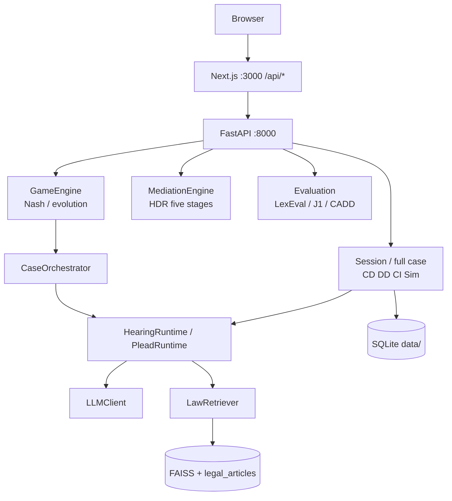
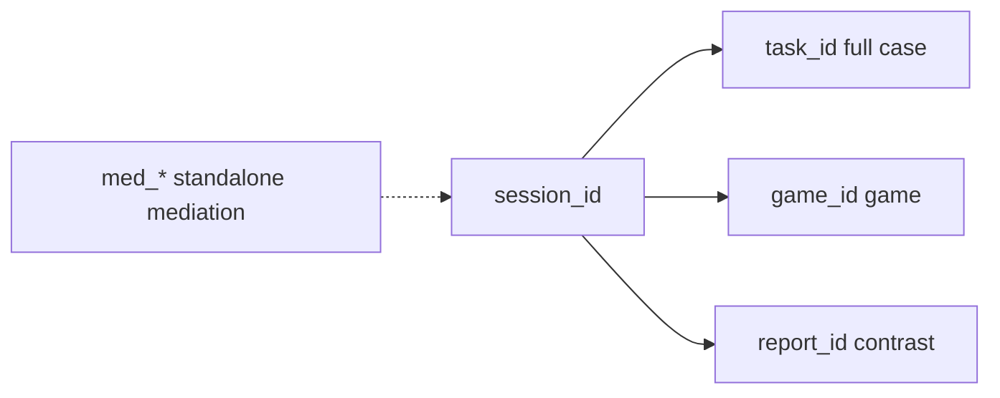

# LexGentium 0.8 — engineering notes

[中文](../README.md) · [English](../README.en.md) · [This page in 中文](README.md)

This page is **APIs / layout / citations**. To run the app, start at the root [README.en.md](../README.en.md).

One hearing, one `session_id`. Version **0.8.0**.

| Tag | Meaning |
|-----|---------|
| **CD** | Application drafting |
| **DD** | Defence drafting |
| **CI** | Hearing |
| **`med_*`** | Standalone mediation, not in-hearing settlement |

## Academic basis

| Paper | Venue | Module here |
|-------|-------|-------------|
| **LexEval** (2409.20288) | NeurIPS 2024 | Six-layer legal cognition (`evaluation/lib/lexeval_cognitive.py`) |
| **J1-ENVS / J1-EVAL** (2507.04037) | 2025 | PFS compliance + JUD/REA/LAW + Big Five (`evaluation/lib/j1eval_metrics.py`) |
| **AgentMediation** (2509.06586) | AAAI 2026 | TKI strategies + five-stage HDR mediation + four LLM-as-judge metrics |
| **CADD** (2511.11715) | 2025 | Behavior–liability–statute chain + symmetry + progressive benchmark |

## Architecture





Production path: CI uses `HearingRuntime` (`CI_USE_GRAPH`); CD/DD use `PleadRuntime` (`PLEAD_USE_RUNTIME`). Full cases go through `CaseOrchestrator`. `GameEngine` wraps the orchestrator. `/mediation` is standalone; in-hearing CI settlement still uses the conversation stream.

## Workbench pages

Marketing: `/` `/about` `/docs`. Four workbench groups (`Ctrl+K` matches):

| Group | Routes |
|-------|--------|
| Hearing | `/conversation` `/conversation/[id]` `/full-simulation` `/mediation` |
| Research | `/research` `/research/packs/[dataset]/[cluster]` (RESEARCH annotation workbench) |
| Watch | `/court3d` `/court3d/[id]` `/court3d/replay` |
| Review | `/evaluation` (contrast / strategy / compliance / research) `/evaluation/reports/[id]` |
| System | `/login` `/register` `/system` `/settings` `/database` `/api-history` `/simulate` |

`/login` tests an existing LLM config; `/register` writes one. Soft unlock via `sessionStorage`, no user table. Send `Authorization` when `API_TOKEN` is set.

Palettes: `ink` / `parchment` / `seal` (`DESIGN.md`).

## Quick start

Two terminals, both in this folder:

```bash
pip install -r requirements.txt
npm install
cp .env.example .env          # LLM_API_KEY, LLM_BASE_URL, LLM_MODEL
python api_server.py          # http://localhost:8000
npm run dev                   # http://localhost:3000
```

`/register` or `/login` → `/conversation` → `/court3d/{session_id}` → `/evaluation`.

No VRM in `public/court3d/models/` means capsules. Character swap: `docs/COURT3D_ASSET_SPEC.md`. Install: `docs/INSTALL.md`. Deploy: `docs/DEPLOY.md`.

## Layout

```
mock_court_system/
├── app/                        # Next pages + /api BFF
├── components/                 # Shells, hearing UI, court3d, palettes
├── lib/                        # API client, session, court3d director
├── agents/                     # CD / DD / CI / Sim
├── api/routers/                # Thin FastAPI routes
├── api/services/               # Sessions, games, eval, SSE, links
├── core/                       # Game, mediation, retrieval, runtimes
├── evaluation/lib/             # LexEval / J1 / CADD / AgentMed
├── data/                       # Runtime SQLite, dataset_1000 metadata
├── database/                   # Statute SQLite + FAISS
├── public/court3d/             # Casts, replay; models/ awaits VRM
├── docs/
├── scripts/                    # Batch / bench / reindex (not the web path)
├── tests/
├── api_server.py
├── main.py                     # Offline batch (COURT_API_*; not web)
├── DESIGN.md
├── package.json                # 0.8.0
└── requirements.txt
```

## Core APIs

The browser calls `/api/*` only. Paths below are FastAPI.

### Session and full case

| Endpoint | Role |
|----------|------|
| `POST /conversation/start` | Start a hearing, return `session_id` |
| `POST /conversation/{id}/message/stream` | Page speech (SSE) |
| `POST /case/full-simulation` | Full case; may write `links.task_id` |

Non-stream `POST /conversation/{id}/message` is debug-only.

### Game (Review → Strategy; create a game for this hearing first)

| Endpoint | Role |
|----------|------|
| `POST /game/create` | Create and write `links.game_id` |
| `POST /game/{id}/stream-round` | SSE one round |
| `POST /game/{id}/round` | Non-stream round |
| `GET /game/{id}/equilibrium` | Nash |
| `POST /game/{id}/strategy/set` | Set TKI |
| `POST /game/{id}/strategy/reflect` | Reflect |
| `POST /game/{id}/strategy/counterfactual` | Counterfactual |
| `DELETE /game/{id}` | Delete (UI confirms twice) |

### Mediation (`/mediation`; in-hearing settlement still uses the session)

| Endpoint | Role |
|----------|------|
| `POST /mediation/create` | Standalone mediation session |
| `POST /mediation/{id}/preliminary` … `/close` | HDR five stages |

### Game evaluation (strategy pane when `links.game_id` exists)

| Endpoint | Role |
|----------|------|
| `POST /game/{id}/evaluate/outcome` | AgentMediation four metrics |
| `POST /game/{id}/evaluate/lexeval` | LexEval |
| `POST /game/{id}/evaluate/j1eval` | J1-EVAL |
| `GET /game/{id}/liability-chain` | CADD chain |
| `POST /game/{id}/evaluate/behavior-symmetry` | Symmetry |
| `GET /game/{id}/strategy/payoff-matrix` | Payoff matrix |

The system-page experiment panel uses **`POST /case/progressive-rag|dual-mode-reasoning|multi-judge`**. Session-scoped copies on `game.py` remain.

Web contrast path is **`POST /evaluate`**. Aliases: `/api/evaluation/status|results|reports`.

## Data and IDs

- Sessions: `data/conversations.sqlite3`
- Eval tasks: `data/app_state.sqlite3`
- Games / mediation: `data/game_sessions.sqlite3`, `data/mediation_sessions.sqlite3`
- Checkpoints / LLM cache: `data/checkpoints.sqlite3`, `data/llm_cache.sqlite3`
- Statutes: `database/legal_articles.db` + `.index` + `_id_map.npy`

`input_json.links`: `task_id` / `game_id` / `report_id`. Standalone `med_*` is not in those keys. Frontend current hearing: `lexgentium.lastSessionId`.

`data/dataset_1000/` in-repo is `dataset_meta.json` plus a 100-case three-cause summary — **no** full train/val/test jsonl. Case picking uses `GET /reference/cases`. Rebuild 1000 rows from ClaimGen-CN with `scripts/build_dataset.py`.

## Flags

See `.env.example`: `CI_USE_GRAPH`, `PLEAD_USE_RUNTIME`, `LLM_CACHE`, `CI_LEGACY_ANALYSIS`, `API_TOKEN`, `LLM_FAST_MODEL`.

## Citation

```bibtex
@article{li2024lexeval,
  title={LexEval: A Comprehensive Chinese Legal Benchmark for Evaluating Large Language Models},
  author={Li, Haitao and others},
  journal={NeurIPS 2024 Datasets and Benchmarks},
  year={2024}
}

@article{jia2025j1bench,
  title={Ready Jurist One: Benchmarking Language Agents for Legal Intelligence in Dynamic Environments},
  author={Jia, Zheng and others},
  year={2025}
}

@article{chen2025agentmediation,
  title={Simulating Dispute Mediation with LLM-Based Agents for Legal Research},
  author={Chen, Junjie and others},
  journal={AAAI 2026},
  year={2025}
}

@article{shen2025cadd,
  title={CADD: A Chinese Traffic Accident Dataset for Statute-Based Liability Attribution},
  author={Shen, Yunfei and Wu, Zhongcheng},
  year={2025}
}
```
