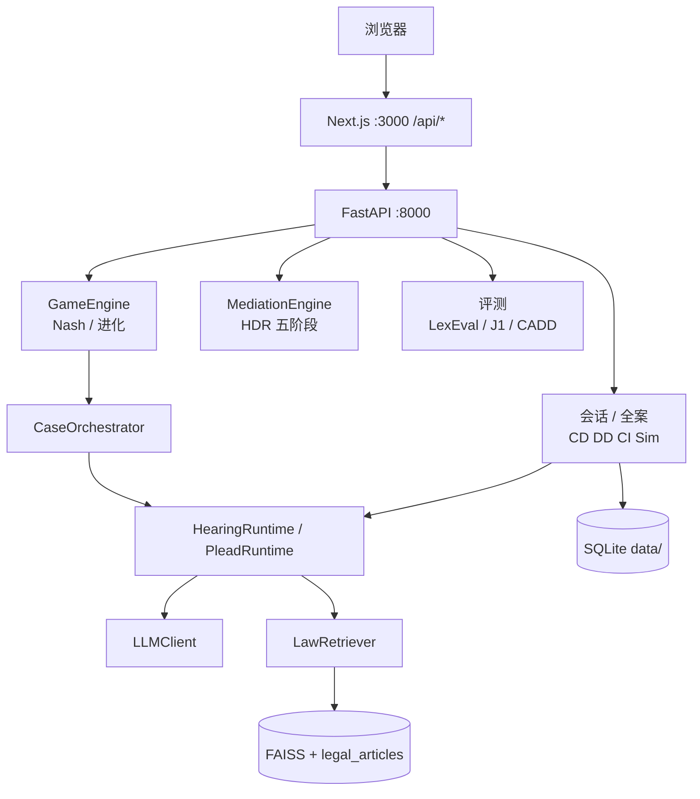
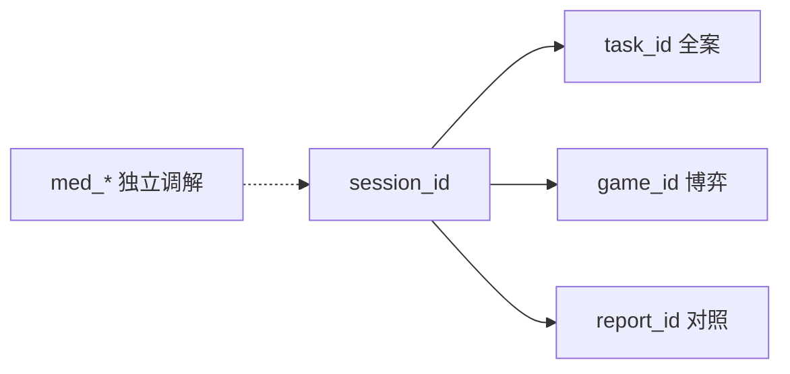

# LexGentium 1.0 — 工程笔记

[中文根说明](../README.md) · [English](../README.en.md) · [This page in English](README.en.md)

本页是 **接口 / 目录 / 引用**。要跑起来，从仓库根 [README.md](../README.md) 走。

一场听证一个 `session_id`。版本 **1.0.0**。国际商事仲裁研究平台，不是泛用模拟法庭演示页。

| 标记 | 意思 |
|------|------|
| **CD** | 申请准备 |
| **DD** | 答辩准备 |
| **CI** | 仲裁听证 |
| **`med_*`** | 独立调解，不是庭内和解 |

## 学术基础

| 论文 | 会议 | 本仓库对应 |
|------|------|-----------|
| **LexEval** (2409.20288) | NeurIPS 2024 | 六层法律认知（`evaluation/lib/lexeval_cognitive.py`） |
| **J1-ENVS / J1-EVAL** (2507.04037) | 2025 | PFS 合规 + JUD/REA/LAW + Big Five（`evaluation/lib/j1eval_metrics.py`） |
| **AgentMediation** (2509.06586) | AAAI 2026 | TKI 策略 + HDR 五阶段调解 + 四指标 LLM-as-judge |
| **CADD** (2511.11715) | 2025 | 行为–责任–法条链 + 对称记录 + 渐进基准 |

## 架构





生产路径：CI 走 `HearingRuntime`（`CI_USE_GRAPH`），CD/DD 走 `PleadRuntime`（`PLEAD_USE_RUNTIME`）。全案经 `CaseOrchestrator`。`GameEngine` 包一层编排器。`/mediation` 独立；庭内 CI 和解仍走会话流。

## 工作台页面

营销：`/` `/about` `/docs`。四个工作台分组（`Ctrl+K` 同源）：

| 组 | 路由 |
|----|------|
| 开庭 | `/conversation` `/conversation/[id]` `/full-simulation` `/mediation` |
| 研究 | `/research` `/research/packs/[dataset]/[cluster]` |
| 观庭 | `/hearing-3d` |
| 复盘 | `/evaluation`（对照 / 策略 / 合规 / 研究）`/evaluation/reports/[id]` |
| 系统 | `/login` `/register` `/system` `/settings` `/database` `/api-history` `/simulate` |

`/login` 测通已有 LLM；`/register` 首次写入。软解锁走 `sessionStorage`，没有用户表。设了 `API_TOKEN` 才带 `Authorization`。

配色：`ink` / `parchment` / `seal`（`DESIGN.md`）。

## 快速启动

两个终端都进本目录：

```bash
pip install -r requirements.txt
npm install
cp .env.example .env          # LLM_API_KEY, LLM_BASE_URL, LLM_MODEL
python api_server.py          # http://localhost:8000
npm run dev                   # http://localhost:3000
```

`/register` 或 `/login` → `/conversation` → `/hearing-3d?sessionId=` → `/evaluation`。

观庭是 `/hearing-3d`（Phase A 程序化占位，非正式 VRM）。旧 `/court3d` 重定向过来。安装：`docs/INSTALL.md`。部署：`docs/DEPLOY.md`。

## 目录

```
mock_court_system/
├── app/                        # Next 页 + /api BFF
├── components/                 # 壳、听证文字、hearing-3d（Phase A）
├── lib/                        # API 客户端、会话、court3d 管子
├── agents/                     # CD / DD / CI / Sim
├── api/routers/                # 薄 FastAPI 路由
├── api/services/               # 会话、博弈、评测、SSE、links
├── core/                       # 运行时、博弈、调解；lab/ offline/ store/；根上是 Phase 0/1
├── evaluation/                 # LIVE lib/ + lab/ 论文批跑。旧跑数在仓库根 归档/评测化石/
├── data/                       # 运行时 SQLite；dataset_1000 = meta + 100 条摘要
├── database/                   # 法条 SQLite + FAISS
├── public/hearing-3d/          # 现役观庭合同 + 样例事件
├── public/court3d/             # 旧剧组 JSON / 空 models；页面已重定向。replay 已删
├── docs/
├── scripts/                    # 批跑 / 基线 / 重建索引（不是 Web）
├── tests/
├── api_server.py
├── main.py                     # 离线批跑（COURT_API_*；不是 Web）
├── DESIGN.md
├── package.json                # 1.0.0
└── requirements.txt
```

## 核心 API

浏览器只打 `/api/*`。下表是 FastAPI。

### 会话与全案

| 端点 | 作用 |
|------|------|
| `POST /conversation/start` | 开一场，返回 `session_id` |
| `POST /conversation/{id}/message/stream` | 页面发言（SSE） |
| `POST /case/full-simulation` | 全案；可回写 `links.task_id` |

非流式 `POST /conversation/{id}/message` 只给调试。

### 研究（无 pack 的民事场次跳过）

| 端点 | 作用 |
|------|------|
| `GET /research/packs` | 列包（含 SAMPLE） |
| `GET /research/runs` | 运行记录 |
| `POST /research/evaluate` | 六维量表 |

### 博弈（复盘 → 策略；先为本场建局）

| 端点 | 作用 |
|------|------|
| `POST /game/create` | 创建并回写 `links.game_id` |
| `POST /game/{id}/stream-round` | SSE 一轮 |
| `POST /game/{id}/round` | 非流式一轮 |
| `GET /game/{id}/equilibrium` | Nash |
| `POST /game/{id}/strategy/set` | 设 TKI |
| `POST /game/{id}/strategy/reflect` | 反思 |
| `POST /game/{id}/strategy/counterfactual` | 反事实 |
| `DELETE /game/{id}` | 删除（界面双确认） |

### 调解（`/mediation`；庭内和解仍走会话）

| 端点 | 作用 |
|------|------|
| `POST /mediation/create` | 独立调解会话 |
| `POST /mediation/{id}/preliminary` … `/close` | HDR 五阶段 |

### 博弈评测（有 `links.game_id` 时在策略栏）

| 端点 | 作用 |
|------|------|
| `POST /game/{id}/evaluate/outcome` | AgentMediation 四指标 |
| `POST /game/{id}/evaluate/lexeval` | LexEval |
| `POST /game/{id}/evaluate/j1eval` | J1-EVAL |
| `GET /game/{id}/liability-chain` | CADD 链 |
| `POST /game/{id}/evaluate/behavior-symmetry` | 对称 |
| `GET /game/{id}/strategy/payoff-matrix` | 收益矩阵 |

系统页实验面板走 **`POST /case/progressive-rag|dual-mode-reasoning|multi-judge`**。`game.py` 上仍有会话版副本。

Web 对照主路是 **`POST /evaluate`**。别名：`/api/evaluation/status|results|reports`。

## 数据与 ID

- 会话：`data/conversations.sqlite3`
- 评测任务：`data/app_state.sqlite3`
- 博弈 / 调解：`data/game_sessions.sqlite3`、`data/mediation_sessions.sqlite3`
- checkpoint / LLM 缓存：`data/checkpoints.sqlite3`、`data/llm_cache.sqlite3`
- 法条：`database/legal_articles.db` + `.index` + `_id_map.npy`

`input_json.links`：`task_id` / `game_id` / `report_id`。独立 `med_*` 不在这些键里。前端本场：`lexgentium.lastSessionId`。

仓库里的 `data/dataset_1000/` 包含 `dataset_meta.json`、100 条三因摘要，以及 train/val/test 分别 600/200/200 条案件和配套 GT。选案走 `GET /reference/cases`。完整 1000 条用 `scripts/build_dataset.py` 从 ClaimGen-CN 重建。

## 开关

见 `.env.example`：`CI_USE_GRAPH`、`PLEAD_USE_RUNTIME`、`LLM_CACHE`、`CI_LEGACY_ANALYSIS`、`API_TOKEN`、`LLM_FAST_MODEL`、`LLM_FAST_MAX_TOKENS`、`CI_MAX_AUTO_TURNS`。

`data/research_packs/` 现有两个 SAMPLE（执行通知、CISG 第 79 条）。是技术夹具，不算正式研究案。

## 引用

```bibtex
@article{li2024lexeval,
  title={LexEval: A Comprehensive Chinese Legal Benchmark for Evaluating Large Language Models},
  author={Li, Haitao and others},
  journal={NeurIPS 2024 Datasets and Benchmarks},
  year={2024}
}

@article{jia2025j1bench,
  title={Ready Jurist One: Benchmarking Language Agents for Legal Intelligence in Dynamic Environments},
  author={Jia, Zheng and others},
  year={2025}
}

@article{chen2025agentmediation,
  title={Simulating Dispute Mediation with LLM-Based Agents for Legal Research},
  author={Chen, Junjie and others},
  journal={AAAI 2026},
  year={2025}
}

@article{shen2025cadd,
  title={CADD: A Chinese Traffic Accident Dataset for Statute-Based Liability Attribution},
  author={Shen, Yunfei and Wu, Zhongcheng},
  year={2025}
}
```
