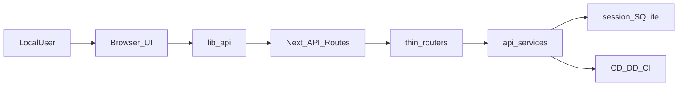

# 主工程全链路梳理（mock_court_system）

本文件面向**本机/离线演示**场景。一场庭只有一个对外 ID：`session_id`（SQLite）。浏览器只打 Next `/api/*`；FastAPI 经 `api/services/` 处理业务。`main.py` 仅离线批跑，不是 Web 主入口。

## 1. 目录与职责

- **前端（Next.js App Router）**：`mock_court_system/app/`
  - 开庭：`/conversation`、`/conversation/[id]`、`/full-simulation`、`/mediation`
  - 观庭：`/court3d`、`/court3d/[id]`、`/court3d/replay`
  - 复盘：`/evaluation`、`/evaluation/reports/[id]`
  - 系统枢纽：`/system`（健康 + 映射表 + 实验面板；快捷入口指向数据库 / 设置 / API 历史 / 调试模拟器，那些是独立页）
  - 调试单轮：`/simulate`（在「系统」菜单，不是四页之一）
  - 共享：优先 `lib/api/`；SSE 与个别调试页仍可直接 `fetch`。`lib/session/SessionProvider.tsx`、`lib/labels.ts`
- **后端（FastAPI）**：`mock_court_system/api_server.py`
  - 薄路由：`api/routers/`
  - 业务：`api/services/`（conversation / simulation / game / evaluation / sse / cases / links）
  - `api/state.py` 为运行时与智能体入口，SSE 拼包委托 `services.sse`
- **会话存储**：`core/conversation_store.py`，默认 SQLite `data/conversations.sqlite3`
- **智能体**：`agents/`（CD/DD/CI 提示词与状态机不在本重构范围内）

## 2. 关键数据流

会话 `input_json.links`：`{ task_id?, game_id?, report_id? }`。`GET /conversation/{id}` 与列表均展开 `links`。

## 3. 接口分档

| 档 | 能力 | 页面 |
|---|---|---|
| 官方 | 会话 CRUD + stream + auto-advance + import；全案启动/状态/stream；health/config/database/api-history；评测；`GET /reference/cases` | 开庭、观庭、复盘、系统 |
| 半官方 | compliance；game create/list/get | 按钮即可 |
| 实验 | 无状态 `POST /`、独立调解、`/case/*` 创新、game 细评测 | `/simulate` 在系统菜单「调试单轮」；调解 `/mediation`；创新在 `/system` 底部；博弈评测在复盘策略 pane |

SSE 最小字段：`type` = `delta` | `final` | `stage_transition` | `simulation_complete` | `error`。发言带 `role`、`degraded?`、`sub_stage?`。3D 只在客户端译为 `PerformanceEvent`。

## 4. 页面 ↔ 代理 ↔ 后端

### 4.1 开庭
- `GET/POST /api/conversation/*` → `/conversation/*`
- 会话页与 `/court3d/{id}` 互链

### 4.2 观庭
- 共用会话 list / get
- 禁止无 `session_id` 的全案 SSE；博弈用手填 `game_id` 已去掉，只认 `links.game_id` 或半官方 create

### 4.3 全案
- `POST /api/case/full-simulation` 可选 `session_id`，回写 `links.task_id`
- 完成后提供「去 3D 观演」

### 4.4 复盘
- `POST /evaluate` 可选 `session_id`：从会话 `dialog_history` 生成预测，关闭默认预测文件
- 1:1 别名：`GET /api/evaluation/status/{id}`、`GET /api/evaluation/results`、`GET /api/evaluation/reports/{id}`（UI 仍走 `/api/evaluate`）

### 4.5 调试与实验
- `/simulate`（系统菜单）→ `POST /api/simulate` → `POST /`（1:1 别名 `POST /api/legacy`，勿改 UI）
- `GET /api/reference/big-five-traits` → `GET /reference/big-five-traits`（UI 仍走 `/api/reference/big-five`）
- `/mediation` → `POST /api/mediation/*` → `/mediation/*`（独立 HDR；庭内 CI 和解仍走会话 SSE）
- `/system` 实验面板 → `/api/case/progressive-rag|dual-mode-reasoning|multi-judge`（`game.py` 会话版重复端点保留）
- 非流式 `POST /api/conversation/{id}/message` 仅调试，页面发言走 stream

## 5. 配置

- `BACKEND_URL`：Next 代理目标（默认 `http://localhost:8000`）
- `CONVERSATION_STORE=sqlite|memory`
- `CONVERSATION_DB_PATH`（默认 `./data/conversations.sqlite3`）

## 6. 启动

- 前端：`http://localhost:3000`
- 后端：`http://localhost:8000/docs`

## 7. 多智能体编排（LangGraph）

庭审不再每回合 2–5 次串行 LLM + 全量回放。CI 走 `HearingRuntime` / `HearingSubgraph`：

1. `clerk_analyze`：一次 `chat_json`（`purpose=clerk`，fast tier）合并状态分析与抽取。
2. `apply_state_machine`：纯 Python，算法与 `StateMachine` 原实现一致。
3. `judge_speak`：模板或一次流式发言（strong tier）。自动模式可 `fast_path`（分析+指令同一次调用）。
4. Checkpoint：`data/checkpoints.sqlite3`，`thread_id = session_id`。合规与阶段从 checkpoint 读，不再读进程单例状态机。
5. 全案：`full_case_graph` 节点 `cd_stage → dd_stage → hearing → score_and_track`，锦标赛循环 `evolve_strategies`。`simulation_tasks` 以 `task_id` 落同一 checkpoint 库。

环境变量：

- `CI_USE_GRAPH=0`：回退旧 `process_turn` 全量回放
- `CI_LEGACY_ANALYSIS=1`：回合内仍分多次分析调用
- `LLM_CACHE=0`：关闭 `purpose in {clerk,extract,score}` 且 `temperature<=0.1` 的 SQLite 提示缓存
- `LLM_FAST_MODEL` / `settings.llm.fast_model`：书记员/抽取/评分用小模型

基线脚本：`python scripts/bench_hearing.py --turns 20`；CD 窗口：`python scripts/bench_plead.py`。

CI 每 `session_id` 一份可变 `CIAgent`（`fork_stateless`），异会话可并行。CD/DD 走 `PleadRuntime`：checkpoint + 最近 k 条（默认 12）。全案/博弈 SSE 与会话流一样用 `asyncio.Queue`。生产执行源是 HearingRuntime / PleadRuntime，不是图上的透传节点。

回退：`PLEAD_USE_RUNTIME=0` 恢复 CD/DD 全量 `process_turn`。

不做：ReAct/`create_agent`、改法律提示词原文、AutoGen/CrewAI、调解/多法官进主干图。
