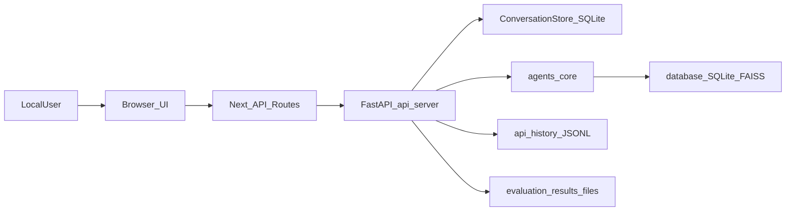

# 主工程全链路梳理（mock_court_system）

本文件面向**本机/离线演示**场景，梳理 `mock_court_system/` 的目录职责、页面与接口映射、关键数据流与配置项。

## 1. 目录与职责

- **前端（Next.js App Router）**：`mock_court_system/app/`
  - 页面：`/conversation`、`/simulate`、`/evaluation`、`/database`、`/api-history`、`/docs`
  - 代理 API：`mock_court_system/app/api/**/route.ts`
- **后端（FastAPI）**：`mock_court_system/api_server.py`
  - 无状态模拟：`POST /`
  - 会话式：`/conversation/*`（含导入）
  - 评测：`/evaluate` + `/evaluation/*`
  - 法条检索：`/database/*`
  - API 历史：`/api-history/*`
- **会话存储（可插拔）**：`mock_court_system/core/conversation_store.py`
  - 默认 SQLite：`mock_court_system/data/conversations.sqlite3`
- **智能体与核心能力**：
  - 智能体：`mock_court_system/agents/`（CD/DD/CI）
  - 核心：`mock_court_system/core/`（LLM client、法条检索、评测器等）
  - 工具：`mock_court_system/utils/`
  - 评测：`mock_court_system/evaluation/`

## 2. 关键数据流

## 3. 页面 ↔ 代理 ↔ 后端端点映射

### 3.1 会话（推荐交互入口）
- **页面**：`app/conversation/page.tsx`
  - `GET /api/conversation/list` → `app/api/conversation/list/route.ts` → `GET /conversation/list`
  - `POST /api/conversation/start` → `app/api/conversation/start/route.ts` → `POST /conversation/start`
- **页面**：`app/conversation/[sessionId]/page.tsx`
  - `GET /api/conversation/{id}` → `app/api/conversation/[sessionId]/route.ts` → `GET /conversation/{id}`
  - `DELETE /api/conversation/{id}` → `app/api/conversation/[sessionId]/route.ts` → `DELETE /conversation/{id}`
  - `POST /api/conversation/{id}/message` → `app/api/conversation/[sessionId]/message/route.ts` → `POST /conversation/{id}/message`

### 3.2 模拟（兼容无状态）
- **页面**：`app/simulate/page.tsx`
  - `POST /api/simulate` → `app/api/simulate/route.ts` → `POST /`
  - 一键迁移：`POST /api/conversation/import` → `app/api/conversation/import/route.ts` → `POST /conversation/import`

### 3.3 评测
- **页面**：`app/evaluation/page.tsx`
  - `POST /api/evaluate` → `app/api/evaluate/route.ts` → `POST /evaluate`
  - `GET /api/evaluate?report_id=...` → `app/api/evaluate/route.ts` → `GET /evaluation/status/{report_id}`
  - `GET /api/evaluate` → `app/api/evaluate/route.ts` → `GET /evaluation/results`
- **页面**：`app/evaluation/reports/[reportId]/page.tsx`
  - `GET /api/evaluate/reports/{id}` → `app/api/evaluate/reports/[reportId]/route.ts` → `GET /evaluation/reports/{id}`

### 3.4 法条检索 / 数据库
- **页面**：`app/database/page.tsx`
  - `GET /api/database/stats` → `app/api/database/stats/route.ts` → `GET /database/stats`
  - `POST /api/database/search` → `app/api/database/search/route.ts` → `POST /database/search`

### 3.5 API 历史
- **页面**：`app/api-history/page.tsx`
  - `GET /api/api-history/stats` → `app/api/api-history/stats/route.ts` → `GET /api-history/stats`
  - `GET /api/api-history/list?...` → `app/api/api-history/list/route.ts` → `GET /api-history/list`

## 4. 关键配置项（本机）

### 前端
- `BACKEND_URL`：Next 代理转发目标（默认 `http://localhost:8000`）

### 后端（会话存储）
- `CONVERSATION_STORE=sqlite|memory`（默认 `sqlite`）
- `CONVERSATION_DB_PATH=...`（默认 `./data/conversations.sqlite3`）

## 5. 启动与入口

参考：`快速启动指南.md`、`README_MAIN.md`。

- 前端：`http://localhost:3000`
- 后端：`http://localhost:8000`（文档：`http://localhost:8000/docs`）

