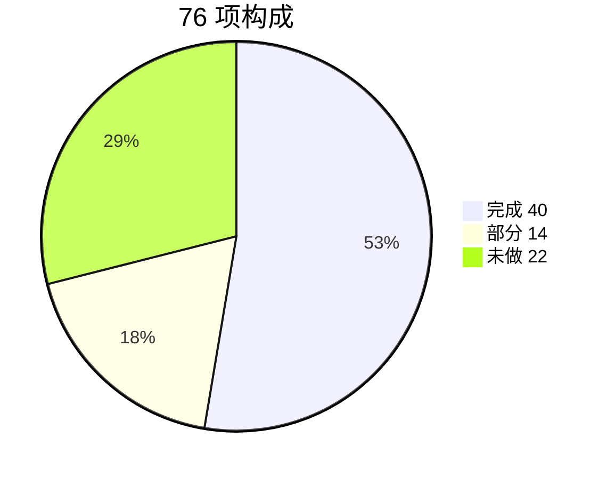

# LexGentium 0.8 系统现状

盘点截止 **2026-09-11**。对照对象：现有工程工作台，以及法学主线（真实法律材料 → 模拟论证实验 → 评价过程与结果）。

**2026-09-12 研究链路（补记，不改下方 76 项原表）：** 已接通研究工作台 `/research`（RESEARCH 标注路径）、开庭选研究包水合、`enforcement_nyc` 运行层（角色材料视图 / 主张链 / 条件变化派生 `run_id`）、六维量表与研究包导出。入口：`/research`、`/conversation` 选研究包、`/conversation/[sessionId]` 文字页主张链、`/evaluation?pane=research`。民事 CD/DD/CI 无研究包时行为不变。不经 court3d。

口径：

| 状态 | 含义 |
|------|------|
| **完成** | 已接通、可跑 |
| **部分** | 有代码或界面，缺关键一环 |
| **未做** | 仓库里没有 |

来源：`mock_court_system` 代码、`data/`、`database/`、`docs/`。共 **76** 项（工程 52 + 法学 24）。每项只记一次。

**两条线不要混着看。** 工程工作台已经能开庭、观庭、复盘。法学主线（承认与执行论证实验）还没有落地：0 项完成。现有评测打的是国内民事 CD/DD/CI，不是《纽约公约》争点。

---

## 总账

| 线 | 完成 | 部分 | 未做 | 合计 | 完成率 |
|----|------|------|------|------|--------|
| 工程工作台 | 40 | 6 | 6 | 52 | 77% |
| 法学研究主线 | 0 | 8 | 16 | 24 | 0% |
| **合计** | **40** | **14** | **22** | **76** | **53%** |

完成率按「完全完成」计，部分完成不计入分子。法学主线的 8 项「部分」是民诉引擎或 3D HUD 可复用，不是研究协议已完成。

---

## 仓库体量

已建成，不代表法学完成。

| 指标 | 数量 |
|------|------|
| Next 页面 | 19 |
| FastAPI 端点 | 67 |
| 智能体 | 4 |
| 后端测试文件 | 13 |
| 评测库模块 | 11 |

10 个路由文件：`conversation` 9、`game` 27、`mediation` 8、其余 23。测试覆盖 runtime / 检索 / 会话，没有前端 E2E，没有承认执行协议。

---

## 分区统计

| 分区 | 线 | 完成 | 部分 | 未做 | 合计 | 完成率 |
|------|----|------|------|------|------|--------|
| 产品主环 | 工程 | 7 | 3 | 0 | 10 | 70% |
| 智能体与运行时 | 工程 | 11 | 0 | 0 | 11 | 100% |
| 数据资产 | 工程 | 7 | 0 | 5 | 12 | 58% |
| 评测库 | 工程 | 9 | 2 | 0 | 11 | 82% |
| 工程文档 | 工程 | 6 | 1 | 1 | 8 | 75% |
| 研究范围 | 法学 | 0 | 0 | 4 | 4 | 0% |
| 仿真协议 | 法学 | 0 | 5 | 4 | 9 | 0% |
| 可追查材料 | 法学 | 0 | 1 | 4 | 5 | 0% |
| 评价边界 | 法学 | 0 | 2 | 4 | 6 | 0% |

```mermaid
xychart-beta
  title "分区：完成 / 部分 / 未做（项）"
  x-axis ["产品主环", "智能体", "数据", "评测库", "文档", "研究范围", "仿真协议", "可追查材料", "评价边界"]
  y-axis "项" 0 --> 12
  bar [7, 11, 7, 9, 6, 0, 0, 0, 0]
  bar [3, 0, 0, 2, 1, 0, 5, 1, 2]
  bar [0, 0, 5, 0, 1, 4, 4, 4, 4]
```

---

## 1. 工程工作台（52 项，40 完成）

### 1.1 产品主环（7 完成 / 3 部分 / 0 未做）

| 状态 | 检查项 | 现在有什么 | 还差什么 |
|------|--------|------------|----------|
| 部分 | 软解锁 `/login` `/register` | 可写入并测通 LLM，sessionStorage 软解锁 | 没有路由守卫，未登录也能进工作台 |
| 完成 | 开庭 `/conversation` | 开场、SSE 发言、`session_id` 贯通 | — |
| 完成 | 全案 `/full-simulation` | CD→DD→CI 编排 + 状态/流式 | — |
| 完成 | 独立调解 `/mediation` | HDR 五阶段页面与接口 | — |
| 部分 | 观庭 3D 本场 | 按 `session_id` 演出，无模型时胶囊人 | `public/court3d/models` 无 VRM |
| 完成 | 观庭离线回放 | `/court3d/replay` + `demo_ci.json` | — |
| 完成 | 复盘三栏 | 对照 / 策略 / 合规，`POST /evaluate` 已接通 | — |
| 完成 | 系统 / 设置 / 法条 / 调用记录 | 健康检查、LLM、检索、历史均可点 | — |
| 完成 | 无状态单轮 `/simulate` | `POST /` 调试入口 | — |
| 部分 | 营销页 `/about` `/docs` | 有简介页 | 未挂载 `docs/*.md` |

### 1.2 智能体与运行时（11 完成 / 0 部分 / 0 未做）

| 状态 | 检查项 | 现在有什么 | 还差什么 |
|------|--------|------------|----------|
| 完成 | CDAgent 申请准备 | `agents/cd_agent.py` | — |
| 完成 | DDAgent 答辩准备 | `agents/dd_agent.py` | — |
| 完成 | CIAgent 听证 | 26 步民诉状态机 | — |
| 完成 | SimAgent 当事人 | 可注入 TKI 策略 | — |
| 完成 | HearingRuntime | `CI_USE_GRAPH` 默认开 | — |
| 完成 | PleadRuntime | `PLEAD_USE_RUNTIME` 默认开 | — |
| 完成 | CaseOrchestrator | 全案 CD→DD→CI | — |
| 完成 | GameEngine | 策略、均衡、评测接口齐全 | — |
| 完成 | MediationEngine HDR | 五阶段独立调解 | — |
| 完成 | LawRetriever / P-RAG | FAISS + BM25，民事法条库 | 检索 ≠ 来源核验 |
| 完成 | LLM 缓存 / Checkpoint | `llm_cache` / `checkpoints` SQLite | — |

### 1.3 数据资产（7 完成 / 0 部分 / 5 未做）

| 状态 | 检查项 | 现在有什么 | 还差什么 |
|------|--------|------------|----------|
| 完成 | dataset_1000 元数据 | `dataset_meta.json` + 100 条摘要 | — |
| 完成 | dataset_1000 全文 jsonl | train/val/test 的 `case_info` 与 CD/DD/CI GT 已在仓库 | 根 README 仍写成「只有摘要」，文案过时 |
| 完成 | 会话 SQLite | `conversations.sqlite3` 运行时存在 | gitignore，不入库 |
| 完成 | 博弈 / 调解 / 评测库 | 三套 SQLite 已接通 | — |
| 完成 | 民事法条 + FAISS | `legal_articles.db` / `.index` 已跟踪 | 领域是民法典，不是公约 |
| 完成 | Checkpoint / LLM 缓存文件 | 本地已生成 | — |
| 完成 | 评测冒烟 test_run | `evaluation/data/test_run` 六份 jsonl | — |
| 未做 | CISG 材料 | 仓库无任何 CISG 语料 | 独立参考库，勿并入执行任务 |
| 未做 | 纽约公约 / 承认执行案件包 | 无公约文本、无执行专题包 | 先做 2–3 个标准包 |
| 未做 | 规则卡 | 无法条版本/争议/使用边界卡 | source / version / 适用条件 |
| 未做 | research_packs | 无研究材料目录 | 六栏案件包格式 |
| 未做 | 3D VRM 模型 | `models/` 只有 `.gitkeep` | 按 `COURT3D_ASSET_SPEC` 投放 |

### 1.4 评测库（9 完成 / 2 部分 / 0 未做）

| 状态 | 检查项 | 现在有什么 | 还差什么 |
|------|--------|------------|----------|
| 完成 | LexEval 六层认知 | `lexeval_cognitive.py` | — |
| 完成 | J1-EVAL PFS/JUD/REA/LAW | `j1eval_metrics.py` + 合规接口 | — |
| 完成 | CADD 责任链 | `cadd_framework.py` | — |
| 部分 | AgentMediation 指标 | 散落在 outcome / solution / mediation | 无独立 agentmed 模块 |
| 完成 | 多层 / 结果 / 博弈评测 | `multi_layer` + `outcome` + `game_eval` | — |
| 完成 | CD / DD / CI 场景评测 | `evaluation/lib/CD.py` `DD.py` `CI.py` | — |
| 完成 | `POST /evaluate` 主路 | FastAPI + Next 代理已接通 | — |
| 完成 | dataset_1000 金标准 | 三分集 GT 已入库 | — |
| 部分 | `eval_config` 官方 GT 路径 | 仍指向 `evaluation/data/CD_ground_truth.jsonl` | 该路径不存在，应改指 `dataset_1000` |
| 完成 | 程序合规 PFS | 状态机 + `/compliance` | — |
| 完成 | 博弈页评测按钮 | outcome / LexEval / J1 / CADD 端点 | — |

### 1.5 工程文档（6 完成 / 1 部分 / 1 未做）

| 状态 | 检查项 | 现在有什么 | 还差什么 |
|------|--------|------------|----------|
| 完成 | `INSTALL.md` | 安装与排错 | — |
| 完成 | `DEPLOY.md` | 部署说明 | — |
| 完成 | `ARCHITECTURE.md` | 页面 / 代理 / 运行时 | — |
| 完成 | `EVALUATION_GUIDE.md` | 复盘与离线批跑 | — |
| 部分 | COURT3D 规格 | 有 `COURT3D_ASSET_SPEC.md` | 无独立 `COURT3D.md` 总览 |
| 完成 | `DESIGN.md` | 配色与双壳 | — |
| 完成 | `申请书正文.md` | 国内民诉 + 博弈论叙事 | 与承认执行主线未对齐 |
| 未做 | `RESEARCH_PROTOCOL.md` | 仓库无此文件 | 真实程序 vs 研究设计必须写明 |

---

## 2. 法学研究主线（24 项，0 完成）

### 2.1 研究范围（0 完成 / 0 部分 / 4 未做）

| 状态 | 检查项 | 现在有什么 | 还差什么 |
|------|--------|------------|----------|
| 未做 | 承认与执行研究定位 | 产品文案写仲裁，引擎是民诉 | 改 RQ，不再用 SPNE/ESS 当主问题 |
| 未做 | 纽约公约模块 | 代码与数据均无公约 | 第 V 条抗辩规则卡 |
| 未做 | 法律问题 vs 方法问题 | 评测只打像不像标准答案 | 两类问题分轨记录 |
| 未做 | 中新案例 / 通知与陈述 | 界面有「核对通知与出庭」标签 | 无专题材料、无模块协议 |

### 2.2 仿真协议（0 完成 / 5 部分 / 4 未做）

| 状态 | 检查项 | 现在有什么 | 还差什么 |
|------|--------|------------|----------|
| 部分 | 角色论证职责 | CI 状态机有步骤，无研究职责书 | 主张必须带事实+规范+推理 |
| 未做 | 可见材料控制 | `input_json` 对角色不分层 | 按角色遮挡材料 |
| 部分 | 交互顺序与停止条件 | 有阶段、`max_turns`、辩论轮次 | 研究停止规则与日志 |
| 部分 | 主张三要素 | 书记员抽诉请/承认否认 | 事实依据 / 规范依据 / 推理 |
| 部分 | 反驳后动作 | 有 `concede` / `no_proof` 意图 | 补 / 改 / 撤 / 承认不足 正式枚举 |
| 部分 | 主持 + 来源核验角色 | HUD 有溯源灯和 `audit` 事件类型 | 后端不发 audit，核验角色未入庭 |
| 未做 | 真实程序 vs 研究设计 | 民诉 FSM 被标成仲裁听证 | 每步标注仿真实 / 研究设计 |
| 未做 | 实验条件（反方/遮材料/核验） | 仅离线脚本有 P-RAG 消融 | 会话级 condition 清单 |
| 未做 | 改材料/规则 → 新 `run_id` | 仍覆盖同一 `session_id` | 追加式运行记录 |

### 2.3 可追查材料（0 完成 / 1 部分 / 4 未做）

| 状态 | 检查项 | 现在有什么 | 还差什么 |
|------|--------|------------|----------|
| 未做 | 案件包六栏 | `CaseInfo` 是国内民事字段 | 程序事实/主张/认定/依据/缺口/锚点 |
| 未做 | 来源分层标记 | DD 金标准是规则合成，未标 provenance | 历史事实 / 研究者归纳 / 系统生成 |
| 部分 | 未知保持未知 | 3D 未知态禁止发言 | 智能体仍会补造以便走完庭 |
| 未做 | 原文锚点 | 无法点回裁判文书段落 | 每项关键事实/论证定位原文 |
| 未做 | 规则元数据 | 法条库无版本/争议/边界 | 规则卡 sidecar |

### 2.4 评价边界（0 完成 / 2 部分 / 4 未做）

| 状态 | 检查项 | 现在有什么 | 还差什么 |
|------|--------|------------|----------|
| 未做 | 六维论证量表 | 现有是 LexEval 六层 + J1，不是这六维 | 争点/事实/规范/反驳/引用/未知 |
| 未做 | 允许多路径金标准 | CI 按 GT 要点覆盖打分 | 有依据的不同路径可合格 |
| 未做 | 结论对理由错 → 低分 | 代码里没有这项罚分 | `reasoning_independence` |
| 部分 | 研究产出物 | 有评测 JSON，无审计表/比较备忘录 | 规则卡、案件包、协议、论证记录、审计表、备忘录 |
| 未做 | 失败/分歧/无法判断 | 报告不保留 undecidable | 失败案例进实验报告 |
| 部分 | 仿真 ≠ 司法实践声明 | about 写「不是泛用模拟法庭」 | 复盘页固定研究边界声明 |

---

## 3. 只看缺口（14 部分 + 22 未做 = 36 项）

### 部分（14）

| 分区 | 检查项 | 还差什么 |
|------|--------|----------|
| 产品主环 | 软解锁 `/login` `/register` | 没有路由守卫 |
| 产品主环 | 观庭 3D 本场 | 无 VRM |
| 产品主环 | 营销页 `/about` `/docs` | 未挂载工程文档 |
| 评测库 | AgentMediation 指标 | 无独立模块 |
| 评测库 | `eval_config` 官方 GT 路径 | 应改指 `dataset_1000` |
| 工程文档 | COURT3D 规格 | 无总览文档 |
| 仿真协议 | 角色论证职责 | 主张三要素未强制 |
| 仿真协议 | 交互顺序与停止条件 | 缺研究停止规则 |
| 仿真协议 | 主张三要素 | 只有诉请/承认否认 |
| 仿真协议 | 反驳后动作 | 无正式枚举 |
| 仿真协议 | 主持 + 来源核验角色 | 后端不发 audit |
| 可追查材料 | 未知保持未知 | 智能体仍会补造 |
| 评价边界 | 研究产出物 | 无审计表/备忘录 |
| 评价边界 | 仿真 ≠ 司法实践声明 | 复盘页无固定声明 |

### 未做（22）

| 分区 | 检查项 |
|------|--------|
| 数据资产 | CISG 材料 |
| 数据资产 | 纽约公约 / 承认执行案件包 |
| 数据资产 | 规则卡 |
| 数据资产 | research_packs |
| 数据资产 | 3D VRM 模型 |
| 工程文档 | `RESEARCH_PROTOCOL.md` |
| 研究范围 | 承认与执行研究定位 |
| 研究范围 | 纽约公约模块 |
| 研究范围 | 法律问题 vs 方法问题 |
| 研究范围 | 中新案例 / 通知与陈述 |
| 仿真协议 | 可见材料控制 |
| 仿真协议 | 真实程序 vs 研究设计 |
| 仿真协议 | 实验条件（反方/遮材料/核验） |
| 仿真协议 | 改材料/规则 → 新 `run_id` |
| 可追查材料 | 案件包六栏 |
| 可追查材料 | 来源分层标记 |
| 可追查材料 | 原文锚点 |
| 可追查材料 | 规则元数据 |
| 评价边界 | 六维论证量表 |
| 评价边界 | 允许多路径金标准 |
| 评价边界 | 结论对理由错 → 低分 |
| 评价边界 | 失败/分歧/无法判断 |

---

## 4. 测试覆盖（不计入上面 76 项）

13 个测试文件覆盖：听证/书状 checkpoint、图与旧路径对照、CI 并发、上下文窗口、LLM 预算、会话持久化、links、离线治理、降级计分、法条检索、FAISS。

| 未覆盖 | 说明 |
|--------|------|
| 前端 / E2E | 没有页面级测试 |
| 全案编排 / 调解 HDR | 有实现，无对应测试文件 |
| `POST /evaluate` | 主路未测 |
| Court3D / 溯源事件 | HUD 能显示，没有发射测试 |
| 博弈一轮推演 | 只有降级计分 |
| 承认执行研究协议 | 协议本身还不存在 |

---

## 5. 口径说明

- `dataset_1000` 全文 jsonl 已在 git（`train` / `val` / `test`），按**完成**计。根 README 仍写「只有摘要」是文档错误，不是数据缺失。
- `申请书正文.md` 算工程文档**完成**，但其研究问题仍是民诉博弈，未改成承认执行。
- 会话等 SQLite 为运行时文件，已被 gitignore；能力按**完成**计。
- 界面把民诉阶段标成「仲裁听证」，不计入法学主线完成。

一句话：0.8 是可用的民事仿真工作台；按「真实材料 → 论证实验 → 评价」来量，主线还没开工。
