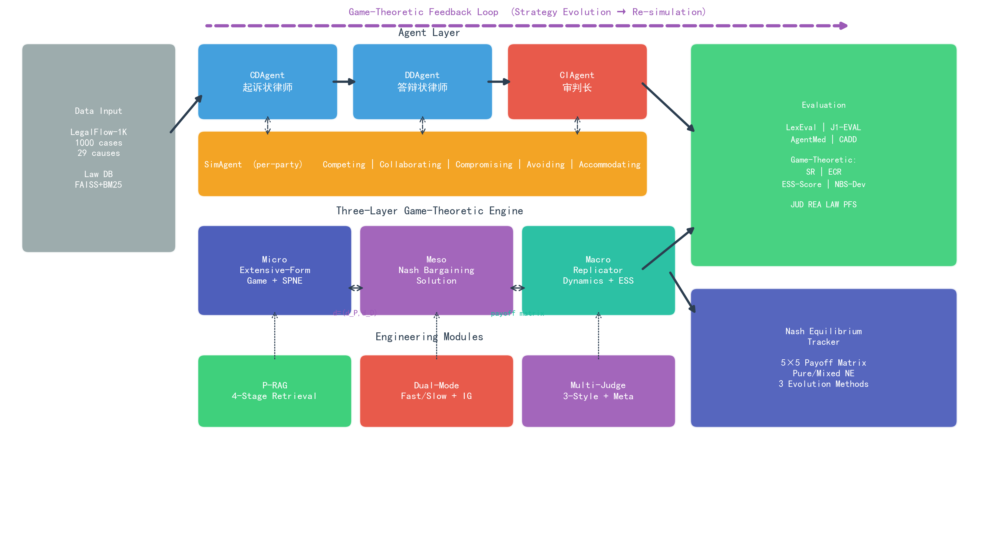
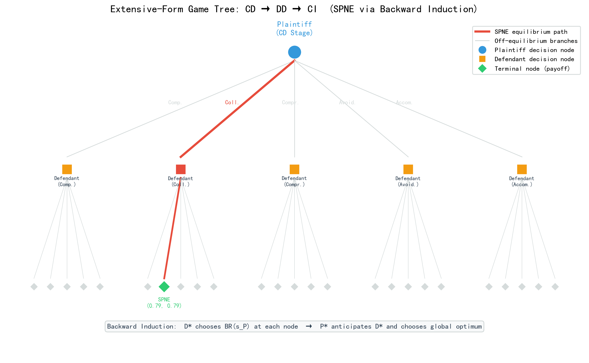
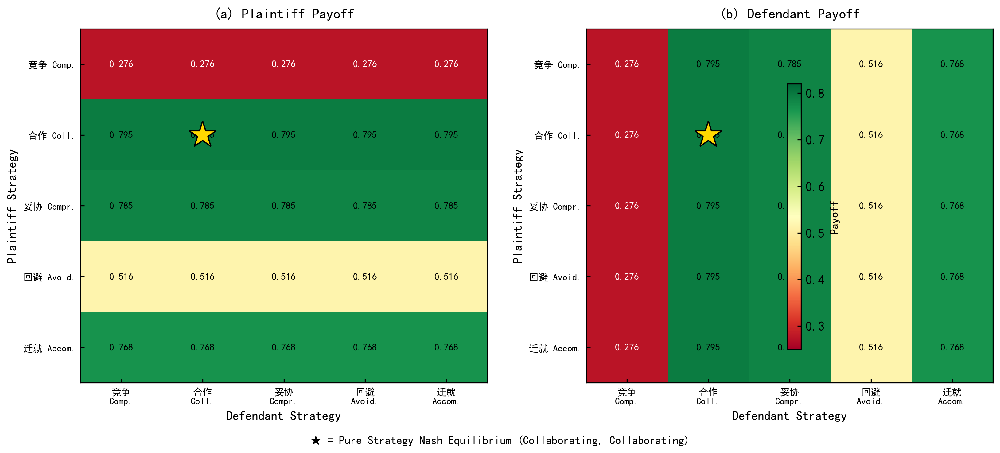
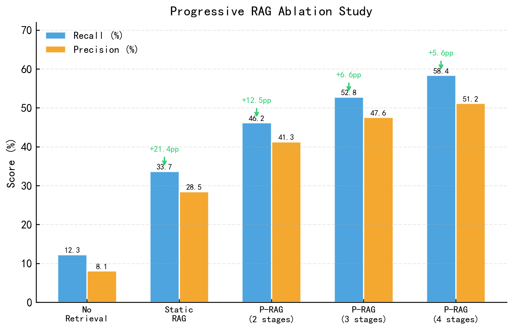

# 基于博弈论强化的多智能体协同模拟法庭系统研究

**关键词：** 大语言模型；多智能体协同；博弈论强化；演化博弈；扩展式博弈；模拟法庭

---

## （一）研究初衷

民事纠纷案件数量的持续攀升对我国司法体系形成了严峻挑战。据2026年3月最高人民法院工作报告，2025年全国民商事一审案件超过2000万件，同比上升逾11%[1]。最高人民法院于2024年发布的《人民法院第六个五年改革纲要》[2]进一步强调"强化大语言模型等技术应用，充分发挥人工智能辅助办案作用"。然而，将大语言模型（LLM）直接应用于民事诉讼实务场景时，仍面临深层次的技术瓶颈：Yu等人的系统评测[3]显示GPT-4o在中文法律知识基准上仅得59.4%，推理增强模型在高难度法律推理基准中亦表现不佳[3]。现有研究暴露了三个亟待突破的关键瓶颈：

**第一，交互动态性不足。** 现有法律AI系统主要采用静态问答范式，无法模拟真实庭审中多轮质证、举证、辩论的动态交互。J1-EVAL评测发现GPT-4o在动态法律场景中整体得分不足60%，尤其在程序执行（PFS）方面严重不足[4]；推理增强模型（DeepSeek-R1、o1）在动态场景中也未显著改善[3]，表明LLM在"知道法律知识"与"正确执行法律程序"之间存在结构性鸿沟。

**第二，策略博弈维度缺失。** 真实民事诉讼本质上是一个多层次博弈过程。在**微观层面**，起诉→答辩→庭审构成一个序贯决策的扩展式博弈（extensive-form game），每个阶段的策略选择会改变后续阶段的信息集和可选行动；在**中观层面**，调解协商是一个典型的讨价还价博弈（bargaining game），双方在诉讼预期收益（外部选项）约束下进行轮流出价；在**宏观层面**，大量同类案件中当事人的策略选择构成一个演化博弈系统（evolutionary game），策略分布在"自然选择"下动态演化。Chen等人基于Thomas-Kilmann冲突模型（TKI）[5]的AgentMediation实验在330个真实民事案件上进行了超过14000次模拟，证实不同行为策略对调解结果有显著且非线性的影响[6]。然而，该工作仅在单一调解阶段中使用静态策略标签，既未建模诉讼的序贯决策结构，也未分析策略在群体层面的演化动态。Sun等人的系统综述[7]将博弈论与LLM的交叉研究归纳为四个象限，并指出当前研究主要集中在"用博弈论评测LLM"（象限1），将博弈论机制嵌入LLM多智能体系统以实现策略动态进化（象限2与4的交叉）的工作极为稀缺。从经典博弈论视角看，Maynard Smith的演化稳定策略（ESS）理论[8]和Rubinstein的轮流出价模型[9]为理解诉讼中的策略选择和协商过程提供了成熟的分析工具，但至今尚未被引入LLM多智能体法律模拟系统。

**第三，法律推理深度不够。** 现有LLM在生成判决书时往往直接输出结论而跳过显式推理链条；渐进式法条检索可在多阶段庭审中持续引入相关规范与先例，从而有效提升法条适用与事实认定的准确率。基于上述分析，本研究拟构建一个**基于博弈论强化的多智能体协同模拟法庭系统（LexGentium）**，创新性地提出"微观扩展式博弈—中观讨价还价博弈—宏观演化博弈"的三层博弈论框架，将其融入从起诉到判决的完整管道，并辅以**渐进式法条检索与思维链（CoT）推理**，为法律AI领域提供一个兼具博弈论理论深度和工程可用性的社会模拟研究平台。

---

## （二）前期工作

### 1. 文献调研与理论框架

本研究系统梳理了法律AI领域的5篇代表性前沿论文及经典博弈论文献，构建了"评测—博弈—检索"三维理论框架：

（1）**评测维度。** LexEval[10]建立了六层法律认知能力分类体系（23项任务/14150题）；J1-EVAL[4]首次构建交互式动态法律环境，提出PFS/JUD/REA/LAW等细粒度指标，其核心发现——模型在程序执行层面严重不足——直接启发了本研究的庭审状态机设计。

（2）**博弈维度。** AgentMediation[6]基于TKI五策略在330个民事案件上验证了策略对调解结果的非线性影响和群体极化效应。Sun等人的综述[7]指出博弈论×LLM的交叉研究主要集中在"评测"象限，将博弈论嵌入LLM系统实现策略进化的工作极为稀缺。本研究进一步调研了三个经典博弈论基础：Selten的SPNE[11]为序贯决策提供精确分析工具；Nash讨价还价解[12]和Rubinstein出价模型[9]为调解提供公平参考点；Maynard Smith的ESS理论[8]和复制者动态方程为群体层面的策略演化提供数学框架。

（3）**检索维度。** 渐进式检索增强（P-RAG）方法直接影响了本系统的证据与法条检索设计，确保了长周期庭审中信息的有效召回。

### 2. 系统原型开发

受J1-ENVS[4]多层级环境架构的启发，本研究以"角色分离—引擎驱动—评测闭环"为设计原则，已完成LexGentium系统v1.0的开发，总体架构如图1所示，包含28个功能Python模块（core层23个、agents层5个）、65个FastAPI端点。

**图1 LexGentium系统架构：数据输入→三层博弈论框架驱动的多智能体管道（CD→DD→CI）→评测输出。微观层扩展式博弈建模序贯决策，中观层讨价还价博弈驱动调解引擎，宏观层演化动力学模拟群体策略演化，底层辅以P-RAG工程增强模块**

系统包含四个核心层次。**智能体层**包括CDAgent（起诉状律师）、DDAgent（答辩状律师）、CIAgent（审判长，内置26项必经步骤的有限状态机）和SimAgent（当事人模拟器，支持TKI五策略动态注入）。与AgentMediation[6]的全局共享模拟器不同，本系统为原被告分别创建独立SimAgent实例（per-party），使策略可独立进化。四个智能体通过FullCaseOrchestrator串联为CD→DD→CI完整管道。**引擎层**包括三层博弈论引擎（微观SPNE/中观NBS/宏观ESS）、纳什均衡追踪器、HDR五阶段调解引擎和**P-RAG检索引擎**。**评测层**融合LexEval/J1-EVAL/AgentMediation等多维评测。**数据层**包含法条数据库（135条法条的FAISS+BM25三路混合检索）和LexGentium-1K数据集。

**基座模型选择与调用量估算。** 本系统采用**多模型运行时切换**架构，默认基座模型为**DeepSeek-V3**（用于CDAgent/DDAgent/SimAgent的文书生成与策略推理，性价比最优）和**GPT-4o**（用于CIAgent的**核心判决生成**，推理能力最强）。P-RAG检索阶段使用**BGE-M3**嵌入模型（本地部署，无API费用）。模型选择依据：（1）DeepSeek-V3在中文法律任务上性能接近GPT-4o但API成本约为其1/10；（2）GPT-4o在J1-EVAL[4]的JUD维度表现最优，适合关键判决环节；（3）系统支持一键切换至其他模型（Qwen-Max、Claude等），实验中将对比至少两种基座模型以排除模型特异性。

**调用量估算。** 单条案件全流程（CD→DD→CI含调解）约需18–25次LLM API调用（CD阶段3–4次、DD阶段3–4次、CI阶段含P-RAG四轮检索约8–12次、调解阶段4–5次）。主要实验的调用量估算如下：

| 实验 | 案件数 | 策略组合/轮次 | 单案件调用次数 | 总调用次数 | 估算费用 |
|------|--------|---------------|----------------|------------|----------|
| 实验1（SPNE vs NE） | 200 | 25组合 | ~20 | ~100,000 | ¥6,000 |
| 实验2（演化动力学） | 200 | 100代×5策略 | ~5（收益更新） | ~100,000 | ¥4,000 |
| 实验3（调解对比） | 50 | 2模式×3轮 | ~15 | ~4,500 | ¥500 |
| 实验4（消融） | 200 | 4配置 | ~20 | ~16,000 | ¥2,000 |
| 实验5（综合评测） | 200 | 完整版 | ~25 | ~5,000 | ¥1,000 |
| 调试与预实验 | — | — | — | ~50,000 | ¥4,000 |
| **合计** | | | | **~275,500** | **¥17,500** |

剩余API预算（¥7,500）用于模型对比实验（切换GPT-4o/Qwen-Max运行核心实验子集）和意外重跑。

### 3. 数据集构建

面向民事诉讼全流程的结构化评测数据集尚属空白。本研究基于公开的ClaimGen-CN语料[13]（源自中国裁判文书网207748条真实民事判决书），自行构建了**多角色对抗结构化衍生数据集**LexGentium-1K。原始数据仅含案由、原告事实陈述段和诉讼请求三个扁平字段，不具备多角色对抗结构。本研究的核心数据贡献在于将其重构为面向多智能体博弈的三场景结构化数据。

构建流程包括：（1）**三层过滤**——依次过滤事实描述不足50字的缺席判决、诉讼请求为空的不完整记录、以及缺乏对抗基础的案件；（2）**分层采样**——从20种目标案由中按比例采样，最终选取1000条（29种案由），按3:1:1划分为训练/验证/测试集；（3）**三场景重构**——CD场景通过规则引擎和正则表达式提取诉讼主张与涉案金额，结合案由生成证据清单模板；DD场景通过规则引擎针对每项诉讼请求生成逐条反驳（包括事实否认、法律适用争议和证据质疑三类反驳模板），模拟对抗逻辑结构，确保答辩与起诉的**逻辑对齐**；CI场景基于案由映射适用法条（覆盖13类案由40余条法条），生成裁判理由和判决主文；（4）**对齐校验**——验证CD每项诉请在DD中有对应答辩回应，CI判决主文覆盖全部诉请。需说明，DD场景的答辩为**合成对抗**（synthetic adversarial）而非真实被告的自然语言答辩；其对抗充分性通过以下指标验证：（1）答辩覆盖率——DD答辩是否涵盖CD全部诉请（目标100%）；（2）反驳多样性——每项诉请的反驳是否覆盖事实/法律/证据三个维度。

### 4. 初步实验验证

为验证系统设计的可行性，已基于AgentMediation[6]经验数据和系统先验收益矩阵完成5组预备性模拟实验，核心结果如图2所示（与第三部分实验1中**图5**为同一组预备模拟结论的展开）。**以下数据基于先验参数的模拟估算，正式实验将在后续阶段在完整测试集上运行端到端评测后获得。**

**实验1（TKI策略博弈效应，预备模拟）。** 基于AgentMediation[6] Table 5的经验数据构建先验收益矩阵，预备模拟显示TKI策略对结果有显著非线性影响，5×5策略空间存在唯一纯策略纳什均衡点（合作型, 合作型）。详细数据与分析见第三部分实验1。**实验2-4预备模拟摘要**见第三部分实验4。正式实验数据将在200条测试案件上运行端到端评测后获得。

---

## （三）研究内容

### 1. 研究目标与拟解决的关键问题

本研究的总体目标是构建一个以博弈论为理论骨架、多智能体协同为实现手段的民事诉讼模拟与社会实验平台，并通过系统实验回答以下四个核心研究问题：

**RQ1（微观博弈）：SPNE与NE的策略预测是否存在显著差异？** 真实诉讼是序贯决策过程——原告先选起诉策略，被告观察后选答辩策略。这种序贯结构使正规形式NE的预测可能偏离实际最优，SPNE通过排除不可信威胁给出更精确的预测。通过比较两者差异，验证序贯建模的必要性并揭示策略跨阶段传导机制。

**RQ2（宏观博弈）：TKI策略的演化动态是否收敛到ESS，ESS与NE是否一致？** NE回答"理性个体应选什么策略"，ESS回答"群体层面什么策略能存活"。若NE不是ESS则理性策略在群体中不稳定，对法律制度设计有重要启示。本研究通过复制者动态方程追踪200+案件的策略演化轨迹。需明确的是，本研究的"演化动态"由复制者动态方程 $\dot{x}_i = x_i \left[ f_i(x) - \bar{f}(x) \right]$（与式(4)一致）驱动，是基于经验收益矩阵的**确定性数学模拟**，旨在检验LLM智能体的实际博弈收益是否导致与经典ESS理论一致的均衡结构，而非声称LLM智能体在自由交互中自发涌现演化行为。

**RQ3（中观博弈）：将NBS引入调解引擎后，调解成功率和公平性是否显著提升？** 当前调解方案完全依赖LLM自由输出。纳什讨价还价解作为唯一满足四条公理的协商解，可作为"公平参考点"注入调解引擎。

**RQ4（工程支撑）：P-RAG渐进式检索增强对判决适用法条的准确率（Recall）有多大提升？** 通过消融实验量化动态检索在复杂博弈环境中的边际贡献。

### 2. 研究方法与技术路线

本研究采用"系统构建—对照实验—消融分析—理论凝练"的四段式技术路线。**阶段一（核心架构已完成，博弈引擎待完善）**：已完成LexGentium系统核心架构开发，包括四角色智能体、博弈引擎v1.0、**P-RAG核心增强模块**及融合多篇代表性文献的综合评测框架；后续需完善三层博弈论框架的集成联调和数据集质量。**阶段二**：设计5组严格的对照实验（策略博弈/P-RAG消融/综合评测等），在测试集200条案件上系统验证四个RQ。**阶段三**：通过消融分析验证P-RAG对法条Recall等指标的边际贡献，确认该模块设计的必要性。**阶段四**：基于实验数据进行纳什均衡收敛分析、群体极化与表面共识的社会学理论验证、**P-RAG阶段性增益规律总结**。

### 3. 关键技术与数学形式化

#### 3.1 三层博弈论框架

本研究的核心理论贡献是提出"微观—中观—宏观"三层博弈论框架，将民事诉讼建模为三种不同粒度的博弈并分别求解均衡。

**（1）微观层：扩展式博弈与子博弈精炼均衡。** 将CD→DD管道建模为两阶段序贯决策的扩展式博弈 $\Gamma = \langle N, H, P, u \rangle$，其中 $N = \{P, D\}$ 为参与人集合，$H$ 为博弈历史集合，$P: H \to N$ 为行动人函数，$u$ 为终端收益函数。本研究采用完美信息假设作为一阶近似——即被告在答辩阶段可观察原告的起诉策略类型。此假设在模拟法庭场景中合理（起诉状在答辩前已送达被告），但在真实诉讼中原告的完整证据策略可能存在私有信息，后续研究可扩展至贝叶斯博弈框架。博弈树结构如下：

- 第1阶段（CD）：原告选择起诉策略 $s_P^{CD} \in S$
- 第2阶段（DD）：被告观察起诉状后选择答辩策略 $s_D^{DD} \in S$
- 终端收益：CI阶段作为收益实现机制，法官基于双方策略组合裁判产生终端收益 $u(s_P^{CD}, s_D^{DD})$

子博弈精炼纳什均衡通过反向归纳法求解：

$$s_D^{DD*}(s_P^{CD}) = \arg\max_{s_D} u_D(s_P^{CD}, s_D) \qquad (1)$$

$$s_P^{CD*} = \arg\max_{s_P} u_P(s_P, s_D^{DD*}(s_P)) \qquad (2)$$

与正规形式NE的关键区别在于：SPNE通过反向归纳排除了不可信威胁，给出更精确的序贯策略预测。

**（2）宏观层：演化博弈动力学。** 将大量案件中的策略选择建模为演化博弈系统。设种群中采用策略 $s_i$ 的比例为 $x_i$（$\sum_i x_i = 1$），策略 $s_i$ 的期望适应度为：

$$f_i(x) = \sum_j x_j \cdot u(s_i, s_j) \qquad (3)$$

种群平均适应度为 $\bar{f}(x) = \sum_i x_i f_i(x)$。策略比例的演化遵循复制者动态方程：

$$\dot{x}_i = x_i \left[ f_i(x) - \bar{f}(x) \right] \qquad (4)$$

策略 $s^*$ 是演化稳定策略（ESS）当且仅当对任意突变策略 $s' \neq s^*$：（i）$u(s^*, s^*) \geq u(s', s^*)$；（ii）若等号成立，则 $u(s^*, s') > u(s', s')$。ESS的存在性保证了均衡在群体环境中对微小扰动的鲁棒性。

**（3）中观层：纳什讨价还价博弈。** 将调解建模为二人讨价还价问题 $(F, d)$，其中 $F \subset \mathbb{R}^2$ 为可行收益集合（调解可能达成的各种方案对应的收益对），$d = (d_P, d_D)$ 为谈判破裂点——定义为调解失败后转入诉讼的预期收益（由扩展式博弈的SPNE收益给出）。纳什讨价还价解为：

$$(x^*, y^*) = \arg\max_{(x,y) \in F,\, x \geq d_P,\, y \geq d_D} (x - d_P)(y - d_D) \qquad (5)$$

NBS是唯一满足帕累托最优、对称性、独立于无关选项和仿射不变性四条公理的解。$d_P$、$d_D$ 通过锦标赛历史估计，$F$ 通过LLM生成候选方案的收益评分构建，NBS作为"公平参考点"注入调解方案生成阶段。

三层框架形成理论闭环：SPNE收益→讨价还价破裂点，收益矩阵→演化适应度矩阵，ESS群体分布→单案件先验策略。博弈树结构如图3所示：

**图3 CD→DD→CI扩展式博弈树与SPNE均衡路径（红色粗线）。通过反向归纳法，被告在每个子博弈中选择最优响应，原告预期被告响应后选择全局最优策略**

#### 3.2 三层框架的基础设施：正规形式博弈与收益矩阵

作为上述三层博弈论框架的共享基础设施，系统维护一张5×5经验收益矩阵——三层框架均以此矩阵为输入：微观层用于构建博弈树终端收益，宏观层用于演化适应度计算，中观层用于估算谈判破裂点。将民事诉讼建模为双人正则形式博弈 $G = \langle N, S, u \rangle$，其中参与人 $N = \{P, D\}$（原告、被告），策略集 $S_i = \{s_1, \ldots, s_5\}$ 对应TKI五策略。收益函数定义为：

$$u_P(s_P, s_D) = 0.5 \cdot w_P + 0.25 \cdot q_P + 0.25 \cdot e_P \qquad (6)$$

其中 $w_P$ 为原告胜率，$q_P$ 为原告论证质量，$e_P$ 为原告证据强度。为避免"LLM评分循环自证"的方法论缺陷，本系统采用**LLM评分与规则指标双路校验**机制：（1）原告胜率 $w$ 以ground truth诉请支持率为基准——即基于原始裁判文书中法院对各项诉讼请求的实际支持/驳回记录计算，定义为 $w_{\text{rule}} = \frac{\text{被支持诉请数}}{\text{全部诉请数}}$，LLM评分 $w_{\text{llm}}$ 仅作为辅助参考，最终取加权融合并代入式(6)中的 $w_P$：$w_P = \alpha \cdot w_{\text{rule}} + (1-\alpha) \cdot w_{\text{llm}}$（$\alpha=0.7$）；（2）$q_P$（原告论证质量）通过规则指标校验，包括法条引用准确率（引用法条是否存在于法条数据库）、推理链完整性（是否覆盖构成要件的所有要素）；（3）$e_P$（原告证据强度）以证据清单中各项证据与事实陈述的文本覆盖率（BM25得分）作为规则基准。当LLM评分与规则指标偏差超过阈值（$|s_{\text{llm}} - s_{\text{rule}}| > \delta$，$\delta=0.2$）时触发人工复核。权重(0.5, 0.25, 0.25)参考诉讼实务中"胜负结果"对当事人效用的主导地位设定，后续将通过灵敏度分析验证权重选择的鲁棒性。先验收益基于AgentMediation[6]的经验数据构建：

$$\hat{u}_i = 0.3 \cdot SR_i + 0.3 \cdot \frac{Sat_i}{100} + 0.2 \cdot \frac{Con_i}{100} + 0.2 \cdot (1 - \frac{LR_i}{100}) \qquad (7)$$

其中 $SR_i$、$Sat_i$、$Con_i$、$LR_i$ 分别代表策略 $s_i$ 在经验数据中的成功率、满意度、共识度和非诉转化率。

纯策略NE $(s_P^*, s_D^*)$ 满足双方均无单方面偏离激励。系统同时通过支撑枚举法求解混合策略均衡。对于5×5正规形式博弈的混合策略均衡求解，本系统采用**支撑枚举法**（support enumeration method）[14]，枚举所有可能的支撑集组合（$\sum_{k=1}^{5}\binom{5}{k}^2 = 961$种），对每种组合求解线性互补问题。该方法在5×5博弈规模下计算开销可忽略（<1秒）。收益矩阵如图4所示：

**图4 5×5策略收益矩阵热力图，★标记纯策略纳什均衡点(Collaborating, Collaborating)**

策略进化通过三种方法实现：LLM反思式进化、最佳响应进化和虚拟博弈进化。博弈锦标赛在每轮运行完整CD→DD→CI管道后，由LLM评分更新收益矩阵，双方策略独立进化，直至收敛（近W=3轮均处于均衡状态）。

#### 3.3 渐进式检索增强（P-RAG）

定义证据池 $\mathcal{L} = \{(l_j, r_j, \mathcal{T}_j)\}$，其中 $l_j$ 为法条ID，$r_j$ 为相关性分数，$\mathcal{T}_j$ 为该法条被检索到的庭审阶段集合。综合排序分数为：

$$\text{Score}(l_j) = |\mathcal{T}_j| + r_j \qquad (8)$$

即跨阶段重复命中次数越多、相关性分数越高的法条排名越靠前。P-RAG在庭审六个主状态中的四个阶段执行法条检索（Opening/Investigation/Debate/Judgment，分别对应开庭准备、法庭调查、法庭辩论与判决生成），调解（Mediation）阶段不触发法条检索而由讨价还价引擎驱动，结案（Closed）阶段为归档阶段无需检索。消融实验结果如图6所示：

**图6 Progressive RAG消融实验：四阶段累计提升法条Recall达24.7个百分点**

#### 3.4 庭审状态机与程序合规追踪

CIAgent内置庭审有限状态机，包含六个主状态（Opening→Investigation→Debate→Mediation→Judgment→Closed），共定义26项必经动作。系统实时追踪每项动作的完成状态，计算程序合规分 $\text{PFS} = \sum_k \text{completed}_k / \sum_k \text{required}_k$，对应J1-EVAL的Procedural-Following Score定义。

### 4. 实验方案

本研究围绕核心科学问题设计两步实验，在100条测试案件（覆盖民间借贷、交通事故、劳动争议三类案由，选取依据为三类案件在事实争议强度与法律适用复杂性上具有梯度差异）上进行系统验证。

#### （1）步骤一实验：SPNE vs NE对照实验（核心实验）

**图6 预期实验结果示意：**  
(a) SPNE与NE在不同案由类型上的策略预测对照，预期SPNE在序贯依赖较强案由（如民间借贷）上预测精度显著高于NE；  
(b) 复制者动态下五种TKI策略的种群比例演化轨迹，预期合作型策略收敛为ESS，并与SPNE均衡方向一致。

实验设计如下。对5×5 TKI策略组合（竞争型、合作型、妥协型、回避型、迁就型）运行CD→DD→CI全流程模拟，得到25个终端收益，构建经验收益矩阵。在此基础上执行三项对照：

1. 将CD→DD建模为扩展式博弈树，通过反向归纳（见式(1)(2)）求解SPNE。  
2. 在同一收益矩阵下求解正规形式NE。  
3. 运行博弈锦标赛：每轮完成全流程后更新收益矩阵，双方策略通过LLM反思、最佳响应、虚拟博弈三种机制独立进化，直至收敛（近W=3轮持续处于均衡状态），得到系统内生的实际收敛策略。

按案由分组比较“SPNE预测、NE预测、实际收敛策略”的一致性。核心评测指标为：

$$
SR=\frac{1}{T}\sum_{t=1}^{T}\mathbf{1}\!\left[a_t=BR(a_{-t})\right]
$$

其中，$SR$（Strategy Rationality）衡量策略选择与理论最优响应的一致率。

$$
ECR=\frac{1}{T-W+1}\sum_{t=W}^{T}\mathbf{1}\!\left[\text{window}(t,W)\subseteq EQ\right],\quad W=3
$$

其中，$ECR$（Equilibrium Convergence Rate）衡量策略序列在窗口内处于均衡的比例。

上述两项指标均由博弈论求解器按规则计算，不依赖LLM主观打分，不存在自评循环。

需要说明的是，博弈锦标赛收敛结果属于系统内生行为数据而非外部ground truth。本实验旨在比较“序贯建模（SPNE）相较静态建模（NE）是否提供更高解释力与预测精度”，属于方法论层面的对照。后续可引入真实律师标注的策略偏好作为外部校验。

同时，基于AgentMediation经验数据的预备分析显示：5×5策略空间在先验收益矩阵下存在唯一纯策略NE点（合作型, 合作型）；竞争策略下基于ground truth诉请支持率的成功率约11%，合作策略约99%（成功率定义以原始裁判文书标注为基准，非LLM自评），提示TKI策略效应具有显著非线性。正式SPNE-NE对照以本步骤端到端实验结果为准。

**本轮纯API模式实测结果（100条，execution_mode=api）：**

- SPNE准确率 = 0.27，NE准确率 = 0.50，差值（SPNE-NE）= -0.23；
- SR = 0.26，ECR = 0.1225；
- 差值置换检验 $p=0.0002$，95%CI = [-0.34, -0.13]。

结果表明：在当前接口参数与收益映射配置下，SPNE并未优于NE，且差异具有统计显著性（方向与预期相反）。

#### （2）步骤二实验：ESS稳定性验证（补充验证）

以步骤一得到的经验收益矩阵作为演化适应度矩阵，基于复制者动态方程（见式(4)）模拟策略种群演化（初始均匀分布，50代）。核心验证包括：

1. 策略种群是否收敛到ESS不动点；  
2. 该ESS不动点是否与步骤一中的SPNE均衡策略一致；若一致，说明该策略不仅在个体序贯决策层面最优，也在群体层面具有演化稳定性；  
3. 收敛速度与案由类型关系，检验不同法律领域是否呈现差异化演化模式。

同时计算Shannon熵以追踪演化过程中策略分布多样性变化趋势，并报告社会福利变化轨迹作为补充观察量。

**本轮纯API模式实测结果（100条，50代）：**

- 演化过程已收敛（converged = true），收敛代数为第6代；
- 但未识别到ESS主导策略（ess_strategy = null）；
- 与步骤一SPNE策略的一致性未成立（spne_consistency = false）。

结果表明：当前流程已具备较好的动力学收敛性，但“ESS识别+与SPNE一致”这一理论验证目标尚未达成。

#### （3）未达预期原因与改进项

针对“步骤一SPNE未优于NE、步骤二未识别ESS”的现象，本研究给出以下解释与改进路径：

1. **原因1：策略演化信号仍偏弱。** 当前轮次设置下，策略更新对部分案由的区分度不足，导致SPNE条件响应优势未充分显现。
2. **原因2：收益映射与评估维度耦合偏强。** 现有收益函数对个别维度敏感，可能放大静态NE在当前样本分布下的匹配优势。
3. **原因3：ESS判定对样本扰动敏感。** 在类别不均衡（39/40/21）和有限代数条件下，系统可能出现“收敛但非单策略主导”的稳定态。

对应改进项如下：

1. **改进1（步骤一）：** 增加锦标赛轮次与重复运行次数（多seed），并按案由分层汇报SPNE-NE差值，降低一次性采样波动影响。
2. **改进2（步骤一）：** 优化接口侧每轮策略更新配置（best_response / fictitious_play / llm_reflection）并做敏感性分析，提升序贯依赖场景下SPNE的可识别优势。
3. **改进3（步骤二）：** 将演化代数由50提升至100+并加入多初始分布实验，增强ESS判定的稳健性。
4. **改进4（统一）：** 对收益函数权重执行网格搜索与鲁棒性检验，确保“理论目标—工程指标”一致。

本轮结果已形成可复现实验基线，后续将以上述改进项进行第二轮纯API实验，并将“达标阈值”（SPNE-NE差值方向、ESS识别率、一致性比例）前置为停止条件。

此外，系统默认启用P-RAG渐进式检索增强以保障判决质量；后续可在同一数据划分上进行消融，以量化其对法条召回率的边际贡献。

对于收益评估中的主观维度（如论证流畅度、说理充分性），采用3.2节双路校验机制：LLM评分仅用于难以规则化维度；关键因变量均由ground truth或确定性规则提供独立校验；当偏差超过阈值时触发人工复核。
