# 第 4 项 · 功能展示与说明材料

比赛交付项：具有代表性的应用案例、输入输出、关键运行日志、失败案例、适用边界，以及对准确性、稳定性、效率或者其他效果主张的说明和依据。

性质：对外说明底稿。**不是**正式研究包验收、**不是**已复核标注、**不是**法律裁决、**不是** VRM 成片说明。不替代 [`mock_court_system/docs/SYSTEM_STATUS.md`](../../../mock_court_system/docs/SYSTEM_STATUS.md) 与根目录 [`AGENTS.md`](../../../AGENTS.md)。

盘点日：2026-09-18。证据日期以各节引用为准。现网图是当日对本机 `127.0.0.1:3001` 截的（产品 **1.0.0**）。配色为 **卷宗** 浅色，1440 宽整页（长页含页脚）。

**正式研究包 = 0。15 份案例标注均未独立复核。观庭是程序化占位，非正式 VRM。**

---

## 1. 封面口径

后面每张图、每张案例卡都顺着这 5 句。不要改写成「已标完」「已裁决」或「正式模型已上」。

1. 产品 **`1.0.0`**（正式发布）。品牌「法序智演 LexGentium」。系统名称 **国际商事仲裁研究平台**。
2. 主路径是开庭 / 观庭 / 复盘，共用一个 `session_id`。场景：申请准备（CD）、答辩准备（DD）、仲裁听证（CI）。另有研究工作台（`/research`）与研究量表。
3. 无 session 时观庭播 `scripted_demo`（9 段人工结构样例）。有 session 才挂本场。角色是程序化坐姿人偶，非正式 VRM / GLB。
4. `data/research_packs/` 里两个 SAMPLE 是技术夹具，**不算**正式研究案。`法学材料/案例材料/` 的 15 份标注全部没有完成独立复核；案例 25 自注为 AI 辅助初标，不得当已复核数据。
5. 登录 / 开通是软解锁（测通或写入 LLM 配置），不是用户账号表。未知事实保持 unknown，材料不足用 `admit_insufficient` 停，禁止补造。

仓库现状：民事 `dataset_1000` 只有 meta + 100 条摘要，**没有** train/val/test jsonl。研究论证轮次上限：纽约执行 12、CISG 第 79 条 10（只计原被告发言）。

---

## 2. 截图目录与功能说明

每张图 4 行：图题、干什么、按哪个键（界面原文）、不能读成什么。22 张图与本文同夹，来源见 [截图来源.md](截图来源.md)。

### 2.1 现在先配：产品主路径

#### 图 01 · 首页

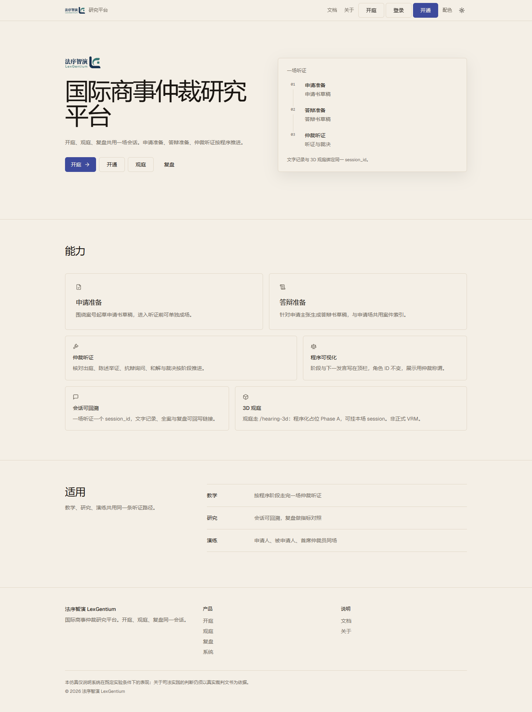

| 行 | 写 |
| --- | --- |
| 图题 | 营销首页。页题「国际商事仲裁研究平台」。顶栏 Logo +「研究平台」。 |
| 干什么 | 说明开庭、观庭、复盘共用一场会话；申请 / 答辩 / 听证按程序推进。 |
| 按什么 | `开庭` / `开通` / `观庭` / `复盘`。 |
| 别读错 | 这不是已开庭、不是已裁决。能力栅格写的是产品路径，不是评测分数。 |

#### 图 02 · 登录

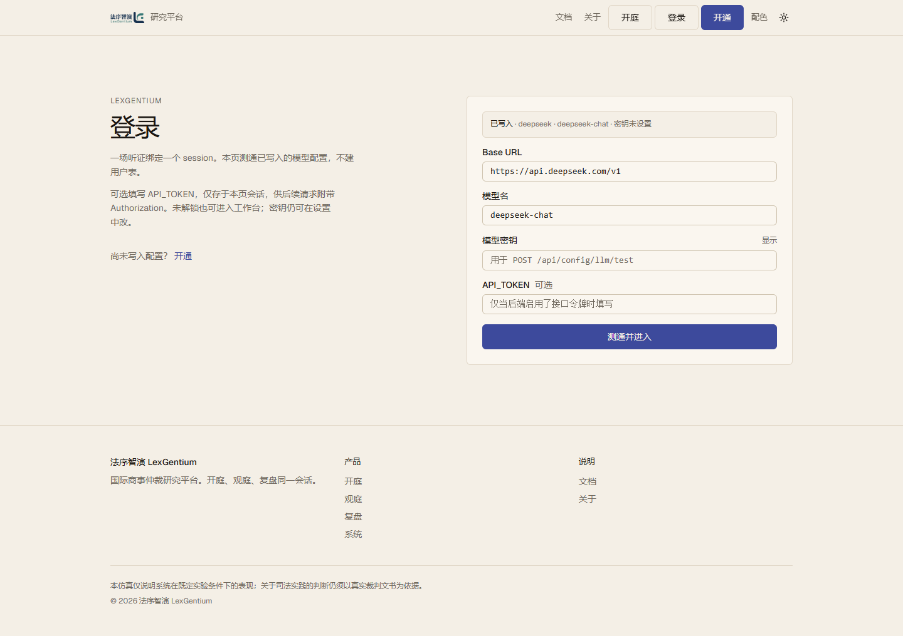

| 行 | 写 |
| --- | --- |
| 图题 | 登录。页上写：测通已写入的模型配置，不建用户表。 |
| 干什么 | 填 Base URL、模型名、密钥，可选 `API_TOKEN`。未解锁也可进工作台。 |
| 按什么 | `测通并进入`。尚未写入配置则走 `开通`。 |
| 别读错 | 这不是云账号登录，也不是服务商控制台。测通成功 ≠ 本场已开庭。 |

#### 图 03 · 开庭

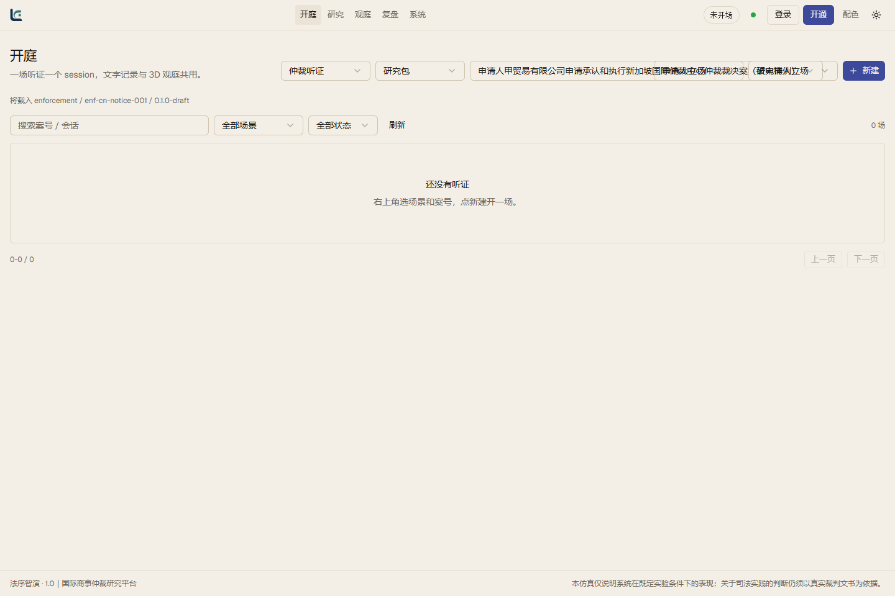

| 行 | 写 |
| --- | --- |
| 图题 | 开庭工作台。顶栏：开庭 / 研究 / 观庭 / 复盘 / 系统。会话芯片「未开场」。 |
| 干什么 | 选场景和案号（或研究包）开一场。文字记录与 3D 观庭共用 `session_id`。 |
| 按什么 | 场景下拉（默认「仲裁听证」）→ 研究包 / 案号 → `新建`。列表可 `刷新`。 |
| 别读错 | 图上 0 场。可选中 SAMPLE（`enf-cn-notice-001` / `0.1.0-draft`）不等于正式研究包。无包时 `新建` 为灰。 |

#### 图 04 · 观庭

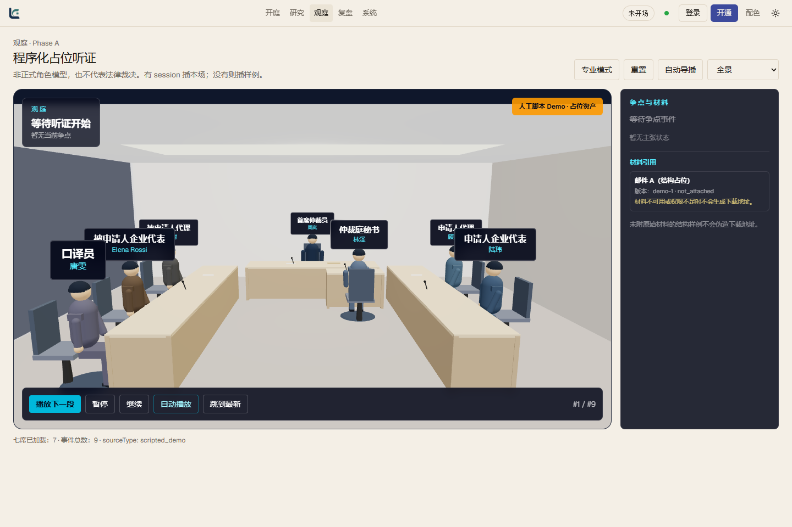

| 行 | 写 |
| --- | --- |
| 图题 | `/hearing-3d`。标题「程序化占位听证」、七席人偶、侧栏争点材料、时间轴 `#1 / #9`、页脚 `sourceType: scripted_demo`。 |
| 干什么 | 无 session 播样例；有 session 挂本场。可切镜头、专业模式、自动导播。 |
| 按什么 | `播放下一段` / `暂停` / `继续` / `自动播放` / `跳到最新`；镜头「全景」等。 |
| 别读错 | 非正式角色模型，也不代表法律裁决。页脚 `sourceType: scripted_demo` 时不是后端本场。HUD「后端运行」在 `source_type` 未落到 `scripted_demo` 时可能误显，以页脚为准。 |

#### 图 05 · 复盘

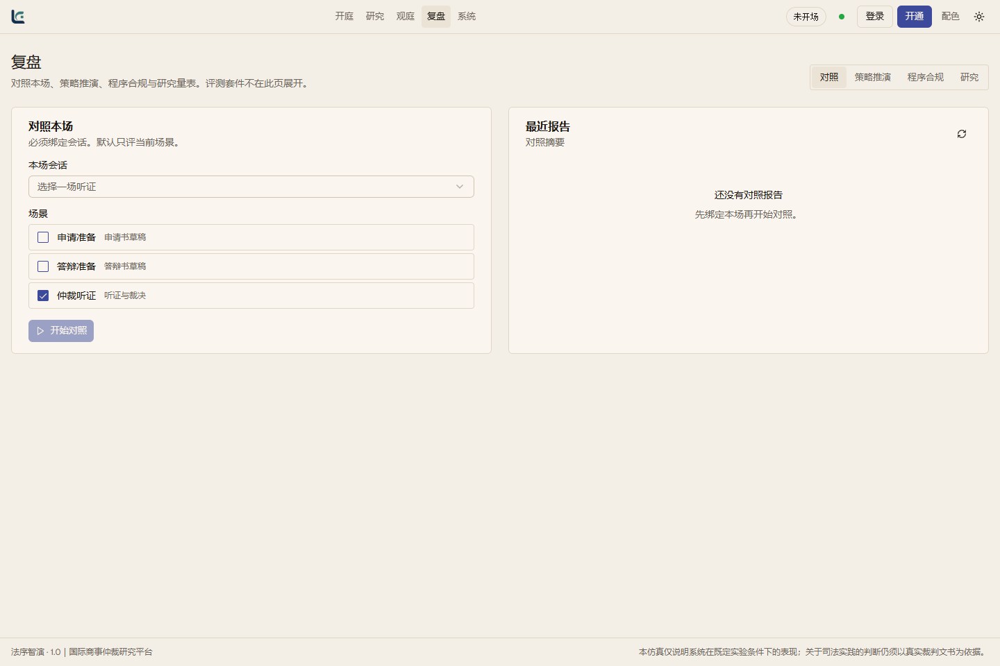

| 行 | 写 |
| --- | --- |
| 图题 | 复盘。四栏：对照 / 策略推演 / 程序合规 / 研究。 |
| 干什么 | 对照本场记录做指标；研究栏走六维量表。评测套件不在此页展开。 |
| 按什么 | 先选一场听证。场景勾选后 `开始对照`。无 session 时对照按钮不可点。 |
| 别读错 | 页能打开 ≠ 已出报告。对照必须绑定会话。 |

### 2.2 有图再配：研究与系统（不当效果证明）

#### 图 06 · 研究

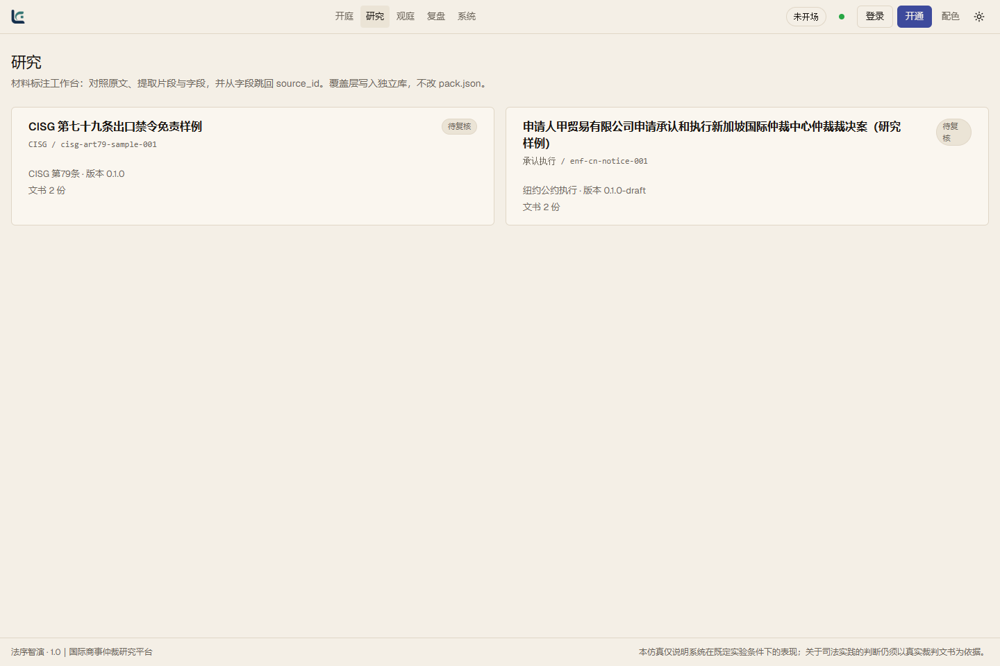

| 行 | 写 |
| --- | --- |
| 图题 | 材料标注工作台。两条 SAMPLE：CISG 第 79 条出口禁令免责样例；承认和执行样例。标签「待复核」。 |
| 干什么 | 对照原文、提取片段与字段，从字段跳回 `source_id`。覆盖层写入独立库，不改 `pack.json`。 |
| 按什么 | 点某一包进入 `/research/packs/[dataset]/[cluster]`。 |
| 别读错 | SAMPLE **不算**正式研究案。正式 pack = 0。待复核 ≠ 已复核。 |

#### 图 07 · 系统

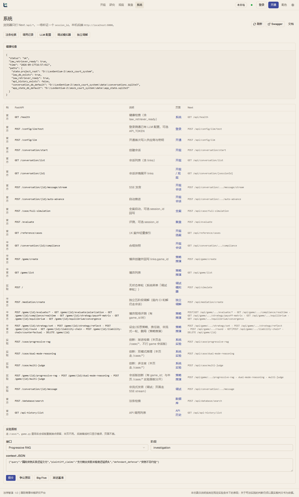

| 行 | 写 |
| --- | --- |
| 图题 | 系统。健康检查 JSON + 入口链（Swagger / 法条 / 调用记录 / LLM / 调试 / 独立调解）。 |
| 干什么 | 看后端是否就绪。浏览器只打 Next `/api/*`。 |
| 按什么 | `刷新`、`Swagger`、各入口钮。 |
| 别读错 | `status=ok` 只说明当时打到的后端活着。本机截图里 `state.project_root` 指向 `D:\LexGentium-2\...`，不要写成 1 号库后端已起。实验区（P-RAG 等）是 LAB，不经听证 SSE。 |

#### 图 08 · 设置

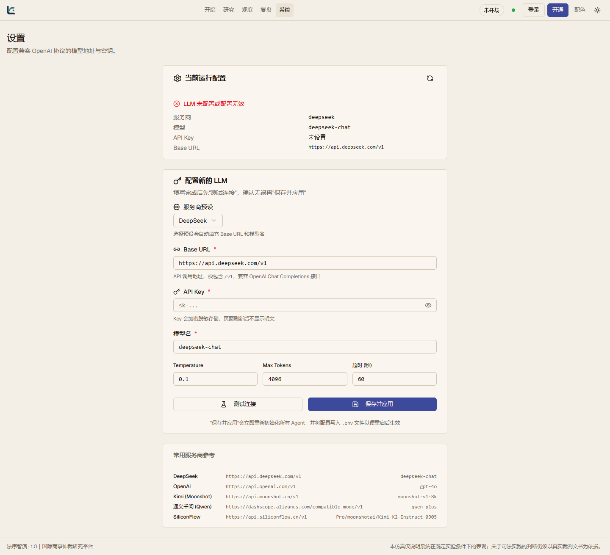

| 行 | 写 |
| --- | --- |
| 图题 | LLM 设置。截图当日横幅：「LLM 未配置或配置无效」。 |
| 干什么 | 配兼容 OpenAI 协议的地址与密钥。`保存并应用` 会重初始化 Agent 并写 `.env`。 |
| 按什么 | `测试连接` / `保存并应用`。 |
| 别读错 | 未设密钥时不能主张「模型已接通」。不要把设置页当评测页。 |

#### 图 09 · 全案

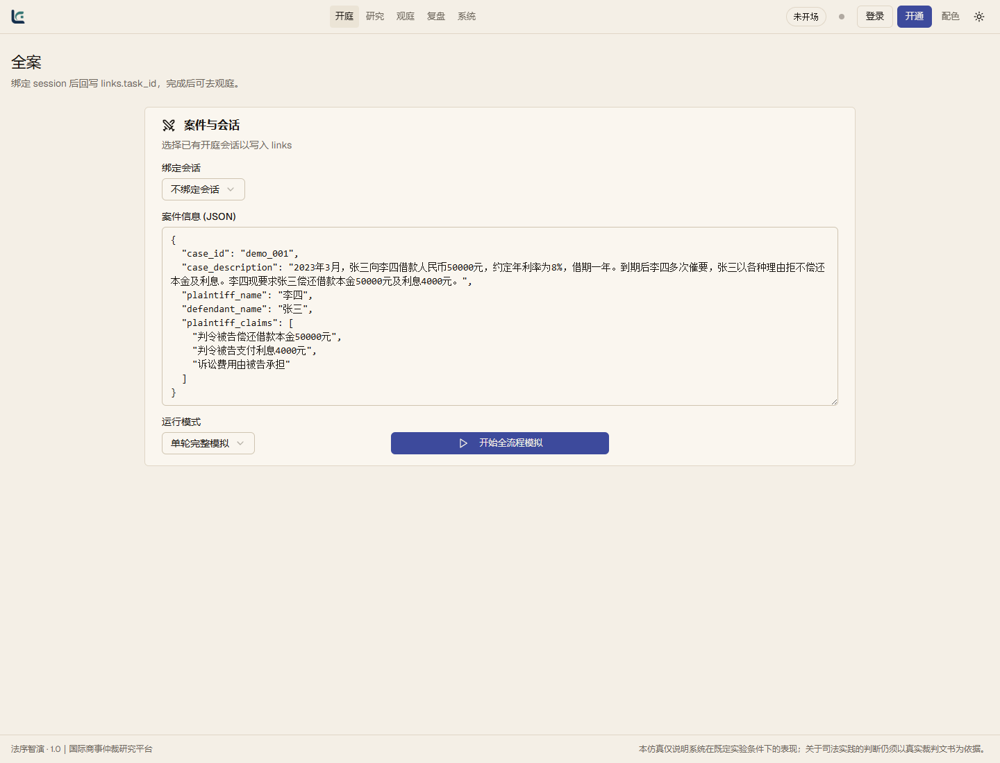

| 行 | 写 |
| --- | --- |
| 图题 | 全案。绑定会话后回写 `links.task_id`。默认 JSON 是 `demo_001` 民事借款。 |
| 干什么 | 一次跑完申请到裁决（受 `CI_MAX_AUTO_TURNS`，默认 30）。 |
| 按什么 | 可选绑定会话；`开始 全流程模拟`。 |
| 别读错 | 默认 `张三/李四` 借款稿不是国际商事仲裁研究案，不要当研究包装进民事训练集。全案能点 ≠ 本场已有文字记录。 |

### 2.3 补图：开通、说明、复盘分栏、研究包、调解与调试

#### 图 10 · 开通

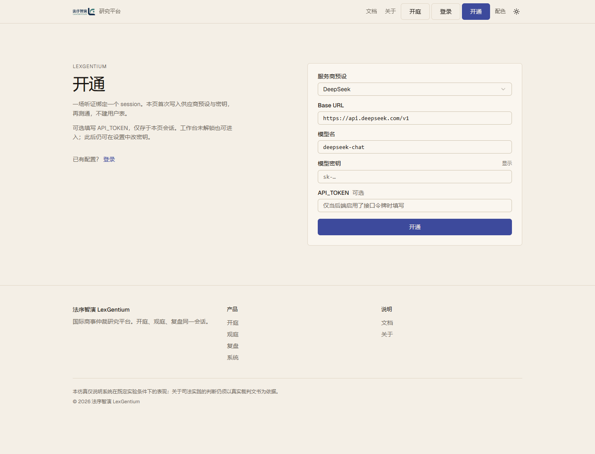

| 行 | 写 |
| --- | --- |
| 图题 | 开通。页上写：首次写入供应商预设与密钥，再测通，不建用户表。 |
| 干什么 | 与登录分工：本页写配置，登录测已有配置。 |
| 按什么 | 选服务商 → 填 Base URL / 模型名 / 密钥 → `开通`。已有配置走 `登录`。 |
| 别读错 | 开通成功 ≠ 本场已开庭。无密钥时开通会失败，图上未提交。 |

#### 图 11 · 文档

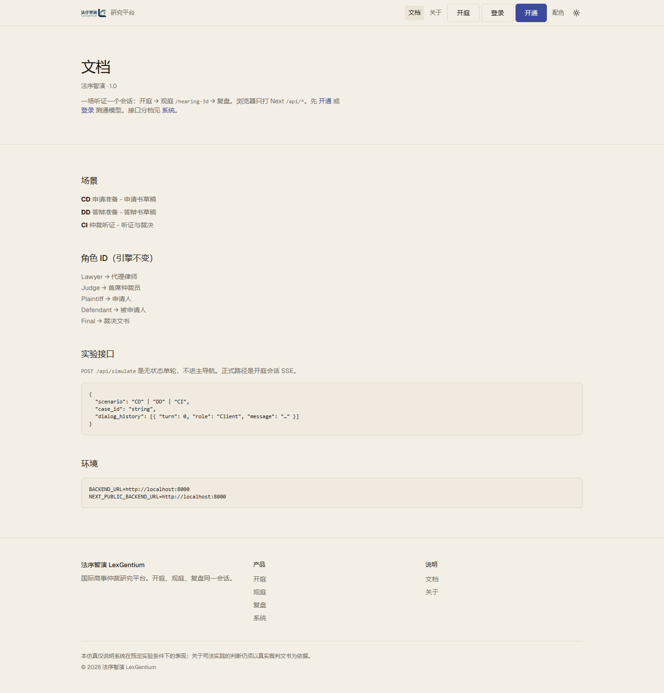

| 行 | 写 |
| --- | --- |
| 图题 | 文档。页标「法序智演 · 1.0」。场景 CD/DD/CI、角色 ID、实验接口、环境变量。 |
| 干什么 | 说明浏览器只打 Next `/api/*`，正式路径是开庭 SSE。 |
| 按什么 | 文内链到 `开通` / `登录` / `系统`。 |
| 别读错 | 文档能打开 ≠ 接口已测通。`POST /api/simulate` 写明是无状态单轮，不进主导航。 |

#### 图 12 · 关于

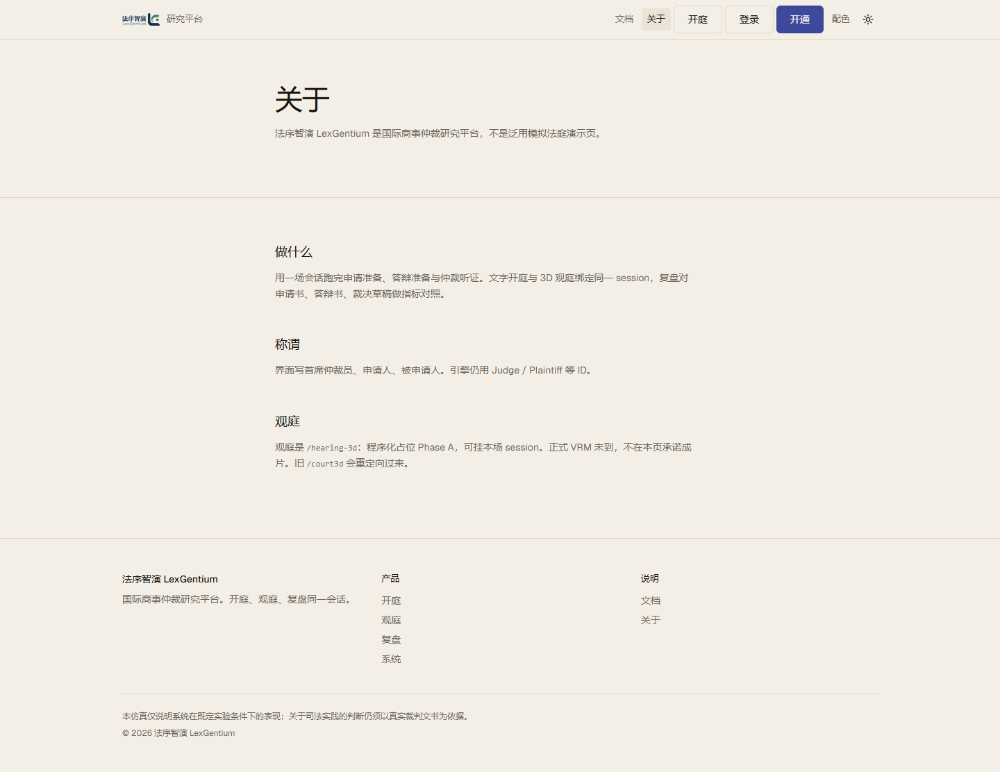

| 行 | 写 |
| --- | --- |
| 图题 | 关于。页上写：国际商事仲裁研究平台，不是泛用模拟法庭演示页。 |
| 干什么 | 交代称谓（界面用仲裁称谓，引擎仍用 Judge / Plaintiff）与观庭边界。 |
| 按什么 | 只读。旧 `/court3d` 重定向到观庭。 |
| 别读错 | 本页承诺不做正式 VRM 成片。 |

#### 图 13 · 独立调解

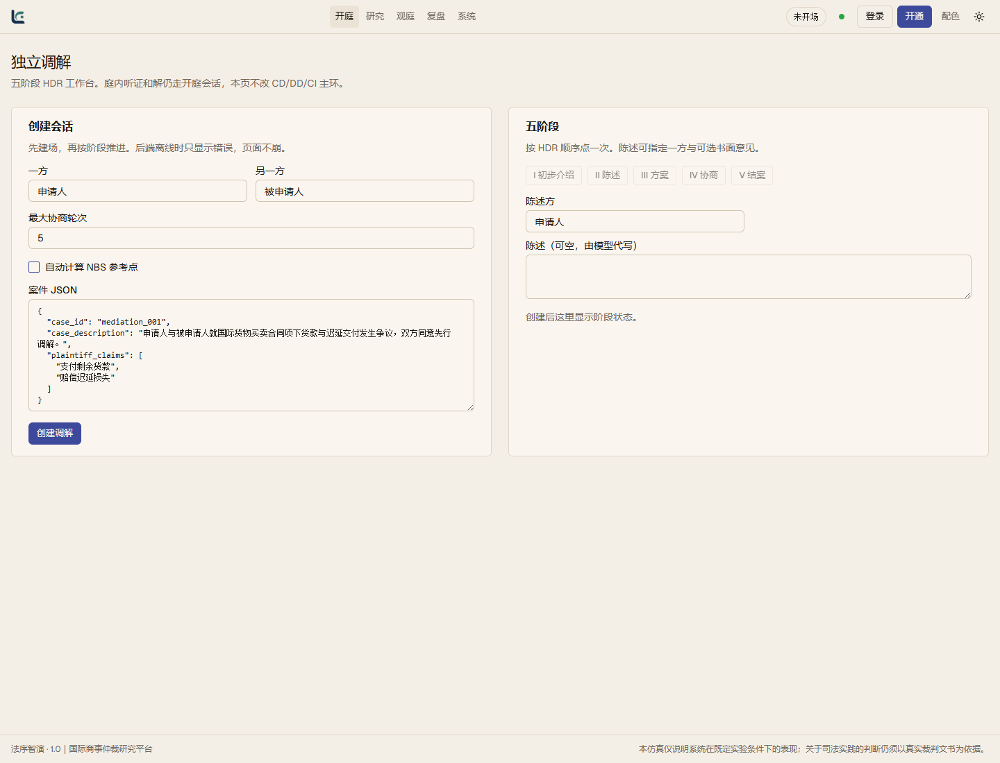

| 行 | 写 |
| --- | --- |
| 图题 | 独立调解。左「创建会话」，右「五阶段」I–V。默认 JSON `mediation_001`。 |
| 干什么 | 五阶段 HDR。庭内和解仍走开庭，本页不改 CD/DD/CI。 |
| 按什么 | `创建调解`；阶段钮在无 session 时不可点。 |
| 别读错 | 能看见五阶段 ≠ 已调解。默认稿不是正式研究案。图上未创建、未跑阶段。 |

#### 图 14 · 研究包标注

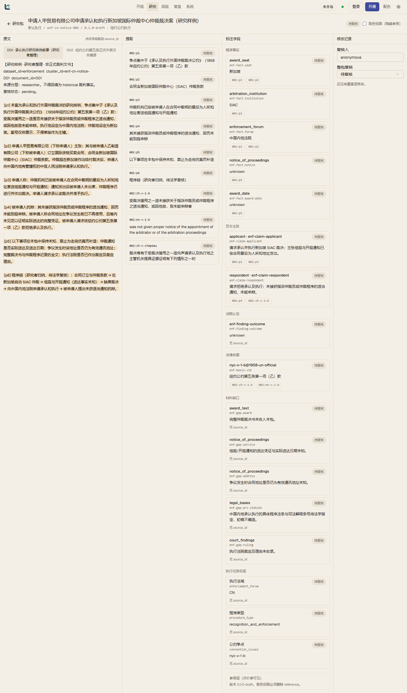

| 行 | 写 |
| --- | --- |
| 图题 | SAMPLE `enforcement / enf-cn-notice-001 / 0.1.0-draft`。左原文，右字段。状态待复核。 |
| 干什么 | 对照原文、改字段、从字段跳回 `source_id`。覆盖层不改 `pack.json`。 |
| 按什么 | 从研究列表点入。可改复核状态、写备注。 |
| 别读错 | SAMPLE **不算**正式研究案。待复核 ≠ 已复核。图上未改字段。 |

#### 图 15 · 策略推演

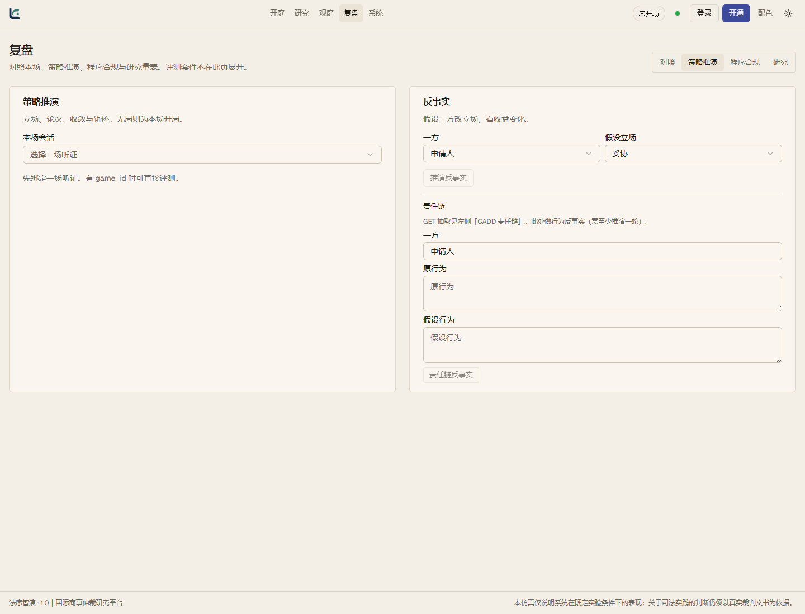

| 行 | 写 |
| --- | --- |
| 图题 | 复盘 · 策略推演。提示「先绑定一场听证。有 game_id 时可直接评测。」 |
| 干什么 | 为本场开策略局；可做反事实 / 责任链（需已开局）。 |
| 按什么 | 先选听证。无场时不能开局。 |
| 别读错 | 栏能打开 ≠ 已推演。图上无 session。 |

#### 图 16 · 程序合规

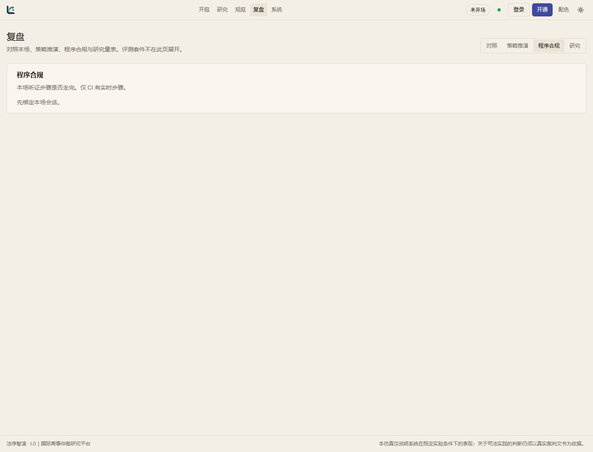

| 行 | 写 |
| --- | --- |
| 图题 | 复盘 · 程序合规。提示「先绑定本场会话。」仅 CI 有实时步骤。 |
| 干什么 | 看本场听证步骤是否走完。 |
| 按什么 | 先绑 CI 会话。 |
| 别读错 | 空态是门禁，不是故障。 |

#### 图 17 · 研究评价

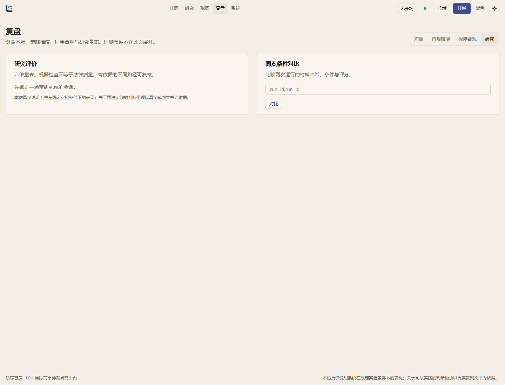

| 行 | 写 |
| --- | --- |
| 图题 | 复盘 · 研究。六维量表入口 + 同案条件对比。提示先绑定带研究包的会话。 |
| 干什么 | 机器检查不等于法律质量。有 `run_id` 才可 `六维打分` / `导出研究包`。 |
| 按什么 | 先从开庭水合 SAMPLE（仍非正式案）再回此栏。 |
| 别读错 | 栏在 ≠ 已打分。正式研究包仍为 0。 |

#### 图 18 · 法条库

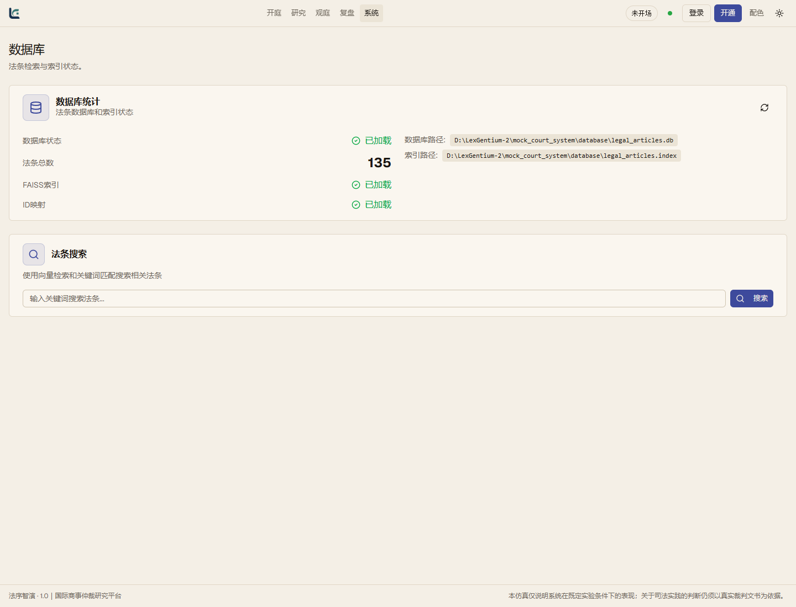

| 行 | 写 |
| --- | --- |
| 图题 | 数据库。统计：法条总数 13500，FAISS / ID 映射显示已加载。 |
| 干什么 | 向量或关键词检索法条。 |
| 按什么 | 输入关键词 → `搜索`。图上未检索。 |
| 别读错 | 路径当时是 `D:\LexGentium-2\mock_court_system\database\...`。不要写成 1 号库自带 13500 条，也不要当评测分数。 |

#### 图 19 · 调用记录

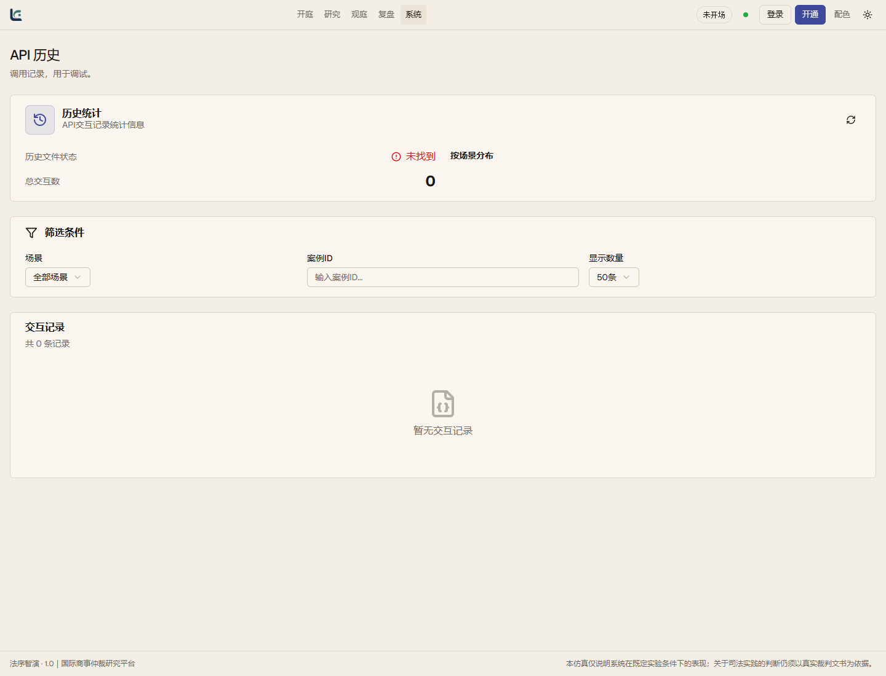

| 行 | 写 |
| --- | --- |
| 图题 | API 历史。历史文件「未找到」，总交互 0，暂无记录。 |
| 干什么 | 调试用调用留痕。 |
| 按什么 | 可按场景 / 案号筛选。无文件时列表为空。 |
| 别读错 | 0 条说明当时没有可展示的调用账本，不是「已跑完全案」。 |

#### 图 20 · 调试模拟器

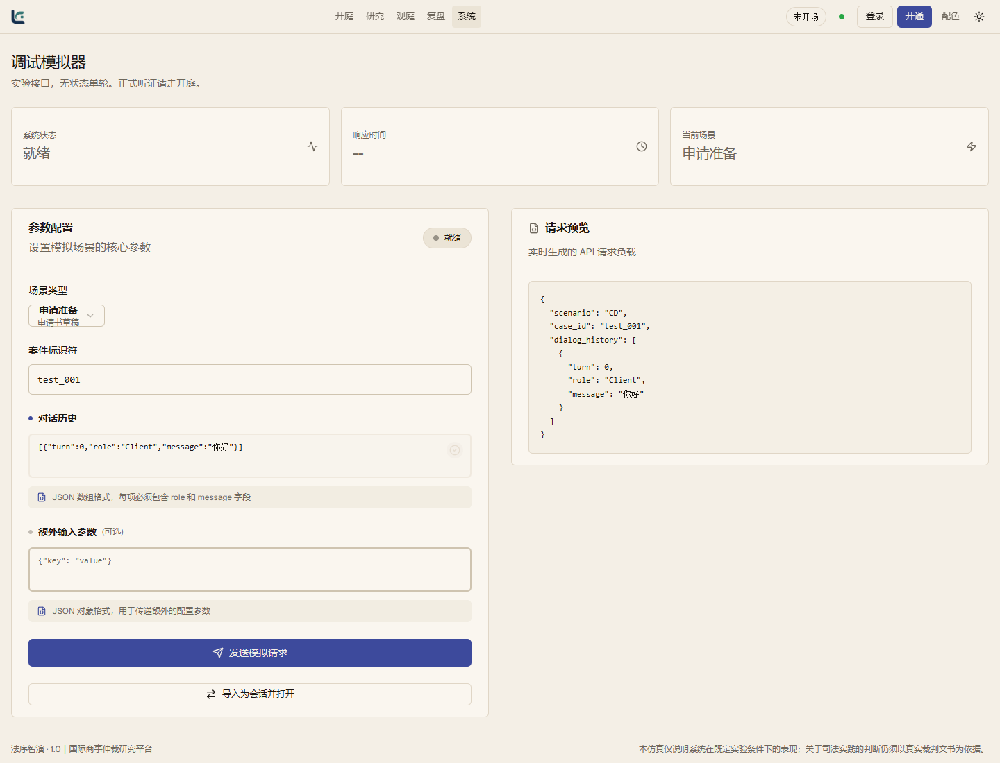

| 行 | 写 |
| --- | --- |
| 图题 | 调试模拟器。页上写：实验接口，无状态单轮，正式听证走开庭。默认 `test_001` / CD。 |
| 干什么 | 单发 `POST /api/simulate`，或导入会话。不进主导航。 |
| 按什么 | `发送模拟请求` / `导入为会话并打开`。图上未发送。 |
| 别读错 | 不要把本页写成听证主路或研究案评测。 |

#### 图 21 · CISG SAMPLE 标注

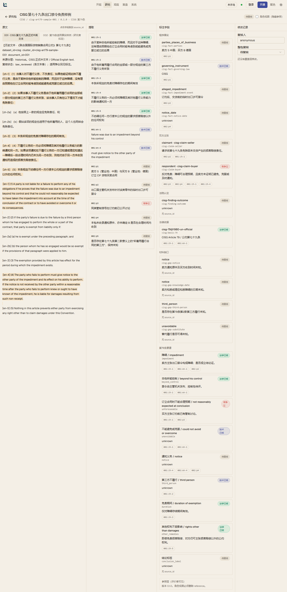

| 行 | 写 |
| --- | --- |
| 图题 | SAMPLE `cisg / cisg-art79-sample-001 / 0.1.0`。左 CISG 第 79 条文本，右字段。待复核。 |
| 干什么 | 与图 14 同属技术夹具，任务类型是第 79 条免责，不是承认和执行。 |
| 按什么 | 从研究列表点「CISG 第七十九条出口禁令免责样例」。 |
| 别读错 | 仍非正式研究案。文书里有官方条文摘录 + 研究者拟定事实，不要当成已复核判例。 |

#### 图 22 · 命令条

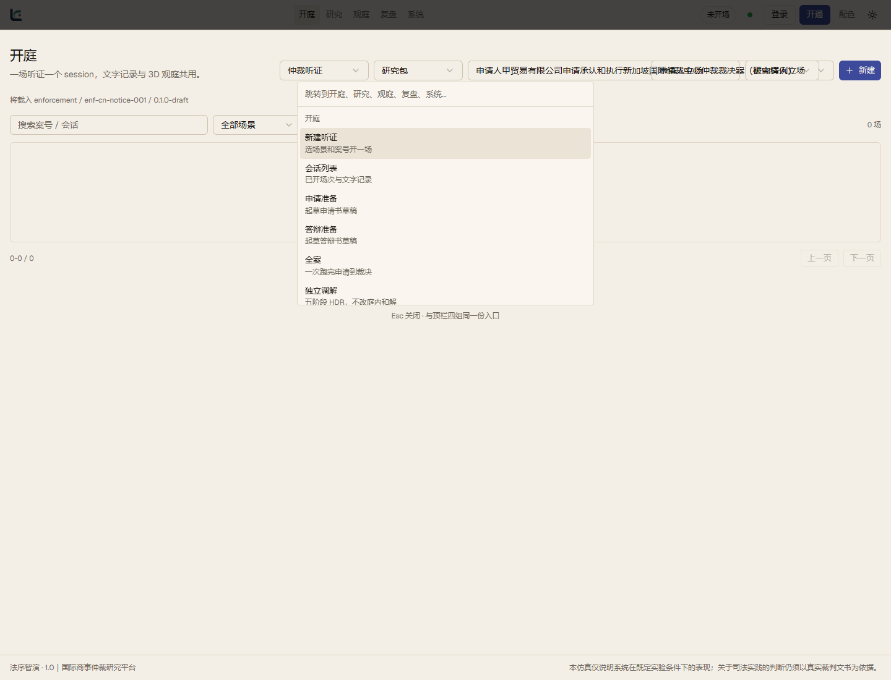

| 行 | 写 |
| --- | --- |
| 图题 | 开庭页上的命令条。检索框「跳转到开庭、研究、观庭、复盘、系统…」。图上展开到开庭组。 |
| 干什么 | 与顶栏五组同一份入口：新建听证、会话列表、申请准备、答辩准备、全案、独立调解。 |
| 按什么 | `Ctrl+K`（Mac `⌘K`）。`Esc` 关闭。下翻才有研究 / 观庭 / 复盘 / 系统。 |
| 别读错 | 命令条能打开 ≠ 已开场。图上仍是 0 场。 |

---

## 3. 代表性应用案例

「代表」指产品主路径三类，不是全国仲裁案抽样。SAMPLE 包 2 个、观庭样例 9 段，文档写明不是代表性保证。

### 案例卡 A · 观庭样例（无 session）

| 项 | 内容 |
| --- | --- |
| 界面名 | 观庭 / 样例回放 |
| 路径 | `/hearing-3d` |
| 内部 | `public/hearing-3d/contracts/sample-events.jsonl` |
| 传输 | 不打听证 LLM |

**输入：** 无 `sessionId`。浏览器加载 9 段结构样例。

**操作：** `播放下一段`（或 `自动播放`）→ 可切「全景 / 首席中景 / 申请方中景 / 被申请方中景」。

**屏幕输出：** 七席人偶与名牌；时间轴 `#n / #9`；HUD 阶段 / 争点 / 字幕。页脚：`七席已加载：7 · 事件总数：9 · sourceType: scripted_demo`。

**停在哪：** 样例播完。没有本场会话，不能当本场裁决。

### 案例卡 B · SAMPLE 研究包（夹具，不是正式案）

| 项 | 内容 |
| --- | --- |
| 界面名 | 研究 / 开庭选包 |
| 包 | `enf-cn-notice-001`（承认和执行样例）、`cisg-art79-sample-001` |
| 版本 | `0.1.0-draft` |
| 状态 | 待复核 |

**输入：** 夹具文书 2 份量级（界面写「文书 2 份」）。不是 `法学材料/案例材料/` 的 15 份标注。

**操作：** `/research` 点开包；或 `/conversation` 选「研究包」后 `新建`。

**屏幕输出：** 研究页两条 SAMPLE +「待复核」。开庭页提示「将载入 enforcement / enf-cn-notice-001 / 0.1.0-draft」。

**停在哪：** 可水合进会话。正式研究包计数仍为 0。不要写成已标完 10–20 案。

### 案例卡 C · 复盘无场（预期不可跑对照）

| 项 | 内容 |
| --- | --- |
| 界面名 | 复盘 · 对照 |
| 路径 | `/evaluation` |
| 会话 | 无（芯片「未开场」） |

**输入：** 未选听证。

**操作：** 可见四栏。`开始对照` 保持不可点。

**屏幕输出：** 「必须绑定会话。」

**停在哪：** 对照前。这是门禁，不是故障。

### 案例卡 D · 案例材料入库（不是第四条成功路径）

只报计数和状态。当事人真名、案号全文、标注单元格不进本页对外主张。来源：`法学材料/案例材料/README.md`。

| 计数 | 值 |
| --- | --- |
| 入库素材 | 约 67 份原文 |
| 已填标注 xlsx | 15 |
| 独立复核完成 | 0 |
| 已做成 `research_packs` | 0 |
| 案例 25 | AI 辅助初标，待填标注人 |

走入库 ≠ 已复核 ≠ 可训。15 份标注不得当已复核数据使用。

---

## 4. 输入 / 输出对照（汇总）

按钮名以界面为准，不要改写。

| 键 | 出现页 | 之后发生 |
| --- | --- | --- |
| `开庭` | 首页 / 顶栏 | 会话列表 `/conversation` |
| `测通并进入` | 登录 | 软解锁；测通 `POST /api/config/llm/test` |
| `开通` | 首页 / 登录 | 写入 LLM 配置并解锁 |
| `新建` | 开庭 | 建一场 `session_id`；选了 SAMPLE 则水合该包 |
| `播放下一段` | 观庭 | 消费下一条事件；样例共 9 段 |
| `开始对照` | 复盘 | 需已选 session；否则不可点 |
| `保存并应用` | 设置 | 重初始化 Agent，写 `.env` |
| `开始 全流程模拟` | 全案 | 自动跑申请到裁决，上限 `CI_MAX_AUTO_TURNS`（默认 30） |
| `开通` | 开通页 | 首次写入 LLM 配置并测通 |
| `创建调解` | 独立调解 | 建五阶段 HDR 场；图上未点 |
| `六维打分` | 复盘 · 研究 | 需已绑带研究包的会话；图上不可用 |
| `搜索` | 法条库 | 检索法条；图上未检索 |
| `发送模拟请求` | 调试模拟器 | 无状态单轮，不进听证主路 |
| `Ctrl+K` | 各工作台 | 打开命令条，与顶栏五组同一入口 |
| `刷新` | 开庭 / 系统 | 重拉列表或健康检查 |

接口对外只报：`session_id`、`scenario`（CD/DD/CI）、`is_finished`、`reasoning_meta.judgment_status`、`source_type`（`scripted_demo` / `backend_run`）。真案事实原文、密钥、`.env` 不进本包。

---

## 5. 失败与阻断

单独成页，避免只看见观庭样例。

### 5.1 无研究包不能新建（民事空列表）

开庭在未选可用包/案号时 `新建` 为灰。图 03 在 SAMPLE 被预选时可点；不要把「能点新建」写成正式研究案已就绪。

### 5.2 复盘无 session

见案例卡 C。`开始对照` 不可点。

### 5.3 LLM 未配置

图 08：设置页「LLM 未配置或配置无效」。书记员 / extract / score 走 `LLM_FAST_MAX_TOKENS`（默认 512）；判决不要截短。没密钥时不要主张本场已生成裁决。

### 5.4 材料不足停机

未知事实保持 unknown。材料不足用 `admit_insufficient` 停。禁止补造。这是功能，不是故障。

### 5.5 研究轮次上限

纽约执行 12 轮、CISG 第 79 条 10 轮，只计原被告发言。到上限不再打 CI LLM。

### 5.6 本机后端指错目录

图 07 健康检查曾返回 `D:\LexGentium-2\mock_court_system`。1 号库前端在 :3001。不要把隔壁检出的 `status=ok` 写成 1.0 后端已部署。

---

## 6. 适用边界

### 做什么

- 用一场 `session_id` 跑申请准备、答辩准备、仲裁听证
- 观庭挂本场或播 9 段结构样例（程序化占位）
- 复盘：对照、策略推演、程序合规、研究六维量表
- 研究工作台对照 SAMPLE 原文与字段回查
- 全案自动跑（有上限）；独立调解五阶段 HDR（不改庭内和解）

### 不做什么

- 自动作出有法律效力的裁决或胜诉预测
- 把 SAMPLE 或 15 份未复核标注写成正式研究包 / 已复核训练集
- 把观庭人偶写成正式 VRM 或真实庭审录像
- 把 `scripted_demo` 写成后端本场
- 把民事 `dataset_1000` 摘要写成已齐 1000 条 jsonl
- 把 LAB（P-RAG / Dual-Mode / Multi-Judge）写成听证主路

### 数据与包

- 正式 `research_packs` = 0；SAMPLE 2 个，状态待复核
- `法学材料/案例材料/`：67 份素材、15 份标注，无 `pack.json` / 规则卡 / 原文锚点回填
- 民事 `dataset_1000/`：meta + 100 条摘要
- 观庭参考：contracts JSON + 本机程序化资产；未接 VRM 文件

### 运行控制

软解锁。Web 主路是 LLM 智能体。`core/offline/api_reconstructor` / `main.py` 最近邻只给离线批跑。自动 CI 默认最多 30 步。

---

## 7. 效果主张与依据

默认主张写成「未主张 / 未测」。没有协议 + 实跑 + 复核的数字不填。

| 主张 | 依据 | 对外怎么写 |
| --- | --- | --- |
| 工作台可打开 | 2026-09-18 本机点过 `/` `/login` `/register` `/docs` `/about` `/conversation` `/hearing-3d` `/evaluation`（四栏）`/research` 及两个 SAMPLE 包页 `/mediation` `/system` `/settings` `/full-simulation` `/database` `/api-history` `/simulate`，以及 `Ctrl+K` 命令条 | 可以写「该日这些页能打开」 |
| 观庭样例可播 | 同日 `/hearing-3d` 播到 `#1/9`，七席人偶可见 | 可以写样例可播；不写正式庭审 |
| 研究入口已接通 | `/research` 列出 2 个 SAMPLE；开庭可选 `enf-cn-notice-001` | 只写 SAMPLE 夹具 |
| 产品已 1.0.0 | `package.json`、`AGENTS.md`、页题 | 可以写版本号 |
| 正式研究案已齐 | 与现行计数相反（0） | **禁止写** |
| 15 案已复核 | 标注人未齐；案例 25 为 AI 初标 | **禁止写** |
| 观庭已是正式模型 | Phase A 程序化占位 | **禁止写** VRM 成片 |
| 准确率 / 胜诉率 / 快于某系统 | 无对照协议、无复核样本 | **不写百分数** |
| 本机后端已是 1 号库 | 图 07 曾指向 LexGentium-2 | **不写** |

3D 单测：仓库有 `npm run test:3d`（vitest，hearing-3d）。本底稿截图日未重跑，不写成刚跑过。无前端 E2E 套件（见 SYSTEM_STATUS）。

---

## 8. 关键运行日志（摘录）

从已有记录抄。不新编本场 CI 裁决、不编正式 pack 导出。

### 8.1 启动

```text
cd mock_court_system
cp .env.example .env    # 填 LLM_API_KEY / LLM_BASE_URL / LLM_MODEL
python api_server.py    # :8000
npm run dev             # :3000；被占则落到 :3001
```

产品入口：`/` 营销；`/conversation` 开庭；`/hearing-3d` 观庭；`/evaluation` 复盘。旧 `/court3d` 重定向到观庭。

### 8.2 观庭样例（本机已执行，2026-09-18）

```text
GET /hearing-3d  200
无 sessionId
sourceType=scripted_demo
cast=7  events=9
播放下一段 → #1/9
非正式 VRM
```

### 8.3 开庭空列表（本机已执行）

```text
GET /conversation  200
会话数 0
芯片：未开场
可选 SAMPLE：enf-cn-notice-001  0.1.0-draft
正式 research_packs = 0
```

### 8.4 设置（本机已执行）

```text
GET /settings  200
LLM 未配置或配置无效
API Key：未设置
```

### 8.5 本包没有的日志

- 本场 CI 完整裁决与 `reasoning_meta` 实跑账本
- 正式研究包 `pack.json` / 规则卡 / 原文锚点回填
- 15 份标注的独立复核签署
- 真实 VRM 加载成功记录
- 用 SAMPLE 或民事借款 `demo_001` 冒充的研究案评测分
- 开庭会话页、观庭 `backend_run`、对照报告、全案/调解已跑完（当时 0 场、未提交密钥）

---

## 9. 本包不包含

- 比赛其他项（可运行作品安装包、架构说明书全文、来源许可、演示视频）可另附；本项只说明功能与边界
- `.env`、`*.sqlite3`、`data/session_predictions/`
- 当事人真名、案号全文、标注表单元格
- 把 SAMPLE、脚本 Demo 或未复核 xlsx 写成正式研究结论

**正式研究包 = 0。观庭非正式 VRM。1.0.0 是产品版本号，不是法学验收号。**
